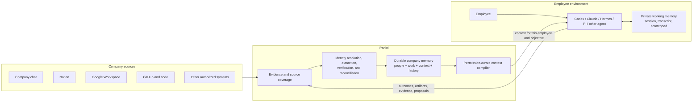

# Panini product contract

**Status:** Canonical product definition
**Last clarified:** 2026-09-21

This is the product north star for Panini. Product design, interface copy, domain models, backend modules, connectors, retrieval, agent integrations, and tests must preserve this definition. When the current implementation falls short, describe the gap explicitly rather than narrowing the product definition to match the code.

## Product definition

Panini is the verified, temporal, permission-aware company-memory and context system between a company's source systems and the agents operated by its employees.

It maintains a living model of:

- every known employee and their identities across company systems;
- current and historical work;
- projects, tasks, dependencies, blockers, and outcomes;
- company decisions, policies, architecture, research, plans, and operating knowledge;
- the evidence, decisions, and revisions that explain how company memory changed;
- employee-owned Agent Profiles and the context each agent is authorized to recall;
- source coverage, freshness, uncertainty, conflicts, and known gaps.

Panini turns that durable company memory into bounded context for a particular employee's agent, repository, task, objective, and moment in time. Agents contribute verified outcomes, evidence, and proposed changes back into the same memory loop.

Panini is not merely a task board, evidence ledger, search engine, document store, or generic RAG system. Those are capabilities inside a larger institutional-memory product.

## The system model



## One memory, several projections

Company memory is the durable whole. Interfaces present projections of it for different jobs.

| Projection | Primary question |
| --- | --- |
| People | Who works here, what are they responsible for, and how has their work changed? |
| Work | What are the company, its projects, and tasks trying to accomplish? |
| Context | What does the company currently know, believe, require, or prohibit, and what long-running Project documents is it working from? |
| History | What changed, when, why, through whose authority, and from which evidence? |
| Agent Context Pack | What does this employee's agent need for this repository, task, objective, and moment? |
| Evidence | What was actually observed, and what are the limits of source coverage? |

Tasks, context, and memory are not three unrelated products. People, work, context, evidence, and history together form Panini's company-memory model.

## Canonical work hierarchy

Use these terms consistently:

```text
Organization
  -> Project
      -> Task
          -> Evidence, artifacts, verification, and revisions
```

- A **Project** is a durable company outcome with a lifecycle and an owner when explicitly known.
- A **Task** is a concrete unit of intended work with an outcome, state, history, and an owner when explicitly known.
- A **Work Link** relates Tasks through dependencies, blocking, duplication, or other explicit relationships.

Historical Workstream records remain queryable for compatibility, but employees organize current work through Projects and Tasks.

A Project, including a small initiative owned by a few people, also has a Context folder for its architecture, plans, work notes, experiments, and decisions. Files in that folder are enduring versioned documents, not automatically atomic facts or verified decisions. Project linkage and access are explicit; a folder name alone confers neither ownership nor authority.

## Employee work is a verified projection

Panini must distinguish:

- **Assigned Work:** accepted work owned by an employee.
- **Current Work:** accepted Tasks that are active, blocked, or under review.
- **Observed Activity:** messages, commits, documents, events, or agent reports that may bear on work.
- **Verified Delivery:** an intended outcome supported by delivery artifacts and verification evidence.
- **Historical Contribution:** accepted work, decisions, context, and artifacts previously associated with an employee.

Observed Activity is not automatically Current Work. A chat message, commit, meeting, or agent report is evidence, not a performance judgment or a silent task mutation.

Panini must not become an employee-surveillance product. It should explain company work and memory, not rank people by message volume, commit count, online status, or other activity proxies.

## Memory and context are different

| Concept | Meaning | Owner | Lifetime |
| --- | --- | --- | --- |
| Company Memory | Versioned people, work, context facts and documents, decisions, evidence lineage, and history, with each item's status preserved | Organization | Durable |
| Context Pack | Bounded projection compiled for one principal and situation | Requesting employee agent | Ephemeral |
| Working Memory | Prompts, transcript, scratchpad, tool output, and unfinished reasoning | Employee and local harness | Local/session-scoped by default |
| Private Agent Workspace | Opt-in, versioned files owned by a member's agent; not accepted company facts | Employee and agent | Durable until deleted or revoked |
| Retrieval Index | Search summaries, embeddings, or other derived retrieval structures | Panini | Rebuildable |
| Source Content | Authorized material retained to verify an observation | Source policy | Revocable and retention-bound |

Panini does not ingest complete private agent conversations by default. Durable company memory receives structured outcomes, artifact references, verification summaries, approved excerpts, source observations, and explicit proposals.

## Employee-owned agents

An agent acts on behalf of a Workspace Member. It is not an anonymous API client and must not inherit organization-wide access merely because it can connect.

The effective principal is:

```text
Organization
+ Workspace Member
+ Agent Profile
+ Device
+ Harness or session
+ Repository, Project, and Task scope
```

Effective access is the intersection of:

```text
member permissions
intersect agent-profile Capability Grants
intersect repository and Project scope
intersect source visibility
intersect retention and revocation policy
```

A member may own several Agent Profiles for different purposes. Each profile and device must be independently attributable, scoped, rotatable, and revocable.

## Temporal company memory

Panini must answer both:

- What is accepted as true now?
- What was accepted as true at a past time, and what evidence was available then?

Preserve distinct times:

| Time | Meaning |
| --- | --- |
| Occurred Time | When the source claims the event or state existed |
| Fetched Time | When a connector retrieved the source |
| Received Time | When Panini recorded the observation |
| Accepted Time | When an authorized decision created a revision |
| Effective Interval | When the accepted claim is considered true in the company |

Do not equate ingestion order, model-run time, or adjudication time with the time a claim became true.

Projects, Tasks, employee associations, context, and material relationships require histories rather than destructive overwrites. Historical Workstreams are retained. A later revision supersedes an earlier state without erasing it.

## Source coverage and honest completeness

"All company history" means all history available within authorized source coverage. Panini must record and expose:

- earliest successfully imported time per source and scope;
- latest successful synchronization;
- pages, channels, repositories, drives, calendars, or other realms included;
- inaccessible or deliberately excluded realms;
- incomplete backfills and outage windows;
- revoked or deleted source content;
- connector and interpretation failures.

Panini must never imply that an employee, Project, or Task history is complete when source coverage is partial.

## Extraction and verification loop

Authorized sources may include company chat, Notion, Google Workspace, GitHub, GitLab, repositories, CI, deployments, coding agents, and manual employee input.

Every source follows the same trust progression:

```text
authenticated source event
-> immutable receipt and content hash
-> revocable encrypted source snapshot
-> normalized observation
-> employee, Project, Task, and context resolution
-> cited candidate finding
-> corroboration, chronology, and authority checks
-> accepted revision, rejection, supersession, escalation, or abstention
```

A connector's ability to read material does not mean every employee or agent may receive it. A model's ability to infer a plausible change does not authorize the change.

## End-to-end verification

Every consequential statement returned to a person or agent must be traceable through:

```text
context fragment or interface field
-> accepted memory item
-> exact revision
-> decision and policy basis
-> proposal or finding
-> cited Evidence Items
-> immutable Source Observations
-> source location, content hash, and coverage state
```

For a completion claim, the chain must additionally identify:

- the intended outcome;
- delivery artifacts;
- verification such as tests, review, or deployment;
- the responsible owner or reviewer when required;
- the accepted status revision.

An agent saying "done," a commit existing, or a task row changing is not independently sufficient completion evidence.

## Agent memory interface

The agent-facing interface has four conceptual behaviors:

```text
recall(principal, situation, budget)
read(principal, memory_reference)
history(principal, subject, interval)
contribute(principal, evidence_or_proposal)
```

The interface hides connector quirks, PostgreSQL layout, retrieval algorithms, graph expansion, semantic indexes, compression, authorization checks, and token allocation.

An employee's harness must continue to work when Panini changes its private retrieval implementation. PostgreSQL, OpenViking, embeddings, or other indexes are adapters behind Panini's memory interface, not agent-facing product identities.

## Interface contract

The interface must make the company-memory model visible rather than collapsing it into a generic dashboard.

### Required views

1. **Company:** current outcomes, active Projects and Tasks, blockers, decisions, source coverage, and memory health.
2. **People:** employee directory, identities, responsibility, current accepted work, historical contributions, and owned Agent Profiles.
3. **Projects:** outcome, owners and participants when known, Tasks, dependencies, a navigable Context folder of living documents and facts, decisions, evidence, and timeline.
4. **Tasks:** current accepted state, intended outcome, owner when known, dependencies, proposals, revisions, artifacts, verification, and evidence.
5. **Context:** facts and long-running Project/company files, with document state, scope, effective time, freshness, revisions, citations, and related people/work. A working document is not a verified fact.
6. **History:** a time-oriented view across people, work, context, decisions, and source changes.
7. **Evidence:** authorized source observations, connector coverage, revocation, interpretation state, and linked accepted revisions.
8. **Agents:** member ownership, harness, device, grants, scopes, repository mappings, private workspace files, activity receipts, rotation, and revocation.

### Required state language

Every important interface element must distinguish:

- observed;
- proposed;
- accepted;
- superseded;
- rejected;
- escalated;
- stale;
- revoked;
- coverage incomplete.

Do not display an extraction confidence score as authority. Do not show an adjudication timestamp as source freshness. Do not present inferred employee activity as accepted work.

### Required navigation

A user must be able to move in both directions:

```text
Employee <-> Project <-> Task <-> Context
                              |
                           Revision
                              |
                           Evidence
                              |
                            Source
```

## Backend contract

The backend must preserve these invariants regardless of implementation technology:

1. Source Observations are immutable receipts; retained source content is separately revocable.
2. Models, connectors, and agents produce findings, evidence, or proposals, never direct accepted-state mutations.
3. One Revision Writer is the only module that changes current accepted memory.
4. Every accepted change records its previous state, current state, decision, actor, evidence, and time basis.
5. People, Projects, Tasks, context, and their relationships are organization-scoped and historically queryable; legacy Workstream history remains available.
6. Identity resolution preserves provider identities and ambiguity; it never merges uncertain people silently.
7. Retrieval scores nominate candidates but cannot decide authority, visibility, freshness, or accepted state.
8. Authorization is rechecked before returning memory or source content.
9. Context compilation is actor-, scope-, objective-, time-, and budget-aware.
10. Revoked, deleted, stale, superseded, and forbidden material cannot silently reappear through an index or cache.
11. Every projection is replayable or rebuildable from canonical receipts, decisions, and revisions.
12. Source coverage and processing failures remain visible and queryable.

## Acceptance scenarios

The product is behaving correctly when all of these work:

### Employee orientation

An employee can ask what they and their team are working on and receive current Tasks grouped by Project, with blockers, decisions, freshness, and evidence-backed history.

### Agent start

An employee's coding agent opens a repository and receives only the relevant authorized company memory, active Task, dependencies, architecture, decisions, and prior verified outcomes.

### Cross-source reconciliation

Notion says a Task is active, Slack reports a blocker, GitHub shows a merged change, and CI is failing. Panini preserves each observation and does not mark the Task done until the intended outcome and configured verification requirements are satisfied.

### Historical reconstruction

A user can inspect what Panini accepted about a Project at an earlier date, the evidence available then, and the later revision that changed the answer.

### Source revocation

A document, channel, repository, employee, Agent Profile, or device loses access. Future reads fail closed, derived retrieval entries are removed or ignored, and the immutable audit lineage remains intelligible without exposing revoked content.

### Handoff across agents

One employee's agent reports a verified outcome. After acceptance, another authorized employee's agent can recall the result, artifacts, decision, and evidence without receiving the first agent's private transcript.

## Anti-goals

Panini is not:

- employee surveillance or productivity scoring;
- a raw company-wide chat or transcript warehouse;
- a last-write-wins synchronization engine;
- a generic vector database exposed directly to agents;
- a board that requires people to duplicate updates manually;
- a model-controlled source of organizational truth;
- a replacement for every source system;
- a claim of complete history when connector coverage is incomplete.

## Change checklist

Before accepting a product or engineering change, ask:

1. Does it strengthen the model of people, work, context, history, or agent use?
2. Does it preserve the distinction between evidence, proposals, accepted memory, and compiled context?
3. Can a returned statement be traced to an accepted revision and source evidence?
4. Does it preserve occurred, observed, accepted, and effective time?
5. Is access derived from the employee principal as well as the Agent Profile?
6. Does it handle source gaps, ambiguity, conflicts, revocation, and supersession explicitly?
7. Does the interface show the user what is current, historical, uncertain, or incomplete?
8. Can the projection or retrieval index be rebuilt without becoming a second source of truth?
9. Does it avoid collecting private working memory that is unnecessary for durable company memory?
10. Would a future employee or agent understand not only the answer, but why Panini believes it?
