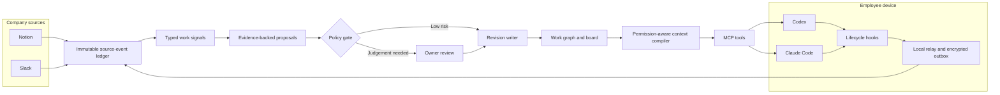

# Notion, Slack, and local-agent integration plan

**Status:** First vertical slice implemented; remaining feature phases proposed  
**Checked:** 2026-09-16  
**Companion research:** [Notion, Slack, Claude Code, and MCP](research/notion-slack-claude-mcp.md)

## Implementation checkpoint

Implemented in the current repository:

- PostgreSQL migrations plus an in-memory development adapter;
- immutable source events, typed task/context signals, proposals, policy decisions, and versioned task revisions;
- configurable polling of Notion pages and data sources with pagination, rate-limit retry, stable snapshot hashes, and property mapping;
- the board, proposal review queue, context view, and authenticated HTTP API;
- dual-era Streamable HTTP MCP tools, resources, prompts, and a portable Codex/Claude skill.

Not yet implemented:

- Slack Socket Mode ingestion and explicit reaction capture;
- the signed local relay, encrypted outbox, and lifecycle hook packages;
- Notion webhook acceleration, Notion write-back, OAuth, granular roles, and multi-tenant isolation.

## 1. Product slice

Build a self-hosted company context control plane in which:

- Notion supplies durable company intent, project structure, ownership, dependencies, and procedures.
- Slack supplies selected discussion-derived evidence about commitments, progress, blockers, and decisions.
- Codex and Claude Code remain local work environments. A user-controlled relay sends lifecycle metadata or explicit structured proposals without centrally uploading raw chats by default.
- The control plane turns observations into evidence-backed proposals, applies deterministic authority policy, and writes immutable task revisions.
- People review ambiguous proposals in the web application.
- Agents retrieve current, permission-filtered context and submit proposals through MCP.
- A portable skill teaches each agent when and how to use those MCP tools.

The board remains a projection of accepted revisions. Notion, Slack, hooks, skills, and agents never update authoritative task rows directly.



## 2. Source roles and authority

Authority is field-specific. Connector access is not authority to change the board and is not permission to disclose data.

| Source | Role in the system | Default authority | MVP boundary |
|---|---|---|---|
| Notion | Company structure and durable operating documents | Project outcome, owner, workstream, hard/soft dependencies, procedures | Read-only selected roots; no writeback |
| Slack | Discussion and selected work evidence | Candidate activity, commitment, blocker, unblocking, and decision signals | Allowlisted public project channels; explicit capture gesture |
| Codex | Local work and explicit agent proposals | Lifecycle metadata, explicit proposal, and artifact references | No raw transcript upload; no JSONL parsing |
| Claude Code | Local work and explicit agent proposals | Lifecycle metadata, explicit proposal, and artifact references | No raw transcript upload; no JSONL parsing |
| Control-plane revision ledger | Accepted organizational state | Current task state and its history | Only the revision writer may mutate the projection |
| GitHub, later | Durable code artifacts and verification | PR, commit, check, merge, and deployment facts | Record links now; add verification connector after the first loop |

Conflict behavior:

- A lower-authority source may create a proposal against an authoritative field, but cannot overwrite it.
- Two authoritative sources that disagree create a conflict proposal.
- A later event never wins merely because it arrived last.
- Completion claims move work at most to `review` unless a configured verifier or authorized owner confirms `done`.

## 3. Supported integration surfaces

### Local compatibility observed

On the development machine checked on 2026-09-12, `codex-cli 0.153.4` exposes App Server and MCP management, while Claude Code `2.1.218` exposes MCP and plugin management. Treat these as observed deployment facts, not permanent minimum versions. The relay installer must record each host version, run a capability health check, and disable unsupported event fields without breaking the core context/proposal workflow.

### Notion

For the first single-company deployment, use a team-owned internal connection with `Read content` only and explicit access to configured handbook, project, workstream, and task roots. Pin the `Notion-Version` header and store the version beside every fetched payload.

Start with polling and keep webhooks as an optional acceleration path:

1. An idempotent importer walks configured roots, pages through their content and data sources, and creates baseline evidence and revisions.
2. A scheduler periodically re-fetches configured roots, compares stable snapshot hashes, and emits events only for new or changed snapshots.
3. An optional signed webhook receiver can trigger an earlier fetch without changing reconciliation semantics.

Notion webhooks require a publicly reachable HTTPS endpoint. They are notifications, not exact diffs, and events can be aggregated, delayed, retried, and delivered out of order. Each reconciliation record must therefore distinguish:

- the immutable webhook envelope;
- the later fetched snapshot and retrieval time;
- the snapshot hash and source URL;
- `latest_state_after_event` from a true `exact_change`.

Polling is the default so a private self-hosted deployment requires no Notion-facing public ingress. An administrator chooses the interval per connection and can later enable webhooks when faster freshness is worth the additional ingress surface.

Primary references: [authorization](https://developers.notion.com/guides/get-started/authorization), [capabilities](https://developers.notion.com/reference/capabilities), [webhooks](https://developers.notion.com/reference/webhooks), [delivery semantics](https://developers.notion.com/reference/webhooks-events-delivery), and [API versions](https://developers.notion.com/reference/changes-by-version).

### Slack

Use a customer-owned Slack app, bot token, and Socket Mode for the self-hosted MVP. Socket Mode needs no public inbound Slack endpoint and delivers Events API payloads over an outbound WebSocket.

Start with:

- an administrator-maintained allowlist of public project channels;
- `message.channels` and the minimum required bot scopes;
- a designated reaction that marks a message as evidence, using `reaction_added` plus `reactions:read`;
- immediate acknowledgement after durable receipt;
- idempotency on the top-level Slack `event_id`;
- bounded `conversations.history` access only for selected-message retrieval or gap repair.

Do not request DMs, multiparty DMs, user tokens, files, or email in the MVP. Private channels require a later explicit policy and bot invitation. Model edits and deletions as later events rather than rewriting the original receipt.

Keep Socket Mode behind a transport adapter. A future externally distributed edition may use signed HTTP Events without changing the normalized event contract.

Primary references: [Events API](https://docs.slack.dev/apis/events-api/), [Socket Mode](https://docs.slack.dev/apis/events-api/using-socket-mode/), [message events and scopes](https://docs.slack.dev/reference/events/message/), [`reaction_added`](https://docs.slack.dev/reference/events/reaction_added/), [request verification](https://docs.slack.dev/authentication/verifying-requests-from-slack/), and [conversation history](https://docs.slack.dev/reference/methods/conversations.history/).

### Codex

Use Codex App Server as the supported local conversation interface:

- `thread/list` discovers stored threads, including filtering by current working directory.
- `thread/read` reads a stored thread without resuming it and can include turns.
- generated TypeScript or JSON Schema bindings are tied to the installed Codex version and should be generated and compatibility-tested during adapter development.
- keep the MVP on the non-experimental API surface; do not depend on experimental paginated turn/item methods.

Use Codex hooks as triggers, not as the transcript integration:

- `SessionStart` asks the local relay for a small cached/current context summary and can inject it as additional context.
- `Stop` performs a fast, synchronous insert into the relay's local durable queue with session ID, turn ID, project mapping, and a hash. It may include `last_assistant_message` only in an explicitly enabled content mode. It never waits for the network.
- `SessionEnd` performs the same local-only metadata enqueue as a fallback. It is not the primary completion signal because it can be delayed and has a short synchronous timeout.

The hook payload contains `transcript_path`, but official OpenAI documentation says its format is not a stable hook interface. The adapter must not parse Codex transcript JSONL as its permanent contract.

Package the integration as a Codex plugin containing the skill, MCP definition, relay hooks, and health-check command. Plugin hooks remain opt-in and must be reviewed and trusted by the user.

Primary references: [Codex App Server](https://learn.chatgpt.com/docs/app-server), [Codex hooks](https://learn.chatgpt.com/docs/hooks), [Codex MCP](https://learn.chatgpt.com/docs/extend/mcp), [Codex skills](https://learn.chatgpt.com/docs/build-skills), and [Codex plugins](https://learn.chatgpt.com/docs/build-plugins).

### Claude Code

Use documented Claude Code hook JSON and explicit MCP calls:

- `SessionStart` loads a compact context summary through a command hook.
- `Stop` and `SubagentStop` provide stable event fields including session identifiers and the latest assistant message when available.
- `SessionEnd` performs a quick, synchronous local enqueue only and never waits for the network.
- task lifecycle hook events may be normalized when the installed version supports them, but they are not required for the first proof.

Claude Code stores sessions locally, but the JSONL entry schema is documented as internal and changeable. The local relay should use hook fields, structured CLI/Agent SDK interfaces, or an explicit export when a user requests retrospective import. It should not tail or parse transcript files as an application contract.

Package a thin Claude Code plugin with the same portable skill content, a Claude-specific manifest, MCP configuration, relay hooks, and health checks. Do not assume the Codex and Claude plugin manifests are identical; share source content and generate two host-specific packages.

Primary references: [sessions](https://code.claude.com/docs/en/sessions), [hooks](https://code.claude.com/docs/en/hooks), [MCP](https://code.claude.com/docs/en/mcp), [skills](https://code.claude.com/docs/en/skills), and [plugins](https://code.claude.com/docs/en/plugins).

## 4. Component boundaries

### Control-plane application

One TypeScript application image owns:

- HTTP ingress for Notion and relay uploads;
- the Slack Socket Mode connection;
- the PostgreSQL event ledger, projections, revisions, outbox, and connector cursors;
- evidence interpretation and task linking workers;
- deterministic policy evaluation;
- the revision writer;
- board, task detail, evidence trail, review inbox, and context preview;
- the authenticated Streamable HTTP MCP endpoint;
- health, backup, restore, and migration commands.

PostgreSQL remains the only required server-side stateful dependency.

### Local relay

One user-controlled process per device owns:

- device enrollment and revocable credentials;
- host adapters for Codex and Claude Code;
- mapping local repositories/worktrees to organization project and workstream IDs;
- privacy policy before any content leaves the machine;
- a small encrypted SQLite-backed durable outbox with at-least-once delivery;
- an optional cache of the last authorized context pack;
- an inspectable health/status command.

The server receives an organization project locator, not an arbitrary raw filesystem path. The relay is outbound-only and never exposes employee files to the control-plane server.

### MCP server

Expose one authenticated Streamable HTTP MCP service from the control plane. Codex and Claude Code both support that transport and OAuth, so the installed plugins can point to the same company endpoint while the server identifies the human caller independently of the local relay's device identity.

Use stdio only for local development and contract tests. Do not create a second task API inside the relay. If a future deployment truly requires an offline MCP proxy, it must call the same server-side application service and preserve the same authentication, proposal, and authorization semantics.

Initial MCP tools:

```text
get_context(objective, project_id?, task_ids?, max_items?)
get_task(task_id)
propose_task_change(client_event_id, task_id?, base_revision?, changes, rationale, evidence_refs, approved_excerpt?)
```

Add `search_work`, `record_artifact`, and review tools only after the first three are reliable.

Tool rules:

- `get_context` and `get_task` are read-only and permission-filtered.
- `propose_task_change` always writes a proposal, never a task directly.
- `client_event_id` is mandatory for idempotency.
- `base_revision` exposes stale proposals instead of silently overwriting a newer state.
- Caller identity and roles come from the authenticated connection, never tool arguments.
- Every evidence reference is checked for caller visibility and field eligibility.
- Tool output includes a structured result plus a compact human-readable fallback.
- Large context is returned as an authorized resource link rather than flooding the model context window.
- Read authorization is re-evaluated on every call; no authority is inferred from an MCP connection's prior state.

Recommended OAuth scopes for the HTTP MCP service:

```text
context:read
task:read
proposal:create
evidence:excerpt   # separate and optional
```

Use the current MCP specification and official TypeScript SDK, while accepting the older protocol versions used by supported installed clients. Pin protocol compatibility in automated tests rather than assuming all clients update together.

### Portable company-context skill

The skill is behavioral guidance, not a transport or database. It should teach agents to:

1. At the start of relevant work, call `get_context` with the actual objective.
2. Respect the returned task revision, constraints, conflicts, visibility, and completion condition.
3. Use stable task IDs rather than guessing links from titles.
4. Call `get_task` before proposing a change against a possibly stale task.
5. Submit evidence-backed proposals when a commitment, blocker, state, artifact, or handoff materially changes.
6. Avoid progress spam when no board-relevant state changed.
7. Never change owner, priority, due date, outcome, or `done` state without the authority/evidence required by policy.
8. Never include private excerpts unless the user deliberately approved them.

Maintain one portable skill source and host-specific packaging tests. The skill must not hard-code any organization's projects, vocabulary, reporting format, or policy; it obtains them from `get_context`.

## 5. Data contracts

### Source envelope

```ts
type SourceEnvelope = {
  schemaVersion: number;
  organizationId: string;
  installationId: string;
  source: "notion" | "slack" | "codex" | "claude_code";
  sourceEventId: string;
  idempotencyKey: string;
  occurredAt: string;
  receivedAt: string;
  actorRef?: string;
  deviceRef?: string;
  projectLocator?: string;
  sessionRef?: string;
  eventKind: string;
  visibilityRealm: string;
  contentMode: "metadata" | "structured_signal" | "approved_excerpt";
  contentHash?: string;
  payloadVersion: string;
  payload: unknown;
};
```

Raw provider envelopes are adapter-specific and encrypted or discarded according to source retention policy. The normalized envelope is stable and versioned.

### Local privacy modes

| Mode | Automatically leaves the device | Use |
|---|---|---|
| Off | Nothing | User or project opts out |
| Metadata only | Session lifecycle, mapped project, coarse result, hashes | Default |
| Structured signal | Explicit task/signal fields submitted through MCP | Recommended work-reporting mode |
| Approved excerpt | A selected excerpt plus its source locator | Per-event consent only |

There is no central raw-transcript mode in the MVP.

### Context pack

A context pack should be objective-specific and include only authorized fragments:

```text
identity and objective
project and workstream outcome
active task neighborhood and revisions
next actions
hard and soft dependencies
blockers and conflicts
accepted decisions
applicable procedural rules
freshness and uncertainty labels
visible evidence citations
token/item budget
```

Every fragment carries source references, visibility, and freshness. Slack or Notion text is evidence, never executable agent instruction.

## 6. Repository shape

```text
apps/
  control-plane/          HTTP, UI, MCP, worker, scheduler
  relay/                  local daemon, hook CLI, encrypted outbox
packages/
  contracts/              versioned schemas and generated clients
  domain/                 task state machine and invariants
  database/               migrations, repositories, outbox
  ingress/                durable receipt and normalization
  connector-notion/
  connector-slack/
  evidence/
  reconciliation/
  policy/
  revisions/
  context/
  mcp/
  relay-core/
  adapter-codex/
  adapter-claude-code/
integrations/
  skill-company-context/  portable SKILL.md source
  codex-plugin/           Codex manifest, MCP, hooks, packaged skill
  claude-code-plugin/     Claude manifest, MCP, hooks, packaged skill
fixtures/
  example-company/        fictional import and reconciliation cases
docs/
  research/
```

Prefer a TypeScript monorepo with strict type checking, versioned SQL migrations, runtime schema validation at every external boundary, and one production application image. Keep provider payload types inside their adapters.

## 7. Feature delivery phases

This sequence matches the feature roadmap in the [product implementation plan](05-product-implementation-plan.md#17-feature-delivery-sequence). A phase is complete only when its user-facing experience and supporting backend work together in one demonstrable, replayable result. Technical foundations are delivered inside the first feature that requires them rather than as independent milestones.

Before Phase 1, freeze the selected Notion roots, Slack pilot channel/capture gesture, fictional organization, authority/privacy rules, positive cases, and ambiguity/conflict/abstention cases. Record supported harness versions. This is a short acceptance-design pre-flight, not a product phase.

### Phase 1: create and see a trusted company workspace

| Frontend | Backend |
|---|---|
| Organization bootstrap, Notion connection, selected-root setup, sync progress, and repair guidance | Organization/actor/install records, immutable event ledger, task/context revisions, and production PostgreSQL path |
| Company/project/workstream board and task detail with source links, owner, dependencies, and freshness | Notion pagination, normalization, snapshot hashes, rate-limit retry, overlap-safe polling, cursors, and repair scans |
| Clear empty, permission-loss, duplicate, and partial-import states | Idempotent import, tenant isolation, replay, jobs/outbox, migrations, and source-pointer preservation |

**End-to-end proof:** A fresh deployment imports the fictional and selected development Notion roots, renders the expected organization structure, creates no duplicates on rerun, and reconstructs the same accepted view by replay.

### Phase 2: review and approve an evidence-backed change

| Frontend | Backend |
|---|---|
| Review inbox showing before/after state, evidence, rationale, confidence, authority, conflicts, and proposal freshness | Signal-to-proposal path, deterministic policy, authorized decisions, optimistic concurrency, and sole revision writer |
| Accept, edit, reject, supersede, undo, and rebase journeys; pending proposals remain visually distinct from accepted state | Evidence-only/freshness auto-apply boundary, reviewer/policy/evidence linkage, audit records, and new-revision undo semantics |
| Evidence and revision timelines that explain why every displayed field exists | Permission-filtered evidence reads, stale command rejection, replay safety, and machine-readable allowed actions |

**End-to-end proof:** A reviewer acts on a fixture-derived proposal, the board changes only after authorization, and duplicate or reordered evidence cannot create duplicate mutations.

### Phase 3: keep work current from selected Slack and GitHub activity

| Frontend | Backend |
|---|---|
| Slack/GitHub setup, channel/repository allowlists, scope explanations, connection health, and revocation state | Customer-owned Slack Socket Mode receiver and, after the Slack loop is stable, GitHub PR/check/merge/deployment receipts |
| Activity and task evidence views showing capture, processing, task link/abstention, edit/delete, and source visibility | Designated-reaction capture, bounded fetch, common envelope normalization, durable receipt, reconnect/retry, deduplication, and gap repair |
| Actionable retry, permission-loss, rotation, and deletion states without exposing raw bodies by default | Token rotation/revocation, edit/delete propagation, revocable content with immutable metadata, and periodic Notion reconciliation |

**End-to-end proof:** One selected Slack blocker and one verified GitHub delivery event create immutable evidence, link correctly or abstain, and produce reviewable proposals that remain safe under retry, reorder, edit, deletion, and revocation.

### Phase 4: give coding agents shared company memory

| Frontend | Backend |
|---|---|
| Agent/device enrollment, repository mapping, privacy modes, health, rotation, revocation, and queued-report inspection | Permission-aware Panini MCP, objective-specific context compilation, visibility/freshness checks, scoped agent profiles, and one-time enrollment |
| Context-pack preview with accepted facts, citations, revisions, omissions, and approved-excerpt controls | Signed local relay, credential storage, encrypted outbox, offline retry, idempotent reports/proposals, and no default transcript upload |
| Uniform activity and proposal status for Codex, Claude Code, Hermes, and Pi | Portable skill plus thin Codex/Claude packages over the same relay/MCP contracts; versioned compatibility and failure fixtures |

**End-to-end proof:** Codex and Claude Code each receive the same authorized Panini context and submit a privacy-filtered, evidence-backed proposal; offline delivery recovers without duplication, and neither harness can directly mutate accepted state or discover forbidden evidence.

### Phase 5: find and navigate the right trusted context

| Frontend | Backend |
|---|---|
| Context tree/search with project/task filters, citations, revisions, freshness, omission reasons, and fallback status | PostgreSQL exact/FTS baseline, bounded graph expansion, token budgets, retrieval manifests, and final authorization/version checks |
| Derived summaries clearly distinguished from canonical accepted content | Gated embedded OpenViking fork behind Panini's private seam; no OpenViking HTTP/MCP surface or harness connection |
| Permission, revocation, deletion, stale-index, and degraded-runtime behavior explained without leaking forbidden metadata | Frozen quality/privacy/cost evaluation, organization/visibility partitioning, deletion/reindex/restore, and PostgreSQL fallback |

**End-to-end proof:** A human and test harness retrieve must-have accepted context with valid citations while prohibited, revoked, and stale material never reaches the result. The feature still works when semantic retrieval is disabled.

### Phase 6: turn accepted work into useful briefings

| Frontend | Backend |
|---|---|
| Administrator-configured update template, cited summary, stale work, blockers, dependencies, decisions, and owner-required exceptions | Briefing generation from accepted revisions, evidence-linked derived findings, abstention, provider/egress/budget enforcement, and evaluation |
| Preview and explicit approval before any Slack or Notion write-back | Idempotent publication only after authorization; no model or connector directly changes accepted task/context state |
| Links from each statement back to accepted facts, revisions, and evidence | Role-specific rendering over the same canonical facts; configurable cadence without organization-specific fields in the domain model |

**End-to-end proof:** The CTO reviews a cited exceptions-and-decisions briefing instead of reconstructing status manually, and no unsupported statement is published or accepted automatically.

### Phase 7: install, operate, and recover the complete loop

| Frontend | Backend |
|---|---|
| Guided setup, integration diagnostics, role administration, health, audit/export, backup age, restore result, and support-bundle preview | Compose/CLI lifecycle, secure configuration, OIDC/TLS, migrations, backup/restore, upgrades, observability, signing, and redaction |
| Clear degraded states for connector, model, retrieval, database, storage, and credential failures | Crash recovery, outage fallback, revocation, replay, capacity checks, and disaster-recovery tests across the full integration loop |

**End-to-end proof:** A new operator can install, connect, use, diagnose, revoke, upgrade, back up, restore, and replay Panini without repository knowledge, recovering the same accepted state and source lineage.

## 8. First end-to-end proof

Use one real development-installation workstream and one mapped repository:

1. The Notion importer creates the project, owner, dependency, and task baseline.
2. An allowlisted Slack message says the task is blocked and is deliberately marked for capture.
3. The Slack connector stores the event and emits a `blocked` signal.
4. The reconciler links it to the correct task and proposes `active -> blocked` with evidence.
5. The owner approves the proposal in the review inbox.
6. The revision writer updates the board projection.
7. Codex starts in the mapped repository and receives a context pack showing the blocker, revision, dependency, and source citation.
8. After resolving the blocker, Codex uses `propose_task_change` with the current base revision and a durable artifact reference.
9. Policy routes the proposal to the owner or auto-applies only the low-risk evidence link.
10. Claude Code retrieves the same updated task and evidence through the same MCP contract.

This is the first release gate. More connectors are not added until this loop is accurate, understandable, privacy-safe, and easier than manual status reconstruction.

## 9. Acceptance and failure tests

### Correctness

- Duplicate provider and relay delivery is idempotent.
- Out-of-order or aggregated Notion events converge through latest-state reconciliation.
- Ambiguous identity or task matching abstains or requests review.
- Illegal state transitions fail deterministically.
- Stale `base_revision` produces a conflict, not last-write-wins behavior.
- Projection replay produces the same current state.

### Privacy and authorization

- Unselected Notion roots and Slack channels cannot be ingested or discovered.
- DMs and raw local chats stay off by default.
- Derived signals inherit source visibility.
- Revoking source access removes content from future context compilation.
- Metadata retained for audit cannot reconstruct deleted raw content.
- MCP actor identity cannot be forged through tool arguments.
- Context reads and all writes are audited.

### Relay and client compatibility

- Hooks return quickly while the network is offline.
- The encrypted queue survives restart, deduplicates retries, and warns before bounded eviction.
- Raw filesystem paths never appear in broadly visible server views.
- Missing or newer hook fields do not crash an adapter.
- Codex transcript schema changes do not affect the adapter.
- Claude transcript schema changes do not affect the adapter.
- Each supported Codex, Claude Code, and MCP protocol version passes a compatibility fixture.

### Connector recovery

- Notion signature failure, retry, rate limit, permission loss, and repair scan are tested.
- Slack reconnect, duplicate event, missing acknowledgement, edit, deletion, token revocation, and gap repair are tested.
- A crash between receipt and processing cannot lose an acknowledged event.

## 10. Decisions to confirm before implementation

| Decision | Recommended first default |
|---|---|
| Notion installation | Organization-owned internal connection, read-only |
| Notion change delivery | Periodic polling first; optional signed webhook acceleration |
| Slack transport | Customer-owned app using Socket Mode |
| Slack evidence selection | Designated reaction first; slash command later |
| Slack scope | One allowlisted public project channel; no DMs/private/files/user token |
| Local session privacy | Metadata-only automatic events; structured MCP proposals; approved excerpts only |
| Local transcript use | No automatic transcript parsing or upload |
| Agent MCP transport | Authenticated Streamable HTTP; stdio for development tests only |
| Agent packaging | One portable skill source with separate Codex and Claude plugin manifests |
| Automatic task mutations | Evidence attachment and freshness only at first |
| Completion | Agent claim moves to `review`; owner or later GitHub verifier confirms `done` |

Implementation should start with generic defaults and a fictional frozen example organization, then deliver the Phase 1 trusted-workspace journey across frontend and backend. Contracts, state-machine tests, policy tests, and fixtures are supporting work inside that feature slice, not a separate technology milestone; introduce live connector credentials only after its expected behavior is fixed.
