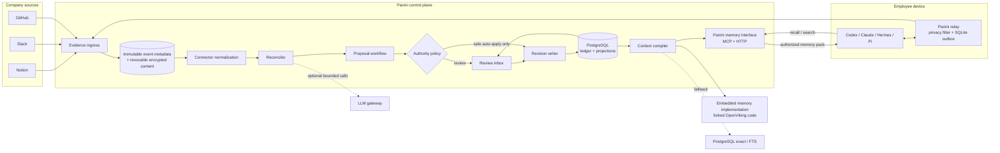

# Panini product implementation plan

**Status:** Recommended target architecture and build sequence  
**Checked:** 2026-09-16  
**Current product:** Runnable vertical slice, not a production release  
**Companion documents:** [integration sequence](04-integration-implementation-plan.md), [connector research](research/notion-slack-claude-mcp.md), and [evidence intelligence](evidence-intelligence.md)

## 1. Outcome

Panini should be the evidence-backed context and work-state layer between a company's systems of record, its conversations, and the agents doing the work.

It is not another board that asks people to report the same work twice. Sources and agents submit observations. Panini links those observations to company work, proposes changes, applies authority policy, records decisions, and publishes a current, permission-aware view back to people and agents.

The invariant is:

> An observation can create evidence. Evidence can support a proposal. Only policy plus an authorized decision can create accepted company state.

That invariant must hold whether a change originated in Notion, Slack, GitHub, Codex, Claude Code, a local model, or a human using the web app.

### First production-shaped proof

The first release is successful when one company can:

1. Import selected Notion structure and tasks.
2. Capture one deliberately selected Slack blocker or decision.
3. Observe one verified GitHub or coding-agent delivery event.
4. Link each observation to the correct task or safely abstain.
5. Review and accept a proposed board or context change.
6. Start a new agent session and receive the revised, cited context.
7. Replay the ledger and reconstruct the same accepted state.

Do not add more connectors until this loop is accurate, understandable, private by default, and easier than manual status reconstruction.

## 2. Current implementation versus target product

Implementation status, 2026-09-16: the repository now contains a tested feature-level slice through Phases 1–5. That does not mean the production phase exits or release gates are complete; the right column remains required work.

The current repository is useful because it already proves the safety model. It should be evolved, not replaced with a speculative rewrite.

| Area | Implemented and tested now | Needed for production |
|---|---|---|
| Runtime | TypeScript/Fastify application, PostgreSQL plus a memory test/dev adapter, Node build, and verified Bun script execution | Migrate routes to Hono and the browser to React; make Bun the first-party packaged runtime while retaining Node compatibility; production remains PostgreSQL-only |
| Work state | Organizations/members/installations, projects/workstreams/typed work links, tasks, full proposal lifecycle, policy decisions, task/context revisions, safe undo, audit events, atomic decision/revision/audit/outbox projection, and supported replay verify/rebuild | Verified identities, richer graph editing, field-level authority explanations, and multi-tenant isolation acceptance |
| Evidence | Idempotent hashed receipts; AES-256-GCM payloads separated from immutable metadata; source/visibility revocation; durable outbox leases/retries/dead letters; per-resource connector scan checkpoints | Retention jobs, operator repair/dead-letter UI, restore verification, and broader connector-specific gap repair |
| Notion | Complete selected page/data-source scans, durable cursor/high-water and repair status, installation health, deterministic task import, source-document evidence for reviewed memory extraction, archive/disappearance/access-loss revocation, and fail-safe incomplete scans | Installation wizard, versioned mapping UI, live model-backed extraction acceptance, webhook acceleration, and later reviewed write-back |
| Slack and GitHub | Slack Socket Mode reaction or approved full-channel capture with allowlists, history/thread backfill, edit/delete revocation, supervised reconnect, a singleton PostgreSQL session lease, and live acceptance against one public channel; HMAC-verified GitHub PR/check/deployment and installation lifecycle adapter with repository allowlists/revocation | Incremental Slack history checkpoints, GitHub delivery-age enforcement, live GitHub acceptance, production credential lifecycle, and broader outage drills |
| Agents | Capability-scoped MCP context/search/read, proposal and idempotent `work_report` tools; profiles; devices; repository mappings; signed relay delivery; encrypted SQLite outbox; macOS Keychain; installable Codex skill and Claude Code plugin/hook packages; Pi adapters | OAuth/OIDC identity, standalone relay packaging, non-macOS keychain adapters, continuously supervised delivery, and production installation UX |
| Intelligence | Optional direct OpenAI Responses structured-output interpreter; findings become proposals | Panini intelligence gateway built on Vercel AI SDK, with redaction, budgets, evals, role-specific summaries, and local-model options |
| Frontend | Responsive server-served UI for board/task/project/workstream/link views, pending proposal overlays, review, evidence/audit, context/search, agents/devices/mappings, integrations/checkpoints, and retrieval health | React application, live updates, richer graph visualization/editing, complete field-authority explanations, installation wizard, and fully exercised accessible mutation journeys |
| Deployment | Drizzle Kit migrations/snapshots, Dockerfile/Compose with role-separated app/worker/migrate services, readiness/liveness, private secret setup/doctor, replay verification plus guarded shadow rebuild, and macOS relay CLI | Unified `panini` CLI, key rotation, published backup/restore drill, upgrades, TLS/SSO profiles, observability, and Helm later |
| Retrieval | Objective-specific exact/PostgreSQL FTS compiler with budgets, graph/task filters, citations/manifests, final reauthorization, deletion checks, and visible fallback health | After explicit license approval, evaluate and optionally embed a pinned Panini-maintained OpenViking fork; PostgreSQL remains the shippable fallback if any gate fails |

Current limitations must stay visible in the UI and documentation. In particular, the signed local-admin cookie is not organization identity, the owner field is a label rather than a verified principal, the in-memory adapter is never a production mode, only the allowlisted Slack path has completed a live provider acceptance run in this checkout, and OpenViking remains disabled behind a legal/product gate.

## 3. Architecture decisions

### 3.1 Chosen stack

| Layer | Choice | Reason |
|---|---|---|
| Control plane | Hono and TypeScript using Web Standards APIs | Keeps the HTTP layer small and portable across Bun and Node.js while preserving one language across domain and API code |
| Runtime and toolchain | Bun for first-party runtime, workspaces, installs, scripts, tests, builds, and container images; a Node.js 24 compatibility build | Uses Bun end to end without locking Panini or customer extensions to a Bun-only server API |
| Browser app | React, Vite, TypeScript, TanStack Router and Query, React Aria, CSS variables/modules | Panini is an authenticated application, so a client app served by Hono is simpler than operating a second SSR server |
| Contracts | Zod at runtime, generated JSON Schema and OpenAPI | Every external event, tool, model response, and API call needs versioned runtime validation |
| Database | PostgreSQL 17, `pg`, explicit SQL migrations and repositories | Transactions, constraints, JSONB, full-text search, advisory locks, and replay are enough for the first product |
| Background work | PostgreSQL job/outbox tables with leases and `FOR UPDATE SKIP LOCKED` | Avoids Redis and Kafka until measured throughput requires them |
| MCP | Official TypeScript SDK, authenticated Streamable HTTP; stdio only for tests/local development | Gives all supported harnesses one permission-aware company-memory and proposal surface |
| Local CLI and relay | TypeScript on Bun, compiled to a standalone binary, with a SQLite outbox and OS keychain integration | Reuses Panini's schemas and language while distributing a binary that does not require Bun or Node.js on employee devices |
| Search | Exact IDs and references, PostgreSQL full-text search, deterministic graph expansion | Establishes a cheap and explainable retrieval baseline before semantic infrastructure |
| Semantic retrieval | Panini memory interface over an embedded, Panini-maintained OpenViking fork; PostgreSQL exact/FTS fallback | Harnesses call only Panini; the fork's local-library implementation stays private inside the memory module |
| Embedded memory runtime | OpenViking's Python local-library mode, built from the pinned fork; no OpenViking HTTP or MCP server | Uses OpenViking's code directly while keeping its transport, credentials, and public tools out of the product interface |
| Intelligence SDK | Vercel AI SDK behind a Panini-owned `IntelligenceGateway` | Standardizes structured generation, provider selection, usage metadata, and testing without delegating Panini's authority or privacy rules to the SDK |
| Model providers | Vercel AI SDK provider adapters; OpenAI first, then Anthropic and approved local/OpenAI-compatible providers | Intelligence stays optional, provider-portable, and deployment-controlled |
| Observability | Pino structured logs, OpenTelemetry traces/metrics, Prometheus-compatible endpoint | Self-hosters can use existing infrastructure without adopting a Panini-specific stack |
| Packaging | One control-plane image with `server`, `worker`, and `migrate` commands | One artifact, independently restartable roles, and a straightforward Compose deployment |

Version pins above describe the target line, not a promise to freeze forever. Dependency versions should be renewed deliberately, with contract fixtures for connector, MCP, and database compatibility.

### 3.2 Deliberate omissions

Do not begin with microservices, Kafka, Redis, Elasticsearch, a separate workflow engine, or an always-required vector database. They add failure modes before Panini has proven its authority and reconciliation semantics.

Do not make Next.js the application server. Panini does not need two backend runtimes for an authenticated workspace. The public marketing site can remain static or be deployed separately.

Do not build a generic connector SDK before Notion, Slack, and GitHub reveal the common interface through three real adapters.

## 4. System shape



### Runtime topology

The same versioned application image runs in three roles:

- `panini server`: HTTP API, MCP, browser assets, authentication, and health endpoints.
- `panini worker`: connector loops, reconciliation, model jobs, projection repair, and retention jobs.
- `panini migrate`: forward-only database migration, invoked explicitly during upgrades.

The worker takes leased jobs from PostgreSQL. Singleton loops such as Slack Socket Mode use a PostgreSQL advisory lock, so starting a second worker is safe but does not duplicate the connection. The server never performs a model call or slow connector fetch in an HTTP request after it has acknowledged durable ingress.

The web application and API are same-origin. One-way browser refreshes use Server-Sent Events; ordinary reads and commands use versioned JSON HTTP endpoints. WebSockets are reserved for providers such as Slack that require them.

## 5. Backend design

### 5.1 Deep module boundaries

Start with a modular monolith. Each module exposes a small application interface and owns its invariants; connector payloads and database row shapes do not leak through those interfaces.

| Module | Public responsibility | Must hide |
|---|---|---|
| `EvidenceLedger` | Accept a validated source envelope idempotently and return a receipt | Provider payload quirks, content encryption, dedupe transaction, retention representation |
| `ConnectorRuntime` | Install, sync, pause, repair, and report connector health | OAuth tokens, provider pagination, retries, cursors, rate limits |
| `Reconciler` | Turn observations into typed signals, candidate links, conflicts, or abstentions | Entity-resolution heuristics and optional model calls |
| `ProposalWorkflow` | Create, edit, supersede, approve, reject, and explain proposals | Stale-head checks, evidence eligibility, decision transaction |
| `RevisionWriter` | Apply one authorized decision and emit a new immutable revision | Projection writes and transactional outbox; no other module writes current state |
| `WorkGraph` | Query current tasks, projects, workstreams, and typed dependencies | Revision folding and graph storage |
| `ContextCatalog` | Version facts/files at stable paths and resolve current entries | Content hashing, conflicting claims, supersession |
| `ContextCompiler` | Produce an objective-specific, permission-filtered, budgeted context pack | Candidate retrieval, graph expansion, freshness, token allocation |
| `Authorization` | Resolve actor, organization, role, visibility, and field authority | OIDC claims, group mapping, source ACL mapping |
| `IntelligenceGateway` | Run an approved typed model job through Vercel AI SDK and return a validated result | AI SDK/provider APIs, redaction, prompt versions, cost limits, retries |
| `JobRuntime` | Enqueue, lease, retry, dead-letter, and inspect background work | SQL locking and scheduling details |

The important dependency direction is:

```text
HTTP / MCP / connectors / workers
                |
                v
         application modules
                |
                v
      domain rules and contracts
                |
                v
    PostgreSQL and provider adapters
```

Domain modules never import Hono, React, provider SDKs, or model SDKs. Adapters implement domain-owned ports.

### 5.2 Repository layout

Evolve toward this shape as features cross a real boundary; do not move every current file before the next vertical slice works.

```text
apps/
  control-plane/          Hono HTTP entry point and worker entry points
  web/                    React application built into server assets
  cli/                    TypeScript/Bun administration CLI
  relay/                  TypeScript/Bun local relay and hook adapters
  memory-runtime/         private Python bridge importing the forked OpenViking local library; no listening network interface
packages/
  contracts/              versioned Zod schemas, JSON Schema, OpenAPI
  core/                   evidence, work graph, proposals, revisions, context
  auth/                   sessions, RBAC, visibility and authority
  intelligence/           Panini gateway on Vercel AI SDK, provider registry, and evals
  connectors/
    notion/
    slack/
    github/
  mcp/                    MCP resources, prompts, and tools
fixtures/
  example-company/        frozen source events and expected outcomes
integrations/
  panini-skill/           vendor-neutral behavioral source
  codex-plugin/
  claude-plugin/
deploy/
  compose/
  helm/                   introduced only for the supported Kubernetes tier
docs/
  adr/
  research/
```

Keep `packages/core` cohesive until separate release or ownership pressure is real. A folder is not automatically a package or service.

### 5.3 Event-to-state transaction

1. The transport authenticates the caller or verifies the provider signature.
2. `EvidenceLedger.record()` validates the envelope, computes the canonical hash, and inserts by `(organization_id, provider, installation_id, provider_event_id)`.
3. The same transaction schedules normalization and returns the existing receipt on a duplicate.
4. A worker converts provider data to a versioned signal. Unparseable data is retained as an observation with an explicit failure, not silently dropped.
5. The reconciler links the signal to a task/context candidate or abstains.
6. A deterministic path may propose a change directly. An LLM path returns only typed findings with evidence identifiers.
7. `ProposalWorkflow` verifies the citations, caller visibility, base revision, transition legality, and authority requirement.
8. A policy decision either allows a narrowly safe auto-apply or waits for an authorized reviewer.
9. `RevisionWriter` atomically writes the decision, revision, current projection, audit event, and downstream outbox record.
10. Browser/MCP caches are invalidated by revision ID, not by a model-generated title or mutable source timestamp.

### 5.4 Source authority is field-specific

| Field/change | Evidence may propose | First-release acceptance authority |
|---|---|---|
| Evidence attachment, source freshness | Any visible source | Safe deterministic auto-apply |
| New imported task baseline | Configured Notion source | Auto-apply only during approved initial import; review afterward |
| Status to `in_progress` or `blocked` | Owner message, linked agent signal, code event | Task owner or delegated reviewer |
| Status to `done` | Delivery artifact plus verification evidence | Owner/reviewer; later an explicitly configured verifier policy |
| Owner, priority, deadline, outcome | Any source may suggest | Current owner, project authority, or organization policy |
| Cancellation | Any source may suggest | Current owner or project authority |
| Durable decision/policy fact | Named source with citation | Designated decision owner |
| Visibility expansion | Never inferred from content | Data owner or organization administrator |

Arrival order never determines authority. Conflicting authoritative sources create a conflict proposal.

## 6. Data model and storage

### 6.1 Canonical records

Add or evolve the schema around these groups:

| Group | Principal tables | Notes |
|---|---|---|
| Tenant and identity | `organizations`, `users`, `memberships`, `roles`, `identity_links`, `sessions` | Every tenant-owned key includes `organization_id`; membership is verified, not a label |
| Integrations | `installations`, `installation_resources`, `connector_cursors`, `connector_health` | Encrypted credentials are referenced, never returned to normal reads |
| Evidence | `source_events`, `content_blobs`, `work_signals`, `signal_links` | Immutable metadata and hashes are separate from expiring/deletable encrypted bodies |
| Work | `projects`, `workstreams`, `tasks`, `work_links`, `task_revisions` | Use explicit concepts; do not hide every company object in a generic JSON node |
| Context | `context_entries`, `context_revisions`, `context_links` | Facts and files retain stable paths plus full revision history |
| Decisions | `proposals`, `proposal_evidence`, `proposal_conflicts`, `decisions`, `policy_versions` | A proposal is never the accepted state |
| Agents | `agent_profiles`, `devices`, `device_enrollments`, `repository_mappings` | A person, harness, and device remain independently revocable |
| Automation | `jobs`, `job_attempts`, `outbox`, `dead_letters` | All jobs are idempotent and observable |
| Intelligence | `model_runs`, `retrieval_runs`, `prompt_versions`, `eval_results` | Retain model/config/hash/usage and validated output; raw prompts follow content policy |
| Audit | `audit_events` | Actor, action, target, decision, policy version, revision, timestamp, request ID |

### 6.2 Immutable provenance and revocable content

Panini needs both an audit trail and deletion. Do not force those requirements into one JSONB payload.

- `source_events` retains provider identity, source pointer, timestamps, visibility realm, schema version, and a content hash.
- `content_blobs` retains the encrypted body or approved excerpt, its data key reference, retention deadline, and deletion state.
- A deletion removes or cryptographically erases the body while the receipt continues to prove that a specific hashed observation existed.
- Derived signals and proposals retain citations but cannot reconstruct deleted source text.
- Context compilation rechecks current visibility and deletion state every time.

Application-level envelope encryption uses one data key per organization or narrower visibility realm, wrapped by the deployment's key provider. Compose may use a local master key with strict file permissions; managed/Kubernetes deployments use a KMS or secret manager. Database-volume encryption remains the operator's responsibility and does not replace application-level separation.

### 6.3 Tenant isolation

Use all four defenses:

1. Organization ID in every tenant-owned primary or unique key.
2. Repository methods require an `ActorContext`; no default organization exists.
3. PostgreSQL row-level security as defense in depth after the application path is stable.
4. Tests that attempt cross-organization access through HTTP, MCP, jobs, retrieval, exports, and support tooling.

Semantic retrieval is also an authorization boundary. Candidate IDs returned by any index are reauthorized and reread from canonical PostgreSQL before inclusion in a context pack.

### 6.4 Migrations and replay

- Migrations are forward-only, transactional where PostgreSQL permits, and tested from every supported previous release.
- A release that changes an event schema adds a new normalizer and a projection backfill job; it does not rewrite old events.
- Projection rebuild runs into shadow tables, compares counts and hashes, then swaps only after validation.
- Destructive column removal follows expand, migrate, observe, contract across at least two releases.
- Production startup never runs an unbounded migration implicitly. `panini upgrade` runs preflight, backup, migration, and post-checks explicitly.

## 7. Frontend implementation

### 7.1 Frontend responsibility

The frontend explains accepted state, proposals, evidence, and authority. It does not reproduce policy logic or guess whether a proposal can be approved. The server returns allowed actions and a machine-readable explanation.

Planned routes:

| Route | Purpose |
|---|---|
| `/app` | Personal overview: active work, blockers, reviews, freshness, connector warnings |
| `/app/board` | Filterable canonical task board |
| `/app/work/:id` | Task detail, dependency graph, revision timeline, evidence, proposals, agent activity |
| `/app/inbox` | Proposal/conflict review with before/after diff, evidence, authority, and stale-state warnings |
| `/app/context` | Path-based facts/files, provenance, conflicts, revisions, and search |
| `/app/activity` | Source receipts and processing state without exposing bodies by default |
| `/app/integrations` | Notion, Slack, GitHub installation, scopes, allowlists, sync and health |
| `/app/agents` | Personal agent profiles, devices, repository mappings, rotation and revocation |
| `/app/policy` | Roles, field authority, retention, model provider, budgets, and auto-apply rules |
| `/app/audit` | Searchable actor/decision/revision log and export |
| `/setup` | First-run deployment and organization bootstrap |

### 7.2 Interaction rules

- The board renders only accepted revisions. Pending proposals appear as overlays/badges, never as silently changed task state.
- Review shows the old revision, proposed patch, resulting state, cited evidence, requester, policy path, conflicts, and exactly who may decide.
- Approve/reject/edit commands include the proposal version and current task revision. A `409` produces an explicit rebase flow.
- Source text is collapsed by default and loaded only after a permission check. Links make the original system easy to inspect.
- AI summaries are labeled derived views with model/prompt/revision metadata and a way to open supporting facts.
- Technical and non-technical views are renderings of the same accepted facts, not separately editable narratives.
- Live updates use SSE to invalidate TanStack Query keys. No local optimistic mutation pretends a proposal has been accepted.
- Keyboard navigation, focus order, contrast, reduced motion, screen-reader labels, and responsive layout are release requirements.

### 7.3 Frontend delivery rule

The frontend is not a later presentation phase or an independent route-by-route backlog. Each feature phase in section 17 includes the smallest complete UI journey and the backend behavior that makes it real. Within a phase, establish the shared shell and design tokens, implement the primary journey, add failure/permission/offline states, and finish its Playwright and accessibility checks before calling the feature complete.

Use Storybook only if component reuse becomes substantial; it is not required to ship the first complete feature slice.

## 8. Where LLMs are used

LLMs are optional interpreters and translators. They never sit on the database write path.

| Job | Input | Typed output | Autonomy |
|---|---|---|---|
| Evidence interpretation | Bounded authorized evidence digests plus candidate tasks/context | Findings, citations, confidence, caveats, or abstention | Creates a proposal only after deterministic validation |
| Ambiguous task/entity linking | Signal plus a small deterministic candidate set | Ranked candidate IDs and reasons, or abstention | A threshold may choose a proposal target; it cannot accept the change |
| Durable fact extraction | Selected source content and existing fact candidates | One independently changeable fact or conflict with citations | Always proposed and reviewable initially |
| Role-specific explanation | Accepted facts/revisions visible to the reader | Engineering, executive, onboarding, or marketing-safe summary | Read-only derived view, cached by source revisions |
| Context compression | An already authorized context pack that exceeds budget | Shorter cited pack with preserved constraints/uncertainty | Read-only; compiler verifies cited IDs and hard constraints |
| Semantic embeddings/reranking | Approved indexable content | Vectors or ranking scores | Retrieval aid only; final entries are reauthorized from PostgreSQL |

### 8.1 No-LLM zones

The following are always deterministic:

- authentication, authorization, tenancy, and visibility;
- provider signature verification and connector scope checks;
- event identity, hashing, deduplication, ordering metadata, and retention;
- legal task transitions and field authority;
- stale-revision detection, proposal approval, rejection, and revision writes;
- completion evidence minimums and configured provider requirements;
- deletion, export, backup, restore, and audit;
- deciding whether source content may leave the deployment.

Panini remains useful when intelligence is disabled: connectors ingest evidence, people or agents create typed proposals, reviewers decide, and agents retrieve accepted context.

### 8.2 Vercel AI SDK intelligence gateway

All model use passes through one Panini-owned `IntelligenceGateway`, implemented with Vercel AI SDK:

```ts
interface IntelligenceGateway {
  run<TInput, TOutput>(job: {
    organizationId: string;
    purpose: "evidence_interpretation" | "entity_link" | "summary" | "compression";
    promptVersion: string;
    input: TInput;
    outputSchema: JsonSchema;
    dataClasses: string[];
    maximumInputTokens: number;
    maximumOutputTokens: number;
  }): Promise<ValidatedModelResult<TOutput>>;
}
```

The gateway:

- resolves an administrator-approved AI SDK provider and model from deployment configuration;
- uses AI SDK structured generation with the job's Zod/JSON Schema and validates the returned value again at the Panini boundary;
- keeps AI SDK and provider-specific types inside `packages/intelligence`; domain modules receive only Panini contracts;
- applies organization egress policy and redaction before a provider call;
- sends the minimum permitted fields, never an entire workspace by convenience;
- treats source content as untrusted data, not instructions;
- requires strict schema where the provider supports it and validates again locally;
- records provider, model, prompt version, input hash, cited evidence, token use, latency, and outcome;
- uses separate credentials and per-organization budgets;
- deduplicates by purpose, prompt version, model, and canonical input hash;
- has timeouts, bounded retries, a circuit breaker, and a dead-letter path;
- fails closed to a manual workflow; it never guesses accepted state during provider failure.

Use non-streaming, complete structured results for evidence interpretation, entity linking, fact extraction, and compression jobs. Streaming is permitted only for read-only explanatory UI where partial text is clearly labeled and cannot become a proposal or accepted fact. Tests use an injected deterministic AI SDK model/provider rather than calling a paid endpoint.

Vercel AI SDK is a transport/provider abstraction, not a privacy boundary. Provider-specific options remain explicit in Panini configuration. For OpenAI, the adapter must set `store: false`, but that must not be described as zero data retention. Provider data-control eligibility, abuse-monitoring retention, residency, and Zero Data Retention or Modified Abuse Monitoring approval are separate deployment decisions. A local AI SDK provider is required for deployments that prohibit content egress; it must still satisfy Panini's schema, timeout, audit, and eval contracts. See OpenAI's current [data controls](https://platform.openai.com/docs/models/default-usage-policies-by-endpoint) before enabling production egress.

### 8.3 Evaluation before automation

Freeze a production-shaped evaluation set before enabling interval runs:

- real-shaped but redacted Notion, Slack, GitHub, and agent events;
- positive task updates, conflicts, unrelated chatter, prompt injection, duplicate events, stale claims, and missing delivery evidence;
- expected evidence citations, candidate task, proposal patch, authority route, and abstention decision.

Track schema validity, citation validity, task-link precision/recall, field-level proposal precision, abstention quality, completion false positives, unsupported-claim rate, cost, and latency. The hard acceptance rule is zero direct accepted-state mutations from a model and zero unauthorized content in a request or result. Paid production runs remain disabled until the rubric, sample, and stop conditions are approved.

## 9. Context compilation and OpenViking

### 9.1 What the context compiler must do

`ContextCompiler.compile(actor, objective, budget)` is a Panini domain service, not a vector-search endpoint. It performs:

1. Actor and organization resolution.
2. Exact project/task/repository mapping.
3. Current-revision and accepted-fact reads.
4. Dependency and decision graph expansion.
5. Visibility, retention, and freshness checks.
6. Lexical and optionally semantic candidate retrieval.
7. Deterministic inclusion of must-have constraints and active blockers.
8. Token/item budgeting and optional cited compression.
9. A manifest containing every entry ID, revision, source citation, freshness label, and omission reason.

This prevents a retrieval score from becoming an authority decision.

### 9.2 OpenViking assessment

OpenViking is relevant because it presents agent context as a filesystem-like hierarchy across memory, resources, and skills, supports semantic retrieval and progressive L0/L1/L2 content loading, and officially supports an embedded Python mode through `OpenViking(path=...)` as well as a server. The [embedded quick start](https://docs.openviking.ai/en/getting-started/02-quickstart) matches the chosen implementation direction. Its broader documentation also describes authentication, roles, resource ACLs, multi-tenancy, Docker, and Helm deployment, although Panini will not expose those OpenViking network surfaces.

It does not replace Panini's evidence ledger or revision model:

| Concern | Panini owns | Role of the embedded OpenViking fork |
|---|---|---|
| Source receipts and hashes | Canonical | None |
| Proposals, authority, decisions, revisions | Canonical | None |
| Current work graph | Canonical PostgreSQL projection | Searchable derived documents only |
| Visibility and retention policy | Canonical | Internal partitioning aid, never sole enforcement |
| Context path model | Canonical facts/files and revisions | Local derived retrieval hierarchy |
| Candidate retrieval | Final authorization and PostgreSQL fallback | Embedded semantic search/rerank implementation |
| Agent-facing context pack | Panini compiler and MCP | Private implementation; never exposed directly |

There are three reasons not to make it Panini's canonical store:

1. It adds a Python/Rust memory runtime plus embedding and VLM configuration to a TypeScript/Bun product, increasing its build, packaging, and upgrade surface even without a separate network service.
2. Panini needs temporality, evidence lineage, field authority, revocable content, and accepted-versus-proposed state semantics that a general context database does not supply.
3. The main project is GNU AGPL v3. That license permits forking and modification, but attribution alone is not sufficient: a modified fork must retain the license/notices, identify modifications, remain AGPL, and offer its complete corresponding source to users who interact with it over a network. The [OpenViking repository describes the component licenses](https://github.com/volcengine/OpenViking#license), and sections 5, 6, and 13 of the [included AGPL license](https://github.com/volcengine/OpenViking/blob/main/LICENSE) contain the modification, source-distribution, and network-source requirements. This document is not legal advice.

### 9.3 Embedded implementation inside Panini

Harnesses call only Panini's MCP/HTTP memory interface. Panini packages and runs the forked OpenViking implementation locally; it does not start or call OpenViking's HTTP or MCP server. Keep that implementation private behind one small Panini-owned interface:

```ts
interface ContextRetrievalIndex {
  upsertAcceptedRevision(document: IndexDocument): Promise<void>;
  removeRevision(ref: RevisionRef): Promise<void>;
  removeVisibilityRealm(realmId: string): Promise<void>;
  searchCandidates(query: RetrievalQuery): Promise<RetrievalCandidate[]>;
  health(): Promise<RetrievalHealth>;
}
```

Create a Panini-maintained fork from a pinned upstream tag and record the exact upstream commit. The embedded memory runtime imports the fork's Python local-library implementation (`OpenViking(path=...)`) directly, with its workspace stored in Panini-managed storage. A narrow Panini-owned local bridge connects the TypeScript/Bun `ContextCompiler` to that co-packaged runtime without a listening port, OpenViking credentials, or OpenViking network calls. This bridge is an internal implementation detail, not an interface exposed to harnesses.

Limit the patch set to the memory/retrieval behavior Panini needs and upstream fixes where practical. Disable or remove OpenViking's HTTP, MCP, CLI administration, broad write tools, session transcript capture, and autonomous memory acceptance from the shipped Panini path. Publish the fork's complete corresponding source plus build/install scripts and keep a documented upstream patch queue.

**License consequence:** Panini is currently MIT-licensed. Because the chosen design directly incorporates and ships the main OpenViking implementation as part of one program, the conservative compliance position is to treat the distribution as a combined work. Under AGPL section 5, that means licensing the combined work as a whole under AGPL-3.0 unless OpenViking's copyright holders grant Panini a separate license. Section 13 also requires a prominent corresponding-source offer to Panini users who interact with the modified program over a network. Retaining attribution is required but not sufficient. Do not import the code until the owner explicitly chooses AGPL-3.0 for the combined Panini distribution or obtains an alternative license; legal counsel should confirm the final packaging.

Mirror only accepted, indexable Panini revisions under organization-scoped paths. Store opaque Panini IDs and revision IDs in the indexed document. On every search, Panini discards unrecognized IDs, rechecks the actor's current access, rereads the current canonical revision, and records the retrieval manifest. PostgreSQL remains the canonical source and the exact/FTS adapter remains the fallback.

Do not:

- give OpenViking direct write access to Panini PostgreSQL;
- let it ingest raw agent transcripts or unrestricted connector bodies;
- treat its memory/session state as accepted company context;
- enable or expose OpenViking's HTTP or MCP server;
- expose OpenViking types, URIs, storage paths, or tools through Panini's public memory interface;
- remove upstream copyright/license notices or omit modification dates;
- ship or network-serve the combined program without AGPL licensing and the required corresponding-source offer.

### 9.4 Adoption gate

Run the same frozen objectives through PostgreSQL exact/FTS retrieval, a simple `pgvector` reference implementation, and the OpenViking adapter. `pgvector` is an evaluation challenger, not a required production dependency. Measure must-include recall, prohibited-result leakage, citation/revision validity, stale-result rate, p50/p95 latency, index lag, operator time, storage, and model cost.

Hard gates:

- zero cross-organization or cross-visibility leakage in the adversarial suite;
- every returned item resolves to a visible current Panini revision;
- deletion and permission revocation disappear from compiled results within the declared index-lag SLO;
- restore/reindex succeeds from Panini canonical state without treating OpenViking storage as a backup;
- retrieval quality materially beats the PostgreSQL baseline enough to justify the embedded runtime;
- legal review approves the chosen packaging and commercial model.

The fork is the chosen semantic-memory implementation, but production promotion still waits for these gates. PostgreSQL exact/FTS remains the working fallback and Panini remains usable when the embedded runtime is disabled or unhealthy. See the source-backed [OpenViking assessment](research/openviking-assessment.md) for current setup and operational details.

### 9.5 How to interpret memory benchmarks

Do not choose a memory provider from a single published "LoCoMo score." The original LoCoMo paper evaluates five question categories with token-normalized F1, while several current vendor reports remove the adversarial category and report binary LLM-judge accuracy over a smaller question set. Scores produced by those protocols are not one leaderboard, and they also depend on the answer model, judge, retrieval depth, and ingestion strategy.

Use public benchmarks only as diagnostic fixtures:

- LoCoMo for long-conversation recall, temporal questions, and multi-hop retrieval;
- LongMemEval for information extraction, knowledge updates, temporal reasoning, and abstention across sessions;
- MemoryAgentBench for incremental retrieval, test-time learning, long-range understanding, and conflict resolution.

The release decision must come from a frozen **CompanyMemoryBench** built from synthetic and consented Panini-shaped cases. Run every provider through the same authorized context compiler, answer model, prompts, token budget, and repetitions. Measure current-state answer accuracy, must-include evidence recall, task/entity link precision, citation validity, knowledge-update and contradiction handling, abstention, tokens, p95 latency, index lag, rebuild time, and operator cost. Treat these as hard failures regardless of average quality:

- any unauthorized, revoked, rejected, or cross-organization item reaches a result;
- any answer citation fails to resolve to the exact visible accepted revision;
- a stale or superseded revision is presented as current;
- deletion or revocation misses the declared propagation SLO;
- the provider cannot be rebuilt entirely from Panini's canonical PostgreSQL state.

Compare PostgreSQL exact/FTS plus graph expansion, a simple `pgvector` challenger, and OpenViking first. Add another external system only when its architecture tests a genuinely different hypothesis, such as a temporal knowledge graph. The detailed protocol and cross-system evidence are in the [agent-memory benchmark assessment](research/agent-memory-systems-benchmark.md).

## 10. Connectors and local agents

### 10.1 Connector contract

Every connector implements the same lifecycle:

```text
install -> verify scopes -> select resources -> baseline import
       -> receive/poll -> durable receipt -> normalize -> reconcile
       -> repair gaps -> rotate/revoke -> delete or retain by policy
```

The normalized envelope contains organization, installation, provider event ID, occurrence/receipt time, actor reference, resource, event kind, visibility, source pointer, content mode, schema version, and payload reference. It never grants authority by itself.

### 10.2 Implementation order

1. **Notion:** keep polling as the private self-host default, add a setup/mapping wizard and repair scans, then optional signed webhook acceleration. Webhook events trigger a fetch; they are not treated as exact content diffs.
2. **Slack:** customer-owned app, bot identity, Socket Mode, allowlisted public project channels, and an explicit reaction/slash-command capture gesture. No DMs, files, user tokens, or email scope in the first release.
3. **GitHub:** organization-owned GitHub App, allowlisted repositories, pull request/check/merge/deployment receipts, signature verification, installation-token rotation, and explicit task links from branch/PR metadata where available.
4. **Local agents:** common relay and MCP interface for Codex, Claude Code, Hermes, Pi, and later harnesses. Use supported hooks/App Server/SDK interfaces, not private transcript JSONL as a permanent contract.
5. **Additional sources:** only after a source-authority rule, privacy policy, and a complete failure fixture exist. Calendar, issue trackers, email, and CRM are later integrations, not implied workspace-wide collection.

### 10.3 Local relay

One `panini relay` process per employee device owns:

- device enrollment and rotating credentials in the OS keychain;
- repository/worktree to Panini project/task mapping;
- vendor-specific hook adapters;
- the local content policy and explicit excerpt consent;
- an encrypted SQLite-backed at-least-once outbox;
- acknowledgements, exponential retry with jitter, and bounded dead letters;
- a permission-filtered cached context pack for offline starts;
- local inspection, pause, export, and deletion controls.

Default automatic events contain session/harness identifiers, mapped project, lifecycle phase, coarse outcome, artifact references, verification summaries, and hashes. Prompts, full transcripts, secrets, raw tool output, arbitrary files, and broad filesystem paths do not leave the device by default.

Hooks only enqueue locally and return quickly. Network delivery happens in the relay. A hook failure must never block coding work.

### 10.4 Panini is the memory system for coding harnesses

Codex, Claude Code, Hermes, Pi, and later harnesses use Panini as their shared long-term **company memory**. They should not connect directly to the OpenViking fork or know which retrieval adapter is active.

```text
coding harness
  -> asks Panini for memory relevant to this repository, task, and objective
  -> receives a permission-filtered pack of current facts, decisions, tasks, history, and source links
  -> reads more entries lazily when needed
  -> performs work
  -> reports structured outcomes and evidence or proposes a memory change
  -> Panini validates and accepts/rejects the proposal through normal authority rules
  -> later harness sessions recall the accepted revision
```

This is similar to OpenViking from the harness's point of view—persistent memory, scoped retrieval, progressive loading, and reuse across sessions—but Panini adds company-specific guarantees:

- each remembered fact resolves to accepted state and evidence;
- rejected proposals are not silently recalled as truth;
- the caller's identity, organization, project, and source permissions filter every pack;
- current and historical revisions remain distinct;
- revocation, deletion, retention, and audit rules apply before and after retrieval;
- agents contribute evidence or proposals rather than directly rewriting shared memory.

The memory interface has three conceptual behaviors: **recall** relevant memory, **read/search** authorized detail, and **contribute** evidence or proposed changes. `ContextCompiler` hides PostgreSQL, graph expansion, token budgeting, and the OpenViking retrieval adapter behind this seam. A harness integration must work unchanged when Panini switches between PostgreSQL fallback retrieval and the OpenViking fork.

Harness-local scratchpads and full conversation history remain local working memory by default. Panini receives durable company memory only through explicit, privacy-filtered reports, approved excerpts, source connectors, and accepted proposals. This avoids turning every private coding conversation into organization-wide memory while still giving every authorized future session the useful result.

## 11. HTTP and MCP interfaces

### 11.1 HTTP API

Introduce `/api/v1` while maintaining a temporary compatibility layer for current routes.

```text
/api/v1/session/*                 login, callback, logout, current actor
/api/v1/work/*                    projects, tasks, graph, revisions
/api/v1/proposals/*               create, edit, approve, reject, supersede
/api/v1/context/*                 index, entry, search, compile manifest
/api/v1/evidence/*                receipts, authorized content, processing state
/api/v1/integrations/*            install, resources, sync, health, revoke
/api/v1/agents/*                  profiles, devices, enrollment, mappings
/api/v1/policies/*                roles, field authority, retention, intelligence
/api/v1/audit/*                   query and export
/api/v1/admin/*                   backup status, jobs, dead letters, migrations
/health/live                      process liveness
/health/ready                     database/migration readiness
/metrics                          operator-controlled metrics endpoint
/mcp                              authenticated Streamable HTTP MCP
```

Commands accept an idempotency key and expected revision where applicable. Responses include request ID, accepted/proposed state, resulting revision, and allowed next actions. Connector webhooks and relay ingress have separate routes and authentication from human browser APIs.

### 11.2 MCP company-memory and work surface

For a coding harness, `context_get`, `context_read`, and `work_search` are the concrete operations through which it recalls Panini memory. The remaining tools let it contribute evidence or propose updates without directly rewriting that memory.

Initial stable tools:

```text
context_get(objective, project_id?, task_ids?, max_items?)
context_read(entry_id)
work_search(query, status?, project_id?)
proposal_create(client_event_id, task_id, base_revision, changes, rationale, evidence_ids)
task_create_proposal(client_event_id, fields, rationale, evidence_ids)
context_proposal_create(client_event_id, base_revision?, fact_or_file, rationale, evidence_ids)
work_report(report_id, work_item_id?, phase, outcome, artifact_refs, verification, occurred_at)
proposal_status(proposal_id)
```

Rules:

- Actor and organization come from the authenticated connection, never tool arguments.
- Read tools are permission-filtered and record a compact access audit.
- Write tools create evidence or proposals only. Agents have no approval tool in the first release.
- Idempotency IDs and base revisions are mandatory on mutations.
- Long content is exposed as an authorized resource link and lazy read, not injected automatically.
- Tool results include structured data and concise text fallback.
- Prompt-injection content in sources cannot change tool authority.

## 12. Authentication, authorization, and security

### Human access

- Use OIDC Authorization Code with PKCE against the customer's IdP; support a first-run local administrator only for bootstrap.
- Maintain a same-origin server session in a secure, HTTP-only, SameSite cookie. Do not store administrator or connector tokens in browser storage.
- Map IdP groups to organization roles explicitly and record mapping changes.
- Use CSRF protection on browser mutations and step-up authentication for credential, retention, export, and restore operations.

Recommended roles are organization admin, integration admin, project authority, task owner/reviewer, member, and auditor. Capabilities and field authority, not role names alone, drive decisions.

### Agent and device access

- A short-lived enrollment code bootstraps a device/profile; the server stores only its digest and consumes it once.
- The relay exchanges it for rotating device credentials stored in the OS keychain.
- Remote MCP should use audience-bound OAuth tokens where supported; scoped bearer credentials remain a compatibility mode and are independently revocable.
- A device credential cannot approve proposals, change policy, read unrestricted evidence, or impersonate a person.

### Threat controls

- Provider webhooks verify signatures against the raw body, enforce replay windows, and acknowledge only after durable receipt.
- Connector and model credentials are encrypted and excluded from logs, diagnostics, exports, and support bundles.
- Source content is always untrusted input and rendered safely in the browser.
- Exports are permission-filtered, watermarked with actor/time/organization, and audited.
- Rate limits apply by organization, actor, IP, connector, and expensive operation.
- Dependency and container images are pinned, scanned, signed, and accompanied by an SBOM.
- Security-sensitive defaults fail closed: loopback binding, intelligence off, no anonymous MCP, no broad source selection, no automatic visibility expansion.

## 13. CLI and setup experience

The following is the broader target CLI contract. This repository currently implements the narrower `panini-setup init|doctor`, `panini-relay`, and guarded replay commands; the unified, packaged `panini` operator binary and the remaining lifecycle commands are not implemented.

### 13.1 Distribution

Publish Bun-compiled, signed, checksummed macOS, Linux, and Windows binaries. Build each platform artifact on native CI and run its install/upgrade/relay fixture suite before release. Support Homebrew, direct download, and a containerized administration image. A shell installer may be offered for convenience but cannot be the only verifiable path.

The CLI never sends telemetry unless the operator explicitly opts in.

### 13.2 First installation

```sh
# Planned interface
brew install panini-work/tap/panini
mkdir panini-deployment && cd panini-deployment
panini init --mode compose
panini config validate
panini up
panini admin bootstrap
panini doctor --deep
```

`panini init` performs these steps:

1. Detect Docker/Compose, architecture, free ports, filesystem permissions, and available memory.
2. Ask for public URL, loopback/private-network mode, organization name, database mode, and retention policy.
3. Generate `panini.yaml`, `.env`, and Compose overrides with restrictive file permissions.
4. Generate random database/admin bootstrap secrets without printing them into logs.
5. Pin image versions/digests and record the deployment ID.
6. Leave intelligence, public ingress, OpenViking, and passive connector collection disabled.

`panini up` starts PostgreSQL, runs migrations, starts server and worker, waits for readiness, and prints the local URL. It does not silently expose a loopback installation to the network.

### 13.3 Connect company sources

```sh
# Planned interface
panini connect notion --mode internal
panini connect slack --transport socket
panini connect github --mode app
panini integrations list
panini integrations doctor notion
```

Each wizard displays requested scopes, asks the administrator to select roots/channels/repositories, performs a no-write verification, shows an import preview, and requires confirmation before the baseline import. Credentials go to the configured secret store, not YAML.

### 13.4 Connect agents

```sh
# Planned interface
panini agent enroll --harness codex --owner person@example.com
panini agent enroll --harness claude-code --owner person@example.com
panini relay install
panini repo link --project PROJECT_ID
panini relay status
```

Enrollment installs or prints a reviewable host-specific recipe for the portable Panini skill, MCP endpoint, and hooks. It stores device credentials in the OS keychain and shows every file it will modify before doing so. `--dry-run` is supported for all installation commands.

### 13.5 Operations

```sh
panini status
panini logs --service worker --since 30m
panini jobs list --failed
panini backup create --output /secure/location
panini backup verify /secure/location/PANINI_BACKUP
panini upgrade plan
panini upgrade apply
panini restore --into-new-deployment PANINI_BACKUP
panini down
```

`upgrade plan` checks the supported upgrade path, disk space, database version, configuration changes, migration locks, and backup age. `upgrade apply` creates and verifies a backup before pulling images or migrating. Restore defaults to a new deployment so the operator can verify it before changing traffic.

`down` stops services but preserves data. Destructive uninstall and data deletion are separate commands with explicit target confirmation.

### 13.6 Configuration shape

```yaml
schemaVersion: 1
deployment:
  mode: compose
  publicUrl: http://127.0.0.1:4141
  bind: 127.0.0.1
database:
  mode: bundled
auth:
  mode: bootstrap_local       # change to oidc before network exposure
content:
  defaultMode: metadata
  retentionDays: 30
intelligence:
  enabled: false
retrieval:
  provider: postgres
  embeddedOpenViking:
    enabled: false
    workspace: /var/lib/panini/memory
connectors:
  notion:
    enabled: false
  slack:
    enabled: false
  github:
    enabled: false
```

Secret values are referenced by name from environment, Docker/Kubernetes secrets, or a secret manager. Configuration validation rejects embedded provider tokens and unsafe public binding without authentication/TLS acknowledgment.

## 14. Self-hosting options

| Option | Components | Best for | Product status |
|---|---|---|---|
| Docker Compose, bundled PostgreSQL | Reverse proxy optional, server, worker, PostgreSQL | Evaluation and most single-company installs | First supported path |
| Docker Compose, external PostgreSQL | Server and worker plus customer database/KMS | Companies with existing database operations | Supported after backup/restore and TLS DB tests |
| Native/systemd | Signed Bun server/worker executable or Node.js compatibility build plus external PostgreSQL | Restricted hosts where Docker is unavailable | Later supported package |
| Kubernetes/Helm | Server deployment, worker deployment, migration job, external PostgreSQL, secrets/KMS | Larger or regulated platform teams | After single-node beta and HA tests |
| Managed Panini | Hosted control plane; customer-controlled connectors/relay remain scoped | Teams that do not want operations | Separate later offering |
| Air-gapped/local-model | No cloud connectors unless an approved gateway exists; local inference and local-only evidence | High-sensitivity environments | Supported capability target, not first beta |

### Compose profiles

The reference deployment should expose profiles rather than one enormous stack:

- `core`: server, worker, PostgreSQL.
- `tls`: Caddy or documented external reverse-proxy integration.
- `observability`: Prometheus and Grafana-compatible example, off by default.

OpenViking is not a Compose service and exposes no port. When enabled, the Panini image starts its private embedded memory runtime and imports the pinned fork in local-library mode. The feature stays off by default until the AGPL decision, model configuration, and evaluation gates are complete.

The default binds to loopback. A remote deployment requires an HTTPS public URL, secure cookies, OIDC or an identity-aware proxy, explicit trusted-proxy configuration, and an operator warning if any admin bootstrap credential remains active.

### Backup and disaster recovery

A backup contains a PostgreSQL custom-format dump, encrypted content blobs if external, deployment/config manifest without secrets, schema/application versions, and checksums. Verification restores to an isolated temporary database, runs migrations, rebuilds projections, compares revision/event counts and hashes, and records the result.

Set recovery objectives per deployment rather than pretending one default fits all. The first supported Compose target should document nightly backups, operator-tested monthly restore, and a clear maximum data-loss window. Connector cursors can be repaired from providers where available, but they are not a substitute for the ledger backup.

## 15. Observability and operations

Every event and command carries a request/correlation ID across ingress, job, model run, proposal, decision, revision, and context pack.

Required signals:

- receipt rate, duplicates, signature failures, and acknowledgement latency;
- connector cursor age, rate limits, reconnects, token revocation, and repair lag;
- job queue depth, lease expiry, retries, dead letters, and oldest-job age;
- proposal volume, review age, approval/rejection/supersession, and conflict rate;
- model schema failures, abstentions, citation rejection, cost, tokens, and latency;
- context compile latency, candidate count, index lag, stale/forbidden candidate rejection;
- database pool saturation, transaction latency, migration state, and backup verification age;
- MCP requests, capability denials, stale revisions, and device/relay delivery lag.

Logs contain IDs and structured outcomes, not connector bodies, prompts, model inputs, enrollment secrets, or raw tool output. Support bundles are previewable and redact deployment secrets and company content.

## 16. Testing strategy

| Layer | Tests |
|---|---|
| Domain | State transition, authority, evidence eligibility, stale revision, conflict, and visibility unit/property tests |
| Contracts | Versioned fixtures for every provider event, MCP era/client, relay envelope, and model output |
| Persistence | Real PostgreSQL integration tests for constraints, transactions, replay, RLS, leases, and migrations |
| Connectors | Recorded/redacted fixtures for pagination, retry, duplicate, out-of-order, edit/delete, revocation, and rate limits |
| Security | Cross-tenant access, confused deputy, webhook replay, prompt injection, XSS, CSRF, SSRF, secret/log leakage, export scope |
| Frontend | Component tests plus Playwright setup, review, stale proposal, connector failure, revocation, and keyboard journeys |
| Relay | Offline queue, crash recovery, duplicate hooks, bounded storage, keychain failure, reinstall, rotation, and opt-out |
| Intelligence | Preregistered golden cases, citations, abstention, false completion, privacy canaries, cost and model-regression tests |
| Retrieval | Must/must-not facts, permission deletion, revision freshness, baseline comparison, reindex and restore |
| Operations | Clean install, upgrade from each supported version, failed migration rollback, backup/restore, disk-full and DB outage |

CI gates are `lint`, `typecheck`, unit tests, PostgreSQL integration tests, build, migration tests, contract fixtures, and the fast security suite. Nightly runs add browser matrices, connector sandboxes, restore, load, and model/retrieval evals. Tests that call paid models use an explicit credential and budget and never run on every pull request.

## 17. Feature delivery sequence

These phases are organized around capabilities a user or operator can demonstrate, not around frontend, backend, database, or infrastructure layers. Frontend and backend work proceed side by side inside every phase and merge into one end-to-end acceptance proof. The estimates are elapsed planning ranges for a focused team of three to four engineers plus part-time product, design, and security support; exit evidence matters more than calendar dates.

Before Phase 1, spend up to one week freezing the product language, authority/retention rules, and fictional acceptance cases. This is pre-flight work, not a standalone technology phase. Every case must name the expected link or abstention, proposal, reviewer, visibility, and accepted revision.

### Phase 1: create and see a trusted company workspace — 3 to 4 weeks

**Current slice:** Implemented and PostgreSQL-tested for private environment setup, canonical organization/work records, complete Notion repair scans, source-document capture separated from accepted memory, board/project views, role-separated services, and deterministic replay. The Hono/React migration, verified actor identity, connection wizard, live model-backed extraction acceptance, and production multi-tenant acceptance remain open.

| Frontend | Backend |
|---|---|
| First-run organization and local-admin setup with clear empty, loading, and failure states | Hono/Bun application composition, PostgreSQL production path, organizations, verified actors/memberships, and installation records |
| Notion connection flow for selecting permitted roots and viewing sync progress/health | Idempotent Notion task import, source-document evidence, pagination/repair, immutable receipts, typed organization/work objects, and source pointers |
| Board, project/workstream views, and task detail showing owner, dependency, freshness, and provenance | Canonical revisions, content/metadata separation, replay, jobs/outbox, and server/worker/migrate roles needed by this feature |
| Accessible responsive navigation using the existing Panini visual language | Contract fixtures, cross-tenant denial, duplicate delivery, and Node.js compatibility checks behind the same behavior |

**End-to-end proof:** A fresh installation connects an approved Notion root, renders imported work with source links, keeps handbook pages inspectable as evidence, produces only cited reviewable memory proposals when intelligence is enabled, produces no duplicates on a second import, and rebuilds the same accepted view from the ledger.

### Phase 2: review and approve an evidence-backed change — 3 to 4 weeks

**Current slice:** Implemented and tested for pending overlays, evidence/revision inspection, create/edit/approve/reject/supersede/rebase/undo, stale/idempotency checks, and atomic decision/revision/audit/outbox writes. Complete field-authority explanations and identity-backed authorization remain open.

| Frontend | Backend |
|---|---|
| Review inbox with before/after state, evidence, rationale, confidence, required authority, and conflicts | Proposal lifecycle, deterministic policy gate, authorized decision commands, and the sole revision writer |
| Pending-change overlays on the board and task page without presenting proposals as accepted truth | Expected-revision/idempotency checks, stale-proposal handling, audit events, and transactional projection updates |
| Approve, edit, reject, supersede, undo, and explicit rebase journeys | Evidence eligibility, field-level authority, decision/revision linkage, and safe undo through a new revision |
| Revision and evidence timelines with allowed-action explanations and accessible error states | Permission-filtered evidence reads and machine-readable allowed-action explanations returned by the server |

**End-to-end proof:** A non-technical reviewer can understand a proposed change, inspect its evidence, approve or reject it safely, and see the board change only after the authorized decision. Duplicate and stale commands cannot create conflicting revisions.

### Phase 3: keep work current from Slack and GitHub — 4 to 6 weeks

**Current slice:** Implemented and tested for Slack reaction or approved full-channel capture, edit/delete revocation, supervised singleton Socket Mode ownership, idempotent history/thread backfill, and evidence-backed local board projection. The Slack path has also been live-accepted against one allowlisted public channel. GitHub receipt normalization/revocation, durable outbox processing, and Notion full-scan repair checkpoints are fixture-tested; GitHub delivery-age enforcement, live GitHub credentials, incremental Slack history checkpoints, and broader outage acceptance remain open.

| Frontend | Backend |
|---|---|
| Integration setup for Slack and GitHub with scopes, channel/repository allowlists, and consent explanations | Customer-owned Slack Socket Mode adapter and GitHub App receipt adapter using the common evidence envelope |
| Integration health, last-sync, retry, permission-loss, rotation, and revocation states | Durable ingress, acknowledgements, reconnect/retry, deduplication, out-of-order handling, gap repair, and credential revocation |
| Activity view showing selected source receipts and their processing/linking result without exposing bodies by default | Explicit Slack capture, GitHub PR/check/merge/deployment normalization, task linking, abstention, and proposal creation |
| Source edit/delete and access-loss explanations in the affected task/evidence view | Revocable encrypted content, immutable metadata/hashes, deletion propagation, and periodic Notion repair |

**End-to-end proof:** One deliberately selected Slack blocker and one verified GitHub delivery event become replayable evidence, link to the right task or abstain safely, create reviewable proposals, and respond correctly to duplicate, edit, delete, and revoked-access cases.

### Phase 4: give coding agents shared company memory — 4 to 6 weeks

**Current slice:** Implemented and tested for capability-scoped MCP, objective-specific cited context, stable semantic idempotency, agent/device/repository controls, signed relay delivery, encrypted offline queueing, and concrete Codex/Claude Code/Pi host packages. Standalone distribution, non-macOS secret storage, OAuth/OIDC, and live harness acceptance remain open.

| Frontend | Backend |
|---|---|
| Agent/device enrollment, repository mapping, privacy mode, rotation, revocation, and connection health | Panini MCP memory/proposal surface, scoped agent profiles, one-time enrollment, and capability enforcement |
| Context-pack preview showing included facts, citations, freshness, visibility, and omission reasons | PostgreSQL exact/FTS `ContextCompiler`, deterministic graph expansion, token budgets, manifests, and final reauthorization |
| Agent activity showing privacy-filtered outcomes, artifacts, verification, queued delivery, and proposal status | Signed local relay, OS keychain credentials, encrypted SQLite outbox, offline retry, and idempotent `work_report`/proposal delivery |
| Clear controls for approved excerpts and a guarantee that full chats are not captured by default | Portable skill plus Codex and Claude Code hook packages; compatibility verification for Hermes and Pi without exposing OpenViking |

**End-to-end proof:** An offline coding session receives authorized Panini memory, performs work, queues a privacy-filtered report, later delivers it exactly once semantically, and makes its accepted result available to a later harness session without uploading the transcript.

### Phase 5: find and navigate the right trusted context — 3 to 4 weeks

**Current slice:** Implemented and tested on the PostgreSQL exact/FTS fallback with project/task filters, citations, manifests, final reauthorization, revocation, and visible health. Embedded OpenViking remains deliberately disabled until the AGPL/commercial-license decision and the frozen privacy/quality/operations evaluation gates are approved.

| Frontend | Backend |
|---|---|
| Context explorer with path navigation, search, project/task filters, citations, revisions, and freshness labels | Objective-specific retrieval over exact/FTS search, bounded graph expansion, candidate/version checks, and retrieval manifests |
| Search-result explanations that distinguish canonical content from derived summaries and show when fallback retrieval is active | After the license decision, pinned OpenViking fork in embedded local-library mode behind Panini's private retrieval seam; no OpenViking server/API |
| Permission/deletion outcomes that do not reveal the existence or metadata of forbidden context | Organization/visibility partitions, deletion/reindex/restore paths, PostgreSQL fallback, and zero-leak reauthorization |
| Operator-visible retrieval health and index freshness without exposing implementation internals to harness users | Frozen comparison against PostgreSQL and `pgvector` challengers for quality, privacy, latency, token, cost, recovery, and license gates |

**End-to-end proof:** A person and a harness can find the required accepted context with valid citations while stale, revoked, and forbidden candidates never reach the result. The embedded OpenViking fork becomes the default retriever only if every hard gate passes; otherwise the same feature ships on PostgreSQL fallback.

### Phase 6: turn evidence into useful explanations and briefings — 3 to 4 weeks

| Frontend | Backend |
|---|---|
| Clearly labeled derived findings, role-specific summaries, source citations, confidence, and model/prompt version | Panini `IntelligenceGateway` through Vercel AI SDK, validated structured output, citation checks, abstention, and proposal-only writes |
| Administrator controls for provider enablement, egress policy, model choice, budget, and job status | Provider registry, local/cloud compatibility, redaction, cost limits, cache, dead letters, and model/evaluation telemetry |
| Reviewable weekly update with stale work, blockers, dependencies, decisions, and links back to accepted facts | Entity linking, fact extraction, and briefing generation from accepted revisions; no direct mutation or unsupported completion claim |
| Explicit approval before any Slack/Notion write-back, with preview and destination visibility | Idempotent publication job and connector write-back only after authorization; interval mode remains off until evaluation approval |

**End-to-end proof:** Panini produces a useful, cited briefing from the frozen corpus, safely abstains when evidence is insufficient, stays within approved quality/cost/privacy limits, and cannot directly change accepted state or publish externally without approval.

### Phase 7: install, operate, and recover self-hosted Panini — 3 to 5 weeks

| Frontend | Backend |
|---|---|
| Guided setup, role administration, integration diagnostics, system health, and actionable degraded-state screens | `panini` CLI and Compose lifecycle, configuration validation, OIDC, TLS/proxy profiles, migrations, and secure defaults |
| Backup age/status, restore verification, upgrade readiness, audit search/export, and redacted support-bundle preview | Backup/restore and upgrade workflows, observability, audit export, capacity metrics, SBOM/signing, and redacted support bundles |
| Recovery and credential-revocation journeys understandable without repository knowledge | Tested disk-full, database/model/connector/runtime outage, key rotation, revocation, disaster recovery, and rollback behavior |

**End-to-end proof:** Two design partners can install, secure, connect, use, upgrade, diagnose, revoke credentials, back up, and restore Panini from published instructions, and the restored system reproduces the expected accepted state.

A focused self-hosted beta is approximately 4 to 6 months when frontend and backend pairs work in parallel and later feature discovery begins before the preceding phase fully closes. A managed multi-tenant service is a later program, not a flag switched on after the beta.

## 18. Release gates

Do not call the release production-ready until all are true:

- No connector, agent, model, or retrieval system can directly mutate accepted state.
- Every accepted field explains its revision, decision, policy version, actor, and evidence.
- Duplicate and reordered events converge without duplicate revisions.
- Cross-tenant and cross-visibility adversarial tests produce zero disclosures.
- Deletion and permission revocation affect future reads and context packs within the documented SLO.
- Models can be disabled without breaking core work, review, or context flows.
- Backup verification and a clean restore have run against the release candidate.
- Upgrade from every supported version is tested on production-shaped data.
- A fresh operator completes CLI install and connector setup without repository knowledge.
- The review UI is usable by both technical and non-technical teammates.
- OpenViking is either absent or has passed retrieval, operations, deletion, and legal gates.

## 19. Easy questions to answer before Phase 1

No technical knowledge is needed for these. If every recommended answer is acceptable, the decision can simply be **"use the recommended answers."** Otherwise, answer only the question numbers that should change.

### 1. Who is the first version for?

**Recommended answer:** One company runs its own Panini installation. We still prepare the database so multiple companies can be supported safely later.

### 2. After we import Notion, where is the trusted current task state?

**Recommended answer:** Panini. Notion continues to supply plans and evidence, but Panini keeps the reviewed history of what was accepted and why.

### 3. What may Panini change without asking a person?

**Recommended answer:** It may attach new evidence and refresh timestamps. It must ask before changing an owner, priority, deadline, task status, completion, cancellation, or access level.

### 4. When may Panini say that work is complete?

**Recommended answer:** Only when it has delivery evidence, verification such as tests or review, and acceptance from the responsible owner or reviewer. An agent saying "done" is not enough.

### 5. How do Slack and coding harnesses use Panini?

**Recommended answer:** Slack is an evidence source: start with messages deliberately marked for capture in selected public project channels.

Coding harnesses use Panini in both directions. Codex, Claude Code, Hermes, Pi, and similar tools treat Panini as their shared long-term company memory. At the start of work and whenever needed, they ask Panini for memory relevant to the repository, task, person, and objective. Panini returns current decisions, tasks, facts, history, and source links that the caller is allowed to see. The harness then reports structured outcomes, artifact links, verification summaries, and proposed memory changes back to Panini.

The OpenViking fork powers memory retrieval inside Panini, but harnesses connect only to Panini's memory interface. They cannot directly rewrite accepted company memory. Complete chats, prompts, secrets, and raw tool output stay local unless an authorized person explicitly selects an excerpt for capture.

### 6. Should Panini use OpenViking's code or call an OpenViking server?

**Current decision:** Use the code. Panini maintains a pinned fork and embeds OpenViking's local Python-library implementation inside Panini's memory module. Do not run or call OpenViking's HTTP or MCP server. Coding harnesses connect only to Panini and see only Panini's memory interface. PostgreSQL remains the trusted company record and fallback.

### 7. Are we comfortable releasing the combined Panini program under AGPL-3.0?

**Answer still needed:** Panini is currently MIT-licensed. Directly incorporating the main OpenViking code means the conservative compliance plan is to distribute the combined program under AGPL-3.0 and offer its complete corresponding source to network users. Attribution alone is not enough. If Panini must remain MIT or closed-source, we need a separate commercial license from OpenViking's copyright holders; the embedded-code design cannot proceed safely on attribution alone. See the [OpenViking license declaration](https://github.com/volcengine/OpenViking#license) and its [AGPL-3.0 terms](https://github.com/volcengine/OpenViking/blob/main/LICENSE). Obtain legal review before release.

### 8. May Panini send company information to a cloud AI model?

**Recommended answer:** No by default. An administrator must explicitly enable a provider, add a separate credential, and approve what may leave the deployment.

### 9. May people reach Panini over the public internet?

**Recommended answer:** No by default. Start on the local machine or private network. Require HTTPS and company login before enabling remote access.

### Engineering defaults that do not need a product decision

- React/Vite for the interface, served by the Hono application.
- Hono and TypeScript for the backend, with Bun as the first-party toolchain/runtime and a tested Node.js build.
- A TypeScript/Bun local helper with OS keychain storage and an encrypted SQLite delivery queue.
- PostgreSQL as the only required core infrastructure.
- Exact search and PostgreSQL full-text search as the dependable fallback.
- The embedded OpenViking fork as the semantic-memory implementation inside Panini; no OpenViking HTTP or MCP server.
- Vercel AI SDK behind Panini's validated and audited model interface.

Start with the short pre-flight fixture set, then ship Phase 1 as a complete trusted-workspace feature with its frontend and backend together. Phase 2 should immediately make evidence review visible and usable, because Panini's differentiator is not collecting more text; it is making cross-tool change safe, explainable, and easy to act on.
