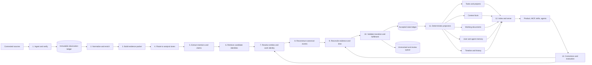

# Panini accuracy-first observation pipeline

Date: 2026-09-30

Status: proposed architecture; not implemented

## Short version

The pipeline must not be:

```text
observation -> LLM -> task/context/document
```

It should be:

```text
observation
  -> immutable evidence
  -> extracted mentions and claims
  -> candidate retrieval
  -> identity resolution
  -> event reconstruction
  -> evidence reconciliation
  -> legal state transition
  -> deterministic projections
  -> task / project / context / memory / document / timeline
```

The essential rule is:

> Models propose interpretations. Evidence policies accept state. Product objects are projections of accepted state.

This tilts toward accuracy because an extraction mistake, an identity mistake, and a completion mistake become separate, inspectable decisions. Today, they can collapse into one generated `InterpretationFinding` that directly chooses `task_create`, `task_change`, `context_file_upsert`, or another product operation.

## What is wrong with the current shape

The current code already has good foundations:

- immutable-looking source events with provider IDs, occurrence/fetch/receive times, content hash, visibility, and supersession;
- proposals and revisions;
- source coverage state;
- context files and facts;
- user and agent scopes.

But the current interpreter interface receives events plus selected tasks/context and returns product-level findings directly. One generated object decides:

- what happened;
- whether it is a task or context;
- which existing task it belongs to;
- the new status;
- owner, priority, project, due date, and document contents;
- confidence and evidence.

That is too much uncertainty in one decision. The current runtime also composes Jev routing, embedding grouping, entity retrieval, Jev proposal classification, and Jev work judgment around the interpreter. Those stages can reject or distort evidence before the system has a stable representation of the underlying claim or event.

The new design preserves the existing observation and proposal machinery, but inserts an evidence interpretation and state-reconstruction layer between them.

## The complete pipeline



This is a DAG, not one synchronous function. Some stages run once per observation, some per evidence packet, some per affected work object, and some only when a user asks a question.

## Canonical data between subprocesses

Do not pass free-form model output between stages. Use small typed records.

### Observation

What the source actually emitted.

```ts
type Observation = {
  id: string;
  source: SourceIdentity;
  sourceObjectId: string;
  sourceRevision: string | null;
  occurredAt: Instant;
  fetchedAt: Instant;
  receivedAt: Instant;
  contentHash: string;
  visibility: Visibility;
  payload: JsonValue;
};
```

### Evidence packet

The observation plus only its mechanically available context.

```ts
type EvidencePacket = {
  observationId: string;
  sourceStructure: Thread | PageDiff | PullRequest | Commit | Run | GenericRecord;
  actorCandidates: IdentityRef[];
  explicitReferences: ExternalRef[];
  quotedObservationIds: string[];
  sourceParentIds: string[];
  normalizedText: string | null;
  occurredAt: Instant;
  coverageSnapshotId: string;
};
```

### Mention

A span or structured field that refers to something, without claiming canonical identity.

```ts
type Mention = {
  id: string;
  observationId: string;
  kind: "person" | "team" | "project" | "task" | "system" | "artifact" | "branch" | "event";
  span: TextSpan | StructuredPath;
  surface: string;
  extractorVersion: string;
  confidence: number;
};
```

### Atomic claim

A proposition narrow enough to independently support, contradict, supersede, or leave unresolved.

```ts
type Claim = {
  id: string;
  observationId: string;
  subjectMentionId: string | null;
  predicate: Predicate;
  object: TypedValue | MentionRef;
  modality: "asserted" | "requested" | "planned" | "hypothetical" | "quoted" | "negated";
  validTime: TimeInterval | null;
  extractorVersion: string;
  confidence: number;
};
```

Examples:

- `causal-worker --reported_tested--> true`
- `Satyam --requested_action--> review`
- `pull-request-123 --merged--> true`
- `deployment-77 --deployed_commit--> abc123`

### Canonical event

One proposed real-world occurrence reconstructed from one or more observations.

```ts
type CanonicalEvent = {
  id: string;
  eventType: EventType;
  participantEntityIds: string[];
  workObjectIds: string[];
  artifactIds: string[];
  validTime: TimeInterval;
  observationIds: string[];
  identityDecisionId: string;
};
```

### State assertion

A candidate value for one field of one work object.

```ts
type StateAssertion = {
  workObjectId: string;
  field: StateField;
  value: JsonValue;
  validTime: TimeInterval;
  recordedAt: Instant;
  supportingClaimIds: string[];
  contradictingClaimIds: string[];
  authorityPolicy: string;
  disposition: "accepted" | "review" | "unresolved" | "rejected";
};
```

### Accepted transition

The only record from which current product state is projected.

```ts
type AcceptedTransition = {
  workObjectId: string;
  fromState: WorkState;
  toState: WorkState;
  validAt: Instant;
  recordedAt: Instant;
  proof: ProofPacket;
  decidedBy: "policy" | "human";
};
```

## Subprocesses in detail

## 1. Ingest and verify

**Input:** connector envelope

**Output:** immutable `Observation`

**Use:** code only

Responsibilities:

- authenticate the source installation;
- validate the provider payload schema;
- preserve provider event ID, object ID, revision, branch/repository/channel/page identity, and permissions;
- canonicalize JSON only for hashing;
- deduplicate exact delivery retries using provider ID plus payload version;
- record edits and deletions as new observations that supersede older observations;
- update a source-coverage snapshot;
- enqueue downstream analysis transactionally through the existing outbox pattern.

Algorithms:

- cryptographic content hashes for exact equality;
- provider event IDs and revision IDs for idempotency;
- append-only event storage;
- transactional outbox;
- monotonic source cursors where the provider supports them.

No LLM belongs here.

## 2. Normalize and enrich

**Input:** `Observation`

**Output:** normalized source structure

**Use:** source-specific code, parsers, and deterministic enrichers

Examples:

- Slack: thread root, reply ancestry, mentions, links, quoted messages, edits, reactions, channel identity.
- GitHub: repository, ref, branch, commit, PR, issue, check run, workflow run, merge base, changed files, linked issue text.
- Notion: page ID, parent path, block tree, revision, section diff, mentions and links.
- Agent: run ID, user identity, agent identity, tool invocations, artifacts, success/failure and workspace writes.
- Code: language parser or Tree-sitter AST, symbols changed, test files changed, configuration and deployment manifests.

Useful algorithms:

- canonical URL and external-reference parsing;
- Unicode normalization without destroying the original text;
- Myers or patience diff for documents and code;
- Tree-sitter or native language parsers for code;
- MinHash/SimHash only for near-duplicate detection, never semantic identity;
- Duckling-style composable rules for dates, times, durations, numbers and quantities. Duckling turns phrases such as “the first Tuesday of October” into structured values without generation. [Duckling](https://github.com/facebook/duckling)

No LLM belongs here.

## 3. Build the evidence packet

**Input:** normalized observation

**Output:** `EvidencePacket`

**Use:** code and source graph traversal

This stage supplies mechanically known local context, not semantically retrieved company context.

Examples:

- A Slack reply receives the root plus a small reply window, not an arbitrary batch of unrelated messages.
- A GitHub notification receives the referenced PR, commit, branch and checks if accessible.
- A Notion edit receives the changed section plus the preceding accepted revision.
- A deployment event receives the deployed artifact and commit mapping.

This prevents the interpreter from being asked to rediscover links the connector already knows.

## 4. Route to analysis lanes

**Input:** `EvidencePacket`

**Output:** zero or more lane labels

**Use:** rules first; tiny multi-label classifier second

Lanes:

- activity/timeline;
- work/task/project;
- knowledge/context;
- decision;
- personal memory;
- agent procedural memory;
- document maintenance;
- no semantic processing.

Every observation always stays in the evidence ledger. Routing only decides which analysis to attempt.

Recommended implementation:

1. Hard source rules for structured events.
2. A `fastText`-style hashed n-gram classifier for ambiguous text.
3. Calibrated probabilities and an `unknown`/multi-label outcome.
4. Never use routing as a hard evidence veto. Low-confidence items enter a low-priority or review lane.

`fastText` demonstrates that simple linear models over word and subword features can be competitive for narrow classification while remaining extremely fast. [Bag of Tricks for Efficient Text Classification](https://aclanthology.org/E17-2068.pdf)

**Good custom-model opportunity:** yes. This is Panini’s closest analogue to Vercel Labs’ `gpu-lexer`.

Possible labels:

- reports_progress;
- requests_action;
- reports_completion;
- reports_blocker;
- makes_decision;
- changes_requirement;
- contains_durable_knowledge;
- social_or_attendance_only;
- ambiguous.

Start with logistic regression or fastText. Only train a tiny neural model if it beats that baseline on an untouched, mixed evaluation set.

## 5. Extract mentions and atomic claims

**Input:** evidence packet plus lane labels

**Output:** `Mention[]` and `Claim[]`

**Use:** a cascade

### Path A: structured source

Use code. Examples:

- GitHub `pull_request.merged=true` becomes a typed claim.
- A check run conclusion becomes a typed claim with its check suite and commit.
- A tracker status change becomes a declared-state claim.
- A deployment record becomes a deployment claim.

These are higher quality than interpreting their rendered text with an LLM.

### Path B: simple free text

Use:

- dictionaries and known aliases;
- dependency parsing or semantic-role labeling for “who did what to whom”;
- GLiNER or a fine-tuned compact token/span classifier for project, task, system, artifact and person mentions;
- deterministic temporal parsing;
- pattern rules for reviews, blockers, decisions, completion language and negation.

GLiNER is a compact bidirectional encoder for arbitrary entity types and performs extraction in parallel rather than generating tokens sequentially. [GLiNER](https://aclanthology.org/2024.naacl-long.300/)

OpenIE and semantic-role labeling can propose subject/relation/object or predicate/argument structures, but they should be treated as candidate generators because company language is fragmentary and context-dependent. [Stanford OpenIE](https://nlp.stanford.edu/software/openie.html)

### Path C: complex free text

Use one LLM interpretation call when:

- multiple speech acts interact;
- meaning depends on several messages;
- there are implicit subjects or artifacts;
- a decision supersedes an earlier decision;
- the observation could update several kinds of state.

The LLM returns only atomic mentions, claims, modality, and supporting spans. It does **not** return a task, task ID, project ID, completion decision, or final document.

This is the first selective LLM call.

## 6. Retrieve candidate identities

**Input:** mentions, claims and evidence packet

**Output:** candidate entities, work objects, events and artifacts

**Use:** multiple independent retrieval methods

Candidate generation must optimize recall. A missed canonical task can never be repaired by the later reranker.

Retrieve from:

1. exact external references and aliases;
2. repository/branch/file/symbol mappings;
3. actor and team relations;
4. time-window indexes;
5. BM25 lexical search;
6. dense embedding search;
7. graph neighbors from already accepted links;
8. recent tasks/projects and recently mentioned work;
9. source-specific backlinks and thread ancestry.

Merge ranked lists with Reciprocal Rank Fusion rather than trusting one score scale. RRF is a simple unsupervised method that has outperformed individual retrieval rankings in classic evaluations. [Reciprocal Rank Fusion](https://research.google/pubs/reciprocal-rank-fusion-outperforms-condorcet-and-individual-rank-learning-methods/)

Then rerank the top candidate set with a non-generative cross-encoder. Cross-encoders jointly read the mention and candidate and are more accurate than independent embeddings, while remaining practical after first-stage retrieval narrows the set. [Sentence Transformers retrieve-and-rerank](https://www.sbert.net/examples/sentence_transformer/applications/retrieve_rerank/README.html)

Accuracy-first defaults:

- retrieve broadly, for example 100–300 candidates across methods;
- rerank every candidate;
- preserve the reason each candidate was retrieved;
- include hard negatives from the same project/topic in training;
- measure end-to-end recall, not reranker performance with the gold candidate forcibly inserted.

## 7. Resolve entity, event and work identity

**Input:** mention/candidate pairs with features

**Output:** `same`, `different`, or `unresolved` link decisions

**Use:** probabilistic record linkage plus constrained clustering

Feature families:

- exact IDs, URLs, branch/ref, commit and source links;
- name and alias similarity;
- actor overlap;
- repository/file/symbol overlap;
- event/action compatibility;
- temporal compatibility;
- project and workstream compatibility;
- cross-encoder score;
- source/thread ancestry;
- contradictions and hard cannot-link conditions.

Recommended scoring:

1. Start with Fellegi–Sunter-style additive log-likelihood evidence. Each feature contributes evidence for or against a match, which is auditable in a waterfall explanation.
2. Calibrate the final probability on held-out company data.
3. Add a small pairwise cross-encoder when enough labeled pairs exist.
4. Cluster only after applying must-link and cannot-link constraints.
5. Do not perform transitive merges that violate a cannot-link or create incompatible time/artifact relationships.

Splink’s documentation gives the useful interpretable formulation: match weights are additive log Bayes factors, while also warning that feature independence is an assumption. [Fellegi–Sunter in Splink](https://github.com/moj-analytical-services/splink/blob/master/docs/topic_guides/theory/fellegi_sunter.md)

Decision bands:

- high calibrated probability plus no constraint violation: auto-link;
- middle band: unresolved or human review;
- low probability or hard conflict: keep separate;
- an explicit source link can form a must-link only when its target identity was verified.

**Good custom-model opportunity:** yes. Fine-tune a compact cross-encoder on `same work`, `related but different`, and `unrelated` pairs. The important training data is hard negatives: two causal-worker tasks, two similarly named experiments, or a July standup mentioning the same topic but not the same work.

Do not train this model on the current task table as ground truth. Use audited episode pairs and human corrections.

## 8. Reconstruct canonical events

**Input:** resolved mentions, claims and links

**Output:** canonical events and event-to-work relationships

**Use:** temporal/graph logic plus a small event-type classifier

Steps:

1. Group claims that likely describe the same occurrence.
2. Enforce compatible action, participants, artifacts, work object and time.
3. Separate an event from later discussion about that event.
4. Link derived notification messages to the underlying event so they do not count as independent evidence.
5. Preserve event hierarchy: implementation, test, review, deploy and production observation are related but not one event.

Cross-document event-coreference research treats action, participants, time and context as central to event identity. [Cross-document event coreference](https://direct.mit.edu/coli/article/47/3/575/102774/Generalizing-Cross-Document-Event-Coreference)

Possible event types:

- work_proposed;
- implementation_started;
- artifact_created;
- code_changed;
- test_executed;
- result_reported;
- review_requested;
- review_accepted;
- merged;
- deployed;
- production_observed;
- blocked;
- resumed;
- decision_made;
- decision_superseded;
- work_cancelled.

This taxonomy is a domain model, not a prompt enum. It should evolve through versioned migrations.

## 9. Reconcile evidence and time

**Input:** affected canonical events, claims and current work state

**Output:** field-level `StateAssertion[]`

**Use:** bitemporal rules, predicate-specific authority and non-generative NLI

For each field or predicate:

1. gather all supporting and contradicting claims;
2. distinguish valid time from recorded time;
3. collapse dependent copies into one evidence family;
4. apply predicate-specific evidence authority;
5. compare candidate claims using an entailment/contradiction/neutral classifier;
6. preserve simultaneous truths when the field is multi-valued;
7. mark no-evidence and unresolved cases explicitly.

Examples of authority policy:

- `code_exists_at_commit`: repository data dominates chat.
- `checks_passed`: check-run data dominates summaries.
- `deployed`: deployment system dominates a PR comment.
- `accepted_by_reviewer`: reviewer action or explicit review message is required.
- `project_intent`: an accepted decision/document may dominate code shape.

Use a fine-tuned encoder-only NLI classifier for textual support/contradiction. It is a useful signal, not the final judge: generic NLI can misunderstand domain-specific negation, partial tests and temporal qualifiers.

No source receives one global trust score. Authority is per predicate and evidence class.

The system should use calibrated probabilities and selective classification: accept fewer automated decisions to lower the error rate, and abstain on ambiguous cases. Selective classification explicitly models the risk–coverage tradeoff. [Selective classification foundations](https://www.jmlr.org/beta/papers/v11/el-yaniv10a.html)

## 10. Validate state transitions and fulfillment

**Input:** state assertions plus the work object’s acceptance policy

**Output:** accepted transition, review request, or unresolved result

**Use:** code, policy rules and source validators

This is the most important non-LLM stage.

Every work type has a state machine and an acceptance policy.

Example for a production code task:

```text
proposed
  -> active
  -> implemented
  -> tested
  -> reviewed
  -> merged
  -> deployed
  -> observed
  -> fulfilled
```

Not every task requires every state, but skipping a required state needs explicit policy.

The proof engine checks:

- transition is legal from the previous state;
- required evidence types exist;
- evidence points to the same artifact/version;
- required coverage was healthy;
- no unresolved contradiction invalidates the transition;
- required human acceptance exists;
- later rollback, rejection, cancellation or reopening reverses current state without deleting history.

`done` is a projection label. Internally, Panini should retain the richer fulfillment phase.

The LLM cannot mark work fulfilled. It may identify a completion claim, but the proof engine decides whether acceptance conditions are satisfied.

## 11. Deterministic projectors

**Input:** accepted events, assertions and transitions

**Output:** product objects

**Use:** code only, except document prose composition

### Task and project projector

- creates a task only from accepted commitment/work-intent events;
- updates owner, state, due date and dependencies field by field;
- keeps artifact completion separate from review work;
- preserves stable task identity across title changes;
- maintains projects and workstreams as longer-lived containers.

### Context-fact projector

- writes accepted decisions, policies, constraints, identities, relationships, metrics and references;
- stores valid intervals and supersession;
- never treats a task status as a durable company fact without a specific projection rule.

### Timeline projector

- shows canonical accepted events in valid-time order;
- keeps recorded-time history for audit;
- excludes duplicate notifications as separate events.

### Memory projector

Keep memory classes separate:

- **episodic memory:** observations and canonical events;
- **semantic company memory:** accepted context assertions;
- **procedural memory:** accepted runbooks, skills and operating instructions;
- **personal memory:** user-scoped preferences and durable personal context;
- **agent memory:** agent-scoped procedures and workspace notes;
- **working memory:** ephemeral context packs compiled for one request.

The same accepted event can feed more than one projector, but the projectors do not become independent evidence sources.

### Working-document projector

Long documents are maintained section by section:

1. map accepted claims/events to document sections;
2. identify only affected sections;
3. build a section proof bundle containing current prose, new accepted evidence, superseded evidence and required citations;
4. ask an LLM for a bounded patch, not a whole-document rewrite;
5. validate every new sentence against its cited claims with NLI plus deterministic citation checks;
6. reject unsupported names, dates, numbers, statuses and causal claims;
7. preserve the old revision and the explanation for the change;
8. require review for high-impact architecture, policy or public-facing documents.

This is the second selective LLM workload. It runs when accepted state changes materially affect a document section, not for every observation.

## 12. Index and serve

**Input:** accepted product projections plus evidence

**Output:** scoped context packs and structured MCP results

**Use:** hybrid retrieval, reranking and deterministic packing; optional LLM answer generation

### Index separately

- raw observations;
- canonical events;
- accepted state assertions;
- tasks/projects;
- context facts;
- document sections;
- people/expertise;
- procedures/skills.

Do not embed one giant concatenated record. Different representations answer different queries.

### Retrieval sequence

1. authenticate user and agent identity;
2. apply source and derived-object permissions before retrieval;
3. classify query intent with rules or the tiny router;
4. retrieve with exact IDs, BM25, dense embeddings, graph expansion and time filters;
5. combine candidate rankings with RRF;
6. rerank with a cross-encoder;
7. expand selected results to their evidence, current state and immediate history;
8. diversify sources and events so duplicates do not crowd out independent evidence;
9. pack by relevance, authority, recency, chronology and token budget;
10. return structured objects plus citations.

For very high retrieval quality, evaluate ColBERT-style late interaction after the simpler hybrid stack. ColBERT retains token-level interaction and can outperform single-vector retrieval, but adds index and operational complexity. [ColBERT](https://github.com/stanford-futuredata/ColBERT)

### Serving modes

- **Product UI:** human-readable current state, timeline, gaps and evidence.
- **MCP:** typed task/context/event/document tools with IDs, versions, evidence and permission scope.
- **Skills:** procedural packages referencing stable context and tools.
- **Agent context:** a compact context pack for the current objective, not the entire company memory.
- **Question answering:** one LLM call may turn the context pack into prose, but citations are attached to claims before generation and verified after generation.

## 13. Corrections, replay and model improvement

**Input:** human correction, source correction, new observation, model upgrade

**Output:** revised links/state plus training examples

Every correction should record which decision was wrong:

- extraction;
- identity linkage;
- event grouping;
- authority/contradiction;
- transition policy;
- projection;
- retrieval.

Then replay only the affected neighborhood:

- the observation and its extracted claims;
- linked candidate pairs;
- affected canonical events;
- affected work objects and documents;
- dependent retrieval indexes.

Version all rules, models, prompts and policies. Old observations remain unchanged.

Before promotion:

- train on reviewed data;
- evaluate on a frozen mixed development set;
- validate on a held-out mixed set containing hard negatives and unknowns;
- run a full isolated replay;
- compare field accuracy, task coverage, identity errors, fulfillment precision and document faithfulness;
- shadow new decisions without changing accepted state;
- promote only if no protected slice regresses beyond its allowed bound.

This is similar to the disciplined part of `gpu-lexer`: its small model has a narrow interface, a teacher-defined label set, held-out repository/package splits, and guarded promotion. Its official repository reports 41,321 reachable weights and a roughly 27.5 KiB deployed package. It also explicitly says it is not a parser or correctness tool. [Vercel Labs gpu-lexer](https://github.com/vercel-labs/gpu-lexer)

## Where to use LLMs

| Subprocess | Default | LLM use |
|---|---|---|
| Ingestion, dedupe, permissions | Code | Never |
| Source normalization | Code/parsers | Never |
| Date, link, identity and structured-event parsing | Rules | Never |
| Observation routing | Rules + tiny classifier | Only as offline teacher if useful |
| Entity/mention extraction | Rules + compact encoder | Fallback for complex text |
| Atomic claim extraction | Structured parsers + compact models | One call for complex text |
| Candidate retrieval | Search algorithms | Never |
| Pairwise identity | Probabilistic linkage + cross-encoder | Only ambiguous, high-impact cases |
| Event reconstruction | Graph/time logic + classifier | Only ambiguous episodes |
| Contradiction/support | Rules + NLI encoder | Only difficult semantic disputes |
| Fulfillment | Policy/proof engine | Never as final judge |
| Task/context projection | Code | Never |
| Long-document prose | Section-level evidence bundle | Yes, bounded patch |
| Retrieval/context packing | Search + deterministic optimizer | Optional query rewrite only |
| User-facing prose answer | Grounded context pack | Yes |

An unstructured observation usually needs zero or one LLM interpretation call. A genuinely ambiguous, high-impact observation may need a second adjudication call. Structured GitHub, tracker, test and deployment observations usually need zero.

## Small and non-generative model plan

### Model A: observation router

- task: multi-label speech-act and durability classification;
- first baseline: regularized logistic regression or fastText over hashed character and word n-grams;
- possible custom model: small convolution/affine-scan encoder inspired by the narrow `gpu-lexer` shape;
- deployment: quantized ONNX on CPU; WebGPU only for optional local/private classification;
- target: very high recall, calibrated probabilities, never a hard veto.

### Model B: mention tagger

- task: person, project, task, system, artifact, branch and event spans;
- baseline: dictionaries plus GLiNER;
- custom model: compact encoder token/span classifier trained on reviewed Panini mentions;
- target: span precision/recall by entity type.

### Model C: same-work pair scorer

- task: `same`, `related-but-different`, `unrelated`;
- baseline: Fellegi–Sunter features plus general cross-encoder;
- custom model: MiniLM-class cross-encoder fine-tuned on Panini hard pairs;
- target: pairwise precision/recall and cluster-level B-cubed metrics, with a strict false-merge ceiling.

### Model D: claim relation classifier

- task: support, contradict, supersede, independent, or unrelated;
- baseline: domain rules plus an encoder NLI model;
- custom model: fine-tuned DeBERTa/ModernBERT-class encoder on company evidence pairs;
- target: per-class precision, especially contradiction and neutral.

### Model E: retrieval reranker

- task: rank evidence for identity resolution and user queries;
- baseline: general MiniLM-class cross-encoder;
- custom model: fine-tune on clicked, accepted and explicitly rejected evidence pairs, with hard negatives;
- target: end-to-end recall@k, nDCG and evidence coverage.

### Model F: document-impact classifier

- task: map an accepted state change to affected document sections;
- baseline: lexical/dense retrieval plus rules;
- custom model only if the baseline misses sections;
- target: affected-section recall. False positives are cheaper than missed necessary updates.

## Why WebGPU is optional, not central

WebGPU changes where inference runs. It does not improve semantic accuracy.

Use it when:

- private text should remain on a user’s device;
- the browser or desktop app needs instant routing/tagging;
- the model is small, stable and independently verified;
- a WASM/CPU fallback exists.

Do not make it the default server architecture. Server-side ONNX CPU inference is easier to reproduce, observe, batch and validate. The useful lesson from `gpu-lexer` is task specialization and a narrow interface, not the graphics runtime.

## Deep modules and seams

Keep the public orchestration surface small.

```ts
interface ObservationPipeline {
  ingest(envelope: ConnectorEnvelope): Promise<ObservationRef>;
  reconcile(observationIds: string[]): Promise<ReconciliationReport>;
  correct(decisionId: string, correction: Correction): Promise<ReplayReport>;
}

interface ContextCompiler {
  compile(request: ContextRequest): Promise<ContextPack>;
}
```

Internally, use these deep modules:

1. **Evidence Ledger** — idempotency, revisions, coverage, permissions and immutable storage behind `append/read`.
2. **Evidence Analyzer** — normalization, routing, mention and claim extraction behind `analyze(observationId)`.
3. **Identity Resolver** — candidate retrieval, pair scoring, constraints and clustering behind `resolve(evidencePacketId)`.
4. **State Reconciler** — bitemporal truth, conflicts, authority and affected-object recomputation behind `reconcile(workObjectIds)`.
5. **Proof Engine** — state machines and acceptance policies behind `decide(stateProposal)`.
6. **Projection Engine** — tasks, context, memories, timeline and document-impact jobs behind `project(acceptedTransitionIds)`.
7. **Context Compiler** — permission filtering, hybrid retrieval, reranking and token packing behind `compile(request)`.
8. **Replay Engine** — dependency traversal, versioned recomputation and comparison behind `replay(scope)`.

These are real seams because each has at least a production adapter and an in-memory or isolated-database adapter for end-to-end verification. Model providers are internal adapters, not leaked into the external interfaces.

## Storage architecture

Keep it simple:

- PostgreSQL remains the authoritative database.
- Append-only tables hold observations, claims, identity decisions, canonical events, state assertions and transitions.
- Ordinary relational tables hold entity/work links and bitemporal intervals.
- Current task/context/document views are materialized projections.
- `pgvector` or the existing vector facility stores dense representations.
- PostgreSQL full-text search is acceptable initially; evaluate a true BM25 index only if held-out retrieval shows a material gap.
- The existing outbox drives background stages and makes replay resumable.
- No graph database is required initially. PostgreSQL edges plus recursive queries are enough for the company sizes in the initial customer profile.
- Python is used offline for training/evaluation; deploy compact models as ONNX to the TypeScript worker.
- Store model, prompt, rule and policy versions on every derived decision.

## Accuracy controls

1. **No direct writes from model output.**
2. **Field-level evidence.** A task object does not have one overall confidence score.
3. **Abstention is a valid result.** Unknown and unresolved are visible states.
4. **Hard structural constraints.** Permissions, incompatible IDs, impossible time and artifact mismatch override similarity scores.
5. **No hard semantic veto from a tiny model or Jev.** Such models rank or route; they do not delete evidence.
6. **Evidence-family deduplication.** Copies and notifications do not become independent corroboration.
7. **Predicate-specific authority.** GitHub is authoritative for a commit, not for deployment or business acceptance.
8. **Two clocks.** Valid time and recorded time are always preserved.
9. **Stable identity.** Titles and generated prose can change without creating new tasks.
10. **Protected evaluation slices.** Non-default branches, ambiguous same-topic tasks, rollbacks, review-only work and missing coverage cannot regress silently.
11. **Human correction is durable evidence.** It is not an overwrite hidden from replay.
12. **Independent verification of generated prose.** Citation presence alone is not support.

## Example: causal-worker message

Input observation:

> “The causal worker is tested, there are some good results, please review it.”

Pipeline behavior:

1. Slack structure identifies author, channel, thread and time.
2. Router labels progress report plus action request.
3. Extractor proposes:
   - mention: `causal worker`;
   - claim: reported tested;
   - claim: results described as positive;
   - requested action: review;
   - missing explicit artifact.
4. Candidate retrieval searches exact aliases, prior task/project mentions, nearby actors/time, repositories, branches, commits, PRs and experiment runs.
5. Identity resolver may link the mention to an existing work object, but only links a GitHub artifact if evidence supports the match.
6. Event reconstruction creates a reported-test event and a review-request event. It does not merge them with a notification merely because the topic is similar.
7. Reconciler records “testing reported” as a claim. If an accessible matching test artifact exists, it can additionally assert “test executed.”
8. Proof engine keeps the review task open until review acceptance exists.
9. Task projector shows the review action; timeline shows the reported test; context/document projectors update only if the accepted evidence materially changes durable knowledge.
10. If the relevant commit is on an unobserved branch, the UI shows the coverage gap and unresolved artifact.

## E2E verification plan

Following the repository’s testing rule, verify the pipeline through its public interface and produce replay artifacts rather than adding narrow post-hoc unit tests.

Create a fixed, mixed corpus with:

- clear positives;
- same-topic different-work negatives;
- missing URLs;
- non-default branches;
- duplicate notifications;
- claimed completion without artifact;
- passing test for the wrong version;
- merged but not deployed;
- deployed then rolled back;
- artifact finished but review still open;
- late corrections and edited messages;
- current and superseded architecture claims;
- permission-restricted evidence;
- genuinely unknowable cases.

For every case, gold-label:

- mentions and atomic claims;
- same/different/unresolved identity pairs;
- canonical events;
- state assertions;
- required acceptance evidence;
- final task/context/document projections;
- expected unknowns and coverage gaps.

The replay artifact should contain:

- stage-by-stage decisions;
- model/rule/policy versions;
- candidate-retrieval recall;
- pair and cluster identity metrics;
- field-level state accuracy;
- fulfillment precision and recall;
- document claim support;
- permission leakage count;
- coverage and abstention rate;
- regressions by protected slice;
- examples of every false merge, false completion and missed task.

Promotion rule: no production write until the isolated replay beats the current best run on task coverage and current-state accuracy, while meeting strict ceilings for false merges, false fulfillment and permission leakage.

## Implementation order

### Phase 1: establish the intermediate truth layer

1. Add mentions, claims, identity decisions, canonical events, state assertions and accepted transitions.
2. Preserve the existing SourceEvent ledger and proposal/revision system.
3. Make current task/context writes consume accepted transitions, not interpreter findings.
4. Re-express existing task/context state as projections.

### Phase 2: deterministic and non-generative baseline

1. Structured-source claim extraction.
2. Exact/alias/graph/time/BM25 candidate retrieval.
3. Fellegi–Sunter identity scoring.
4. State machines and proof policies.
5. Deterministic task, context, timeline and memory projectors.

### Phase 3: selective compact models

1. fastText observation router;
2. GLiNER mention extraction;
3. dense retrieval plus cross-encoder reranking;
4. NLI support/contradiction classifier;
5. calibrated abstention thresholds.

### Phase 4: selective LLM interpretation

1. Use the LLM only for complex atomic-claim extraction.
2. Add LLM ambiguity adjudication only where the non-generative system abstains and the impact justifies it.
3. Add section-level working-document patches with evidence verification.

### Phase 5: train Panini-specific small models

1. Collect reviewed errors and hard negatives.
2. Fine-tune pair scorer, NLI relation classifier and reranker.
3. Distill stable routing and speech-act labels into tiny models.
4. Consider WebGPU only for privacy-sensitive local inference.

## Final recommendation

Build the non-generative evidence, identity and state machinery first. Use general compact encoders as candidate generators and scorers. Keep LLMs at the two points where language generation or deep implicit interpretation is genuinely required:

1. complex atomic-claim extraction/adjudication;
2. grounded section-level document composition.

Everything after an accepted claim—identity constraints, state transitions, fulfillment, projections, permissions, history and retrieval packaging—should be governed by code, probabilistic models with calibrated abstention, or explicit policies.

