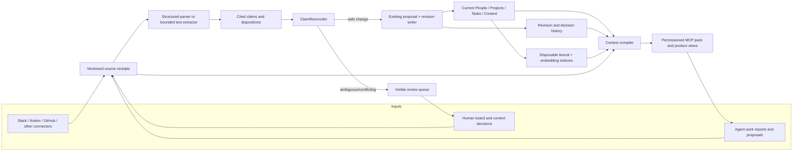
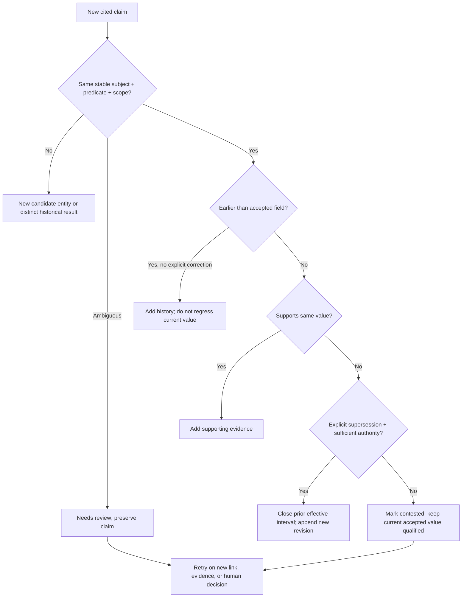
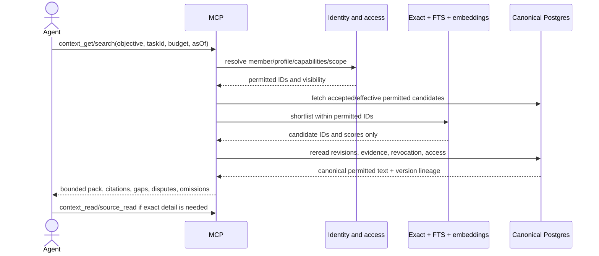

# Panini memory v2: technical design candidate

Date: 2026-09-30. Status: **proposed, not implemented or validated**. This extends the [full-loop outline](../evaluation/panini-full-information-loop-2026-09-30.md). It covers sources, people, Projects, Tasks, Context, history, retrieval, product, MCP, and agent skills. It preserves the [canonical product contract](../../PRODUCT.md). The [primary-source research](../../artifacts/panini-memory-systems-primary-research-2026-09-30.md) informs choices but does not prove they win on Sozu.

## Decision in one sentence

Use PostgreSQL as the sole authority for versioned source receipts, cited claims, decisions, and accepted revisions; use deterministic evidence/identity/time rules with an explicit unresolved state; use full-text plus existing embeddings only for **candidate discovery**; compile authorized, versioned context on demand. Remove Jev from routing, work gating, and Context reranking. Keep one existing interpreter for unstructured **candidate extraction**, not accepted-state mutation. Retain current MCP tool names and the portable skill.

This chooses the smallest implementation that can explain every accepted value and reproduce it. It does **not** promise fully automatic resolution of ambiguous Slack prose. Measure that review load before changing the acceptance policy.

## The four different kinds of information

| Layer | Canonical owner | May say | May not do |
|---|---|---|---|
| Source receipt | Connector, authorized person, or agent | “This exact version was observed here, at these times, with this visibility.” | Become an instruction or accepted fact merely by being ingested. |
| Extracted claim | Panini extraction job | “This source appears to report/request/decide X; here is the exact span.” | Silently merge entities or replace current state. |
| Company memory | One revision writer after a decision | “This Project/Task/Context item is the current version available under its stated status.” | Treat every sentence in a working document as a verified company fact, erase a prior revision, or hide conflicting evidence. |
| Working memory | Member/agent workspace or session | “This agent/user saved a note or procedure.” | Enter company memory without a cited proposal and authority decision. |

An ephemeral context pack is **not** a fifth canonical store. It is a scoped projection of authorized current items for one agent, situation, and time, with each item's document or claim status intact.

## Project Context is a living document workspace

Context is **not merely a fact store**. A small, long-running company initiative is a Project when it has its own outcome, regardless of its size. Its Project folder can hold architecture documents, plans, experiment logs, work notes, decision records, and other evolving files alongside linked Tasks. A folder makes these navigable; it does not create a separate database, determine access, or prove the text is true. The canonical link is to the Project's stable ID. For example:

```text
Company / Projects / Evidence pipeline /
  Architecture / Overview.md
  Architecture / Tradeoffs.md
  Work / Migration plan.md
  Experiments / Replay 2026-09-27.md
  Decisions / 004-adopt-source-claims.md
```

Each file keeps a stable document ID across rename/move, explicit Project and optional Task links, current version, author/contributors, source lineage, visibility, and document state: `working`, `accepted_reference`, `decision_record`, or `archived`. **Document state is not claim truth.** A `working` architecture note may contain hypotheses and discarded options. An accepted reference is approved for use as a reference; only an explicitly accepted decision or independently supported claim changes company policy or Task state. Project ownership/participation must be explicit; the current Project model has one owner string, so several accountable owners would require a small membership/role change rather than inferring them from authorship or the folder path.

A human edit or external document version becomes a receipted document revision, preserving the previous full text or diff and its effective/accepted times. Update the file as a file; extract only independently useful claims such as an accepted decision, stated dependency, or completed outcome. Do **not** shred the narrative into facts, regenerate the entire file from Slack, or allow a source summary to overwrite a human-authored document. A changed section can trigger incremental extraction and reindexing without revisiting unchanged sections. Competing proposals remain visible beside the current document until resolved.

Panini may also maintain a **Synthesized Context File** when no trustworthy current document exists. This is a separate asynchronous materialization job, not a second stage for every observation. Accepted claims and implementation evidence linked to a Project mark affected document sections stale. On demand or after a debounce window, a Document Curator freezes an evidence manifest for one document or section: cited discussions and decisions, current Task state, repository/PR/commit/check evidence, relevant code symbols/configuration/migrations/tests, and older documents labelled by age and contradiction. One bounded LLM call per changed section writes a working section with sentence-level citations and explicit `implemented`, `decided`, `proposed`, `disputed`, or `outdated` labels. Independent sections can run in parallel against the same frozen manifest; code assembles them deterministically into one new document revision. No final uncited LLM rewrite is allowed. The result remains `working` until accepted as a reference.

The present GitHub connector records branches, PR metadata/reviews, commit metadata, and checks, but not repository blobs or changed-file patches. Add a Code Evidence adapter before treating synthesized architecture as implementation-aware. For an observed commit/PR, code should record repository + commit SHA + changed paths, fetch the exact permitted file versions or patches, and use language parsers where available (the TypeScript compiler for TypeScript and Tree-sitter adapters only for additional languages that are actually needed) to derive imports, exported symbols, routes, schemas/migrations, configuration, and test/artifact references. These deterministic facts and versioned source spans become retrieval candidates; the LLM explains their architectural meaning in the Document Curator. Implementation evidence says what code currently does, not why it is desired; accepted decisions and proposals retain those separate meanings.

For ordinary-sized documents, the curator may update all affected sections in one call. If the frozen evidence bundle exceeds the tested input budget, split by stable document section and run independent section calls in parallel. Assemble by section ID and base document version, not by a final uncited model rewrite. An overview section that depends on other changed sections runs after those sections and cites them plus their underlying evidence.

For retrieval, first use Project ID and folder catalog to locate the right files, then use stable section IDs and versioned headings/spans for lexical and embedding search. Return the relevant section plus title, document state, version, Project/Task links, and citation; read adjacent sections or the full file on request. An agent asking “What are we doing?” can receive a small Project overview; an agent asking “Why did we choose this?” gets the decision record and earlier alternatives. This prevents long files from either consuming the whole pack or vanishing because a whole-document rank was low. The existing whole-file Context reader remains a fallback during migration.

## Diagram 1 — the whole information loop



The arrows from receipts and history to the compiler mean source detail and as-of history are read **only when the query calls for them**. The index proposes candidate IDs; it never supplies canonical text or authority.

## Minimal data changes

Keep existing `source_events`, encrypted `source_event_contents`, `tasks`, `context_entries`, proposals, revisions, audit, outbox, work links, identities, and agent workspaces. Existing Context Files already have paths, bodies, revisions, and Project links; add document state and a derived section index, without a second canonical document store. Existing lifecycle `accepted` would mean the file is admitted to the authorized workspace; the separate document state can still be `working`. Unpublished `needs_review` content must not appear as accepted policy. Add one `memory_claims` table (or equivalent) before adding another database:

```ts
type MemoryClaim = {
  id: UUID;
  organizationId: UUID;
  sourceEventId: UUID; sourceContentHash: string;
  sectionOrJsonPointer: string | null;
  spanStart: number | null; spanEnd: number | null; spanHash: string | null;
  kind: 'work' | 'fact' | 'decision' | 'policy' | 'procedure' | 'relationship';
  assertion: 'requested' | 'planned' | 'reported' | 'observed' | 'verified' | 'retracted';
  polarity: 'affirmative' | 'negative' | 'uncertain';
  speakerRef: string | null;      // provider identity or attributed speaker, not an inferred person ID
  subject: string; predicate: string; value: JsonValue;
  scope: JsonValue;                 // e.g. project, environment, run, branch
  sourceOccurredAt: ISOTime; receivedAt: ISOTime;
  effectiveFrom: ISOTime | null; effectiveTo: ISOTime | null;
  extractorVersion: string; inputHash: string;
  targetType: 'person' | 'project' | 'task' | 'context' | null;
  targetId: UUID | null;
  disposition: 'new' | 'confirmed' | 'amended' | 'superseded'
             | 'contradicted' | 'irrelevant' | 'needs_review' | 'retryable';
  supersedesClaimId: UUID | null; reason: string;
};
```

This is a **candidate** shape, not a migration. Start with current vocabulary; do not invent a universal ontology. Unique extraction identity should include organization, source event/version, source span or structured field, claim payload hash, and extractor version. The span offsets and hash point into the encrypted source version; do not duplicate private quotes as plaintext. Claim values themselves need the same encryption and access rules as their source. Store every decision transition in the existing audit stream and accepted decision in proposals/revisions; do not let a mutable disposition be the only history. Stable Task identity is its outcome plus accepted source anchors, not generated title. A Context fact key is subject + predicate + scope; a folder path is user-facing placement, not the fact's identity. Long files retain a stable document/section source ID and version.

## Exact write path

The language path uses the [single-call reconciler contract](./panini-single-call-reconciler-2026-09-30.md): one bounded generative call sees the new observation together with candidate Projects, Tasks, facts, document sections, versions, recent history, identities, policy, and coverage. It performs semantic classification, identity comparison, and proposed state reconciliation together. There is no separate LLM signal extractor, adjudicator, or Jev gate in the normal path. Deterministic code validates and commits the result; it does not reinterpret it.

Before that call, an Episode Assembler follows hard source relationships: Slack thread/reply IDs; normalized GitHub repository, PR, issue, commit, branch and check identifiers parsed from payloads and URLs; Notion page/block IDs; agent-reported Task IDs; repository mappings; and previously accepted source-to-work links. Lexical and embedding similarity may add candidate state but may not create an Episode edge by itself. A vague reply such as “please review it” is interpretable only when those links bring the referent into the episode. If the required message or source is missing or unauthorized, the result stays unresolved.

1. **Receive idempotently.** Normalize source ID, version, author, ACL/visibility, source and receipt timestamps, and content hash. Store encrypted payload and an outbox extraction job in one transaction. Human board changes must also emit receipts; private agent/user files do not become company receipts by default.
2. **Parse the smallest coherent unit.** Structured source fields are parsed in code. For prose, send a bounded document section or complete short thread to the existing interpreter. It outputs candidate claims and exact quoted spans/structured pointers, including negation, uncertainty, and who said what. Validate the span against the encrypted source version, then persist only its offsets/hash and protected claim payload. Cache output by source hash + extractor model/prompt/schema version. A model timeout is retryable; it never marks the source semantically reconciled. Span existence is checked in code; meaning still requires evaluation.
3. **Persist each claim independently.** One source may yield a Task request, a result, a decision, and a Context fact. A successful extraction run does not erase an unresolved claim. Source edits link old and new source versions; repeated copies of one message are not independent corroboration.
4. **Find possible targets.** Try explicit Task/Project IDs, GitHub/Notion object IDs, accepted aliases and source references first. Lexical/embedding similarity can add suggestions to review but cannot prove same outcome. Resolve people through accepted provider identities, never just names.
5. **Decide under the entity lock.** `ClaimReconciler.reconcile(claimId)` loads active evidence, target revision, related claims, coverage, and authority policy; it returns `confirm`, `amend`, `supersede`, `contradict`, `new`, `irrelevant`, or `needs_review`. Extend the existing revision writer's transaction to record the claim decision and accepted revision atomically, with a claim-derived idempotency key and base version; do not nest its present transaction inside another. On conflict, retry against the new version; do not last-write-win. A policy change requeues only affected claims.
6. **Project and index.** The revision outbox updates current views and a derived search index. An index may lag; canonical retrieval rereads PostgreSQL and checks revision/hash and access. Revocation makes dependent results unreadable immediately through canonical checks and queues re-projection/pruning.

### Authority rules, not a universal source ranking

| Claim | Safe automatic representation | What needs a stronger decision |
|---|---|---|
| Slack “feature is done” | Store a cited **completion report**. | Marking the full Task `done` needs the outcome's verification or an authorized board action. |
| Merged PR | Store that this PR merged, with exact repository/commit. | Claiming deployed/working requires CI, deployment, or user acceptance appropriate to the Task. |
| New benchmark number | Store a result scoped to run, dataset, model, and date. | Replacing a different run's result or declaring a global improvement. |
| Notion policy draft | Store a proposed decision or source text. | Company policy requires authorized acceptance and effective date. |
| Agent verified report | Store artifact and verification receipt linked by Task ID. | Independent acceptance of the whole Task; do not use the agent report as its own corroboration. |
| Human board change | Store an authoritative decision receipt and revision. | Replay must preserve it; a later conflicting source claim goes to review, not silent overwrite. |

The policy is claim-type-specific. An observation can be accepted *as an observation* without claiming the underlying real-world proposition is verified. This allows useful automatic memory without turning every Slack assertion into company truth.

## Diagram 2 — new information changes old information



Use two separate query times: `validAt` asks what the claim says was true in the world; `knownAt` asks what Panini had accepted by then. A late correction may change our account of an earlier period without pretending the correction was known earlier. Superseding a Context fact does not delete its history. A new run result usually adds a scoped result, not overwrites a previous experiment.

## Exact read path: product and MCP use the same compiler

1. Resolve the authenticated member + Agent Profile + device/session, capabilities, repository/Project/Task scope, and requested `validAt`/`knownAt`. Effective permissions are intersections, not permissions inferred from a folder name. The existing user/agent workspaces remain private and separate from company memory.
2. For `context_get`, compile a *small orientation*: identity, current Task/Project, relevant policies/decisions, blockers, important Project documents, and coverage. For `context_search`, retrieve only objective-relevant facts, Task views, and document sections, including permitted working documents when the query calls for them. History/source views are explicit reads. Do not inject an entire company corpus into the prompt.
3. Pre-filter by tenant, principal, visibility, document/claim state, effective time, Project/Task links, and active evidence. Candidate generation is the **union** of exact IDs/links, PostgreSQL full-text/lexical search, and the existing embeddings. Use a simple rank fusion and category budget; record candidate IDs, scores, misses, and truncation. A score nominates; it cannot change truth.
4. Reread canonical rows, source validity, revision hash, and permissions immediately before return. Include document state and version, section IDs, claim/revision IDs, source pointers, quoted support where allowed, assertion state, effective time, conflict flags, coverage gaps, and an omission manifest. Never emit raw source text as instructions. If no accepted support is present for a factual answer, return unknown rather than promoting a nearby working hypothesis. When there are merely candidate hits, label them candidates; the agent must verify support or abstain.
5. Index documents by stable sections and accepted facts by ID/version; index updates/removals follow revision/revocation events. It is safe to delete and rebuild the index. If it is stale/unavailable, fall back to exact/lexical canonical retrieval and report degraded recall.



MCP retains existing tool names (`identity_get`, `context_get`, `context_search`, `context_read`, `source_read`, `work_search`, `work_report`, proposal tools, `proposal_status`) for compatibility. Reads never create accepted facts; writes create receipts/proposals. Server authorization is per call, not delegated to skill text. The UI presents the same accepted projections as Company, People, Projects, Tasks, Context, History, Evidence, and Agents. Show “reported,” “accepted,” “disputed,” “superseded,” and “coverage incomplete” plainly; reveal source and decision history on demand rather than exposing internal URIs as the folder UI.

## Skills: instructions for agents, not a second memory database

Keep `integrations/panini-skill/SKILL.md` thin and host-portable: when starting work, call live `context_get`; follow Task IDs and scoped evidence; use `work_report` and proposals for meaningful changes; check status before claiming acceptance. It must not embed company facts that can go stale or grant permissions. Test Codex/Claude/Hermes packaging separately; the MCP interface is the shared contract.

If Panini later serves reusable *procedural* skills, store an accepted versioned Context procedure with applicability, prerequisites, required tools/capabilities, ordered steps, failure quirks, expected artifact, and an executable or human verifier. Source it from observed work **plus** a successful verification and review. Retrieve it only when the current Task and agent environment match; never auto-execute it or promote a raw transcript to a company skill. Agent-private learning may remain in its workspace until explicitly proposed for company use.

## Alternatives checked and choice

| Option | Advantage | Why not the default now |
|---|---|---|
| Existing multi-stage Jev + interpreter + direct approvals | Already wired. | The [replays](../../artifacts/task-picture-root-cause-2026-09-27.md) show route/gate omissions, identity errors, and terminal processing of rejected findings. More thresholds are not a stable information model. |
| Mem0-style automatic fact memory | Simple fact CRUD and hybrid retrieval. | Its documented write path is not Panini's accepted organizational authority or source/decision lineage. [Official flow](https://github.com/mem0ai/mem0/blob/main/docs/core-concepts/how-it-works.mdx). |
| Graphiti/Zep graph | Explicit temporal fact invalidation and hybrid search. | Strong design reference; a separate graph store and extraction stack add operational cost without a measured Sozu win. [Official overview](https://help.getzep.com/v2/graphiti/getting-started/overview). |
| Glean/Notion enterprise search | Connector coverage and permission-aware retrieval. | Useful read-side reference, not a work-state reconciliation algorithm. [Glean connectors](https://docs.glean.com/connectors/about), [Notion connectors](https://www.notion.com/help/notion-ai-connectors). |
| OpenViking hierarchy | Possible long-document/navigation savings. | Keep as a **derived, conditional benchmark challenger**, consistent with the [earlier assessment](../research/agent-memory-systems-benchmark.md); licensing, complexity, and Sozu quality gain are not established. |
| **PostgreSQL claim/revision kernel + hybrid retrieval** | Fits current product, database, permissions, MCP, and replay model; fewest new dependencies and inspectable decisions. | Requires measured review load for ambiguous cross-source semantics and held-out quality validation. **Selected candidate**, not proven winner. |

## Failure-mode gates and efficiency budget

| Failure | Required E2E invariant |
|---|---|
| Duplicate webhook, retry, concurrent workers | One receipt/version, one claim decision, one accepted revision; idempotent after crash. |
| Source edit, deletion, revoked ACL | No revoked body or derived claim leaks through pack, index, cache, source read, or another agent scope. Audit metadata stays minimally intelligible. |
| Late/contradictory evidence | Historical enrichment or visible dispute; no silent rollback; accepted correction records why and both times. |
| Wrong identity/nearby topic | Heap memory cannot alter product memory; causal-worker retest remains distinct from broad causal graph work. |
| Unverified or duplicate completion | One copied Slack message is not two witnesses; report is not verified delivery; no false `done`. |
| Extractor omission/hallucinated quote | Claim has exact source version/span, unresolved failures remain retryable, and held-out positives/negatives measure semantic fidelity. |
| Negation, hypothetical, or quoted third-party statement | Preserve polarity, assertion type, speaker, and source span; “not shipped,” “could ship,” and “Alice says shipped” must not become “shipped.” |
| Missing source coverage or agent report | Show gap; never turn “nothing found” into “work complete.” |
| Index lag/outage | Canonical version/ACL check rejects stale candidates; fallback and degraded manifest are visible. |
| No answer in memory | Unknown/abstain despite semantically nearby search results. |
| Prompt injection or scope change mid-read | Source text remains data; final authorization rejects results after principal or ACL change. |
| Board-only human action | Receipted decision survives rebuild and appears in as-of history. |
| Stale/revoked procedure | Skill is not served as current or executed without matching capability and verifier. |
| Working Project document mistaken for policy | Section carries document state and source/revision; agent cannot silently promote exploratory text into accepted decisions or Task status. |
| Project document rename, concurrent edit, or ownership change | Stable document/Project IDs survive moves; revision check prevents lost edits; owner/access changes take effect on the next read. |
| Long architecture file partially retrieved | Section search finds a gold passage at the real pack budget, with an exact section read and neighboring-context expansion available. |

Cost must be measured for **extraction**, **reconciliation/review**, **indexing/storage**, and **retrieval/answering** separately. Reduce cost by structured-field parsing, source-hash/extractor-version caching, section/thread-sized calls, one extraction pass that emits multiple claims, local exact/FTS retrieval, embeddings only for allowed content and semantic gaps, incremental reindexing, and no per-candidate Jev calls. Record every provider's tokens/cost, not only interpreter usage. No automatic full-corpus retry on one changed claim.

### How to decide whether this actually wins

Build a frozen, reviewable gold set before tuning: source versions and eligible-event manifest; independently labeled claim spans and negatives; exact Task/Context identities, statuses, Project document states and sections, board decisions; temporal corrections; permissions/revocations; and answerable plus unanswerable queries. Include recent live-source catch-up separately from historical replay. Preserve disagreements between reviewers rather than converting them to convenient labels.

The E2E runner should emit one repeatable artifact containing source/board snapshot hashes, code/config/extractor versions, provider usage, per-case expected versus observed lineage, and a failure manifest. Report these dimensions separately: eligible-event coverage; claim recall and supported-claim precision; identity merge/split errors; Task status and Context-update correctness; temporal-as-of correctness; retrieval recall at the actual pack budget; answer support and abstention; ACL/revocation leakage; human review load; p50/p95 latency and cost per changed source. Do not collapse them into one reassuring score. A source-only replay cannot be graded against live board state until board actions are included.

Release gates: zero observed false completion, wrong cross-Task merge, unauthorized disclosure, or stale-revocation leak in the adjudicated set; no material regression in gold-positive coverage, updates, or unknown-question abstention versus the fixed baseline; bounded review load and cost agreed before rollout. Zero observed failures is **not** proof of zero real-world risk. Keep ambiguous cases unresolved instead of lowering the gate to hit a recall target.

## Implementation and acceptance order

1. **Freeze a reference set before code:** same source snapshot/coverage, human board baseline/actions, positive and negative Task/Context claims, ambiguous links, temporal updates, ACLs, and at least one unknown question. Record old-system outputs and cost. The September five-case diagnostic is a regression set, not an accuracy score.
2. **Make ingestion replayable:** receipt manual Task edits and per-claim dispositions; cache extractor output and manifest versions; keep old pipeline serving reads.
3. **Implement the claim/revision seam behind a flag:** first write E2E scenarios and verifiable artifacts, then add schema and `ClaimReconciler`. Structured sources first, unstructured extraction second. No unit tests after code; verify through the module's externally visible E2E behavior.
4. **Rebuild current views and indexes in an isolated shadow:** compare extraction, identity, update, and retrieval separately, then run end-to-end questions and the full source set. Historical source-only and board-seeded current-state runs are distinct. Stop on wrong merges, false `done`, ACL leaks, or revocation leaks; review review-queue volume, cost, and latency.
5. **Only after a good shadow:** explicit review before any promotion, then canary live ingestion with rollback to old read path. Keep the old projections untouched until the new accepted-state comparison passes. External private-source provider egress and replay budgets need their own approval; this document authorizes neither.

No paper or competitor establishes universal “best” or eliminates all edge cases. The selected candidate wins on the present constraints—small existing PostgreSQL system, provenance/permissions, simple operations—but production selection is conditional on those gates.
