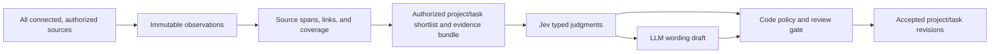

# Project and task reconciliation plan

**Status:** Partly implemented, with later user instructions superseding parts of the original plan. On September 21, a verified backup preceded a reset of 31 Tasks and 81 Task proposals; three Projects and source evidence remained. A second verified backup preceded the automatic work rollout. The user approved hosted Jev/OpenAI processing for connected Notion evidence, one Slack channel, the selected private GitHub repository, and submitted agent reports. The v6 worker uses Jev to classify work, then an LLM to interpret source-backed Task and Project context; qualifying changes are accepted through the audited revision writer without a Task review queue. The populated app showed five accepted Tasks, all with canonical Project IDs, and four Projects at the last check. Old Notion rows remain evidence rather than direct imports. Automatic owner, completion, and general status correction remain disabled; GitHub check-run coverage and held-out semantic accuracy remain unverified.
**Baseline checked:** 2026-09-20 against the checkout and populated app at `127.0.0.1:4141`. The findings below describe that baseline, before implementation.
**Implementation checked:** 2026-09-21 against local tests, the populated 4141 API, and an authenticated browser session showing four Project cards and five accepted Tasks with Project labels. The earlier Company-source Jev status shadow flow failed its stage-quality stop rule, so the separate status scanner is still disabled. The GitHub App is connected and backfilled but lacks Checks read permission.

## The product change

Work will have exactly two employee-facing views: **Projects** and **Tasks**. A project is a durable outcome the team is pursuing. A task is a concrete, executable contribution to that outcome. The project page groups its tasks, decisions, code activity, blockers, and history. Branches and pull requests are linked activity, not substitute tasks. Workstreams can remain in stored history for compatibility, but the UI will not create or expose placeholder “General” workstreams. After project/task links migrate, we can retire the unused workstream entity separately if it has no real cases to represent. The root `PRODUCT.md` navigation contract will be updated to match this approved presentation without deleting historical records.

The GitHub installation is authoritative for what happened in selected repositories: branches, commits, pull requests, reviews, checks, and deployments if granted. Panini's accepted revision ledger remains authoritative for the company's current project and task state. A merge or green check is delivery evidence; neither alone proves the task's stated outcome was met. **Every connected, authorized source** can contribute evidence: full source text and titles, messages, GitHub activity, structured agent reports, and later connectors. GitHub does not outrank the other sources for project intent, ownership, or completion. Each observation retains its source, visibility, and time.

## Why the present data is weak

- `src/connectors/notion/normalize.ts` turns configured `task_board` rows into task fields. `src/domain/team-ledger.ts:ingest` creates a proposal and can immediately accept it under `autoApproveNewTasks`. `src/store/postgres.ts:projectAcceptedTask` then creates a Project from the task's free-text `project` field and a “General” workstream. The three current project cards therefore have no authored outcome or owner.
- `src/connectors/github/webhook.ts` verifies signatures and records only selected pull request, check-run, deployment-status, and installation events. It has a configured repository allowlist, no GitHub App/OAuth connection flow, no repository discovery, no historical backfill, and no durable branch/PR/check view for a task. The live Integrations screen lists Notion and Slack, not GitHub.
- `src/intelligence/openai-responses.ts` currently asks a generative LLM to decide whether to create/change a task or context entry and to write its fields. `src/adjudication/engine.ts` can also call a generative model to approve or reject proposals. `src/retrieval/jev-ranker.ts` uses Jev only to rank already accepted context entries. Those are the decision responsibilities the new plan changes.
- The live Tasks screen includes many planned items without an owner or project. That is a useful coverage warning, not a reason to guess an owner or silently mark work complete.
- `src/mcp/server.ts` currently exposes `panini://context` as a compiled brief, plus `context_read`, `source_read`, and proposal/report tools. There is no `panini://<user_id>/<agent_id>/<filename>` workspace or URI-based evidence reader yet. The design below extends that surface; it is not running now.

## 1. Connect selected GitHub repositories

Use a **GitHub App installation** for durable organization/repository access. The admin-facing “Connect GitHub” flow uses GitHub App user authorization (OAuth web flow with state and PKCE) to identify the person connecting it, then lets them choose the organization and repositories in GitHub's installation UI. This gives the requested OAuth experience with an installation token for background reads. A broad OAuth App token tied to one employee would be a poor long-lived connector. GitHub documents the App's fine-grained permissions, selected-repository installation, and short-lived installation tokens. [App versus OAuth App](https://docs.github.com/en/apps/oauth-apps/building-oauth-apps/differences-between-github-apps-and-oauth-apps), [user authorization](https://docs.github.com/en/apps/creating-github-apps/authenticating-with-a-github-app/generating-a-user-access-token-for-a-github-app), [installation authentication](https://docs.github.com/en/apps/creating-github-apps/authenticating-with-a-github-app/authenticating-as-a-github-app-installation).

1. Register a Panini GitHub App and configure its OAuth callback, setup URL, webhook URL, private key, and webhook secret. Use a **separate OAuth step before installation**: GitHub does not allow a setup URL when “Request user authorization (OAuth) during installation” is enabled. Request read-only Metadata (implicit), Contents, Pull requests, Checks, Commit statuses, and Issues only if issues are selected as a source; add Deployments read only if deployment evidence is in scope. No repository write permission. A stable HTTPS callback/webhook endpoint is needed for live GitHub delivery; the local `127.0.0.1:4141` address alone is insufficient. [Registration](https://docs.github.com/en/apps/creating-github-apps/registering-a-github-app/registering-a-github-app), [setup URL restriction](https://docs.github.com/en/apps/maintaining-github-apps/modifying-a-github-app-registration), [permissions](https://docs.github.com/en/apps/creating-github-apps/registering-a-github-app/choosing-permissions-for-a-github-app).
2. Bind OAuth to the initiating Panini admin session and CSRF state. Attempt to list the user's organizations with `GET /user/memberships/orgs?state=active`, then let an organization owner or authorized repository admin choose an account and selected repositories in GitHub's installation UI. If the App user token cannot enumerate a pre-installation organization, fall back to GitHub's own account chooser and verify the chosen account after installation. Do not use `GET /user/orgs` for this fine-grained token; GitHub says it can return an empty list. Do not trust a setup URL's `installation_id` alone; verify it against the authorized user's `GET /user/installations`, then fetch its current account and repository list. Store installation ID, GitHub account ID, selected repository IDs, granted permissions, and the local workspace link. Keep the private key and tokens outside ordinary UI/API reads. [Organization memberships](https://docs.github.com/en/rest/orgs/members#list-organization-memberships-for-the-authenticated-user), [organization-list caveat](https://docs.github.com/en/rest/orgs/orgs#list-organizations-for-the-authenticated-user), [setup URL warning](https://docs.github.com/en/apps/creating-github-apps/registering-a-github-app/about-the-setup-url), [installations REST](https://docs.github.com/en/rest/apps/installations).
3. Use installation access tokens for background sync. Persist one coverage/checkpoint record per repository and resource type. Backfill selected repositories in bounded pages: default branch and branches, recent commits, open and closed PRs plus reviews, associated checks/statuses, and issues if chosen. Capture source URLs, stable GitHub IDs, event times, fetched times, and repo visibility. Avoid importing whole private repositories or arbitrary file content for this first slice. Follow REST pagination and rate-limit headers. [Pagination](https://docs.github.com/en/rest/using-the-rest-api/using-pagination-in-the-rest-api), [rate limits](https://docs.github.com/en/rest/using-the-rest-api/rate-limits-for-the-rest-api).
4. Subscribe to push/create/delete, pull request/review, check/status, and optional issue/deployment events. Verify signatures, deduplicate delivery IDs, queue work durably, and return quickly. Periodically reconcile from REST because GitHub does not automatically redeliver failed webhook deliveries and some large pushes are omitted or truncated. Handle installation suspension, removal, and selected-repo changes by stopping ingestion and revoking access to derived content. [Webhook events](https://docs.github.com/en/webhooks/webhook-events-and-payloads), [failed deliveries](https://docs.github.com/en/webhooks/using-webhooks/handling-failed-webhook-deliveries), [webhook practices](https://docs.github.com/en/webhooks/using-webhooks/best-practices-for-using-webhooks).
5. Link GitHub user IDs to Panini people only when an identity is verified. A commit author or PR opener is an observed contributor, not automatically the task owner. Show repository, branch, PR, check, and last observed activity on linked task/project pages with a freshness and coverage note.

**Connection acceptance:** an admin can authorize, see the available organization and selected repositories, narrow the selection, import one pilot repository, see a PR and its check history, and remove access. Re-running backfill or receiving a duplicate webhook must not duplicate evidence or tasks. A removed repository must disappear from employee retrieval while its audit trail remains intelligible.

## 2. Make Projects and Tasks evidence-backed

### Durable model

- Give Projects a stable ID, aliases, purpose/outcome, owner when explicitly known, lifecycle, source coverage, and revisions with previous/current state, decision, and cited evidence. Add a project proposal/revision path through the existing sole revision writer. A repository may support several projects, and a project may span several repositories; use an explicit many-to-many relation rather than equating repo and project.
- Move Tasks toward a canonical `projectId` while retaining the old text field during migration. Keep task versions and history. Link accepted tasks to GitHub branches, PRs, checks, issues, and source observations through stable provider IDs. Store the intent and “done when” checks separately from observed activity. Show “unassigned” and “project uncertain” when those facts are unknown.
- Stop automatically making a Project and “General” workstream from a task's Notion Project cell. Treat the cell as one clue to an existing project or a new-project proposal. Do not delete current project/task rows; reconcile them into new stable identities, preserve aliases and old revisions, and flag uncertain merges for review.
- Replace the blanket `autoApproveNewTasks` rule for connector imports with source-aware proposal policy. A Notion row remains visible as source evidence, but cannot become accepted work solely because it appeared in the configured database. Direct human-created tasks can retain a separate explicit-authority path.
- Preserve source visibility and revoked-content rules across links, search indexes, and context packs. A GitHub private repo may be visible to fewer employees than a public project summary.

### Decision flow across all evidence

1. Normalize available source text and titles, messages, issue/PR bodies, branch names, checks, and structured agent reports into cited spans. Keep the raw observation and source coverage in Panini. Use timestamps and explicit identifiers in code, not model guesses. A page title, message, or private agent note is evidence only when its source and authority are known; none automatically creates a project/task.
2. Join observations about the same possible work across **all authorized sources**, retaining supporting and contradicting spans, source independence, freshness, and known coverage gaps. Shortlist existing projects and tasks with deterministic aliases and search (including the existing embedding → Jev retrieval where helpful). Search discovers candidates; it does not establish a match. Include `new`, `unrelated`, and `uncertain`. Never ask Jev to invent an ID or choose from the entire company corpus.
3. Ask Jev narrow, typed classification questions over a bounded **evidence bundle**: is there a concrete outstanding action, which shortlisted Task or Project might it concern, and what stage is stated? Treat its probabilities as screening signals, not prose or proof. [Jev primitives](https://docs.typesafe.ai/primitives).
4. After a positive Jev classification, ask Jev a separate bounded Project question over the visible Project outcomes. It chooses an existing Project, a distinct new outcome, or no assignment. The LLM may only draft an extractive Task title, a possible description, or the name and outcome wording for a Jev-approved new Project. It cannot choose IDs, infer an owner or completion, or accept a change.
5. Route every accepted change through a cited proposal and the revision writer. The code checks active access, stable IDs, fresh versions, scope, duplicates, recency, and source support before automatic acceptance. Unsupported or uncertain claims are skipped. A high model score alone is not proof. [Jev confidence](https://docs.typesafe.ai/confidence), [Jev limitations](https://docs.typesafe.ai/model-jaggedness/jev-1.13).

Send only the smallest authorized, secret-screened excerpts needed for a Jev judgment. Jev is a hosted service in the current integration, so the pilot must verify the organization's allowed data scope before it sends private repository text. The current retrieval pilot does not establish that project/task thresholds are calibrated. [TypeSafe data handling](https://docs.typesafe.ai/models), [Jev limitations](https://docs.typesafe.ai/model-jaggedness/jev-1.13).

Keep these responsibilities behind small interfaces: each source adapter emits normalized observations; a reconciliation module accepts a cross-source evidence bundle plus an authorized shortlist and returns proposed relations/actions with evidence; a Jev adapter answers its bounded questions; a text-drafting adapter returns prose only; the existing revision writer accepts a policy-approved proposal. This keeps the same reconciliation flow for Notion, Slack, GitHub, and later sources rather than creating a GitHub-only task pipeline.

### Panini memory and each agent's workspace

Use `panini://` as the stable address space agents see through MCP, backed by Panini's existing evidence and accepted-state records. A URI is an authorized view of a record, not a second copy of source data or a local filesystem path.

| Address | Meaning | Read/write rule |
| --- | --- | --- |
| `panini://context` | Existing scoped, compiled company brief. | Read by agents with the current context/work grants. |
| `panini://context/entries/<entry_id>` | Accepted, versioned company context and its citation chain. | Authorized read; changes enter through a cited proposal and the revision writer. |
| `panini://context/work/<work_id>` | Accepted Project or Task state with activity and revision history. | Authorized read; changes enter through a cited proposal and the revision writer. |
| `panini://context/evidence/<source_event_id>` | Stored source observation or pinned source span, clearly labeled as untrusted evidence. | Authorized read with source visibility checks; agents append new evidence through reporting/ingestion, never overwrite a source record. |
| `panini://<user_id>/<agent_id>/<filename>` | Persistent private files for one Workspace Member's Agent Profile. Nested file paths may be allowed. | That authenticated profile may read/write its own files with a workspace capability; its member may inspect/manage them. Other profiles cannot access them in the first release. |

Here `<user_id>` is the stable Workspace Member ID and `<agent_id>` the stable Agent Profile ID, not display names. Reserve `context` as a system authority so it cannot collide with a user ID. Resolve each URI from the authenticated principal; reject cross-user/profile paths, `..`, encoded traversal, and unsupported names. Do not accept a user-supplied ID as proof of access. Recheck permissions and source revocation on every read and before returning search results.

The private workspace is **agent working memory**, not accepted Company Memory: useful notes and drafts can persist between sessions without becoming company facts. Add narrow `workspace:read` and `workspace:write` grants. Store versioned file content in the same Panini deployment, with size/type limits, compare-and-swap writes, an audit trail, and deletion/export controls. Do not ingest whole transcripts, secrets, or raw tool dumps by default. Private files are excluded from shared retrieval and Jev decisions. An agent may explicitly submit a selected file or excerpt as an evidence report or context/work proposal; that submission gets a new receipt and source citation, is checked for authorization, and cannot count as independent corroboration of the source it summarizes. Accepted company memory still changes only through the policy-gated revision writer. This extends the current `PRODUCT.md` rule that working memory is local/session-scoped **by default**; it does not change the default for agents that do not use a Panini workspace.

“Any agent” means any **authorized** member-owned agent can discover and use the same relevant company memory and evidence, according to its capabilities, project/repository scope, and source visibility. An agent with write grants can contribute evidence or proposals to that shared memory; direct file edits are limited to its own workspace by default. The context pack should return resolvable `panini://` URIs with version, citation, trust label, and freshness so another authorized agent can inspect the same material rather than relying on a pasted summary.

**Memory acceptance:** two profiles owned by one member get separate persistent files; restart preserves them; an unauthorized profile cannot list, read, or write the other's path; a revoked profile loses access; a source revocation removes its content from URI reads and compiled packs; an agent report/proposal appears as pending until accepted; every accepted item links back to the source observations that support it.

### Task status and completion

GitHub signals should update an **activity strip** promptly: branch and latest commit, PR open/review/merged, failing/passing checks, and deployment when available. Messages, documents, and agent reports can also show work activity, intent, or explicit verification. The accepted task status changes only when the combined evidence actually supports it. An open PR may justify `in progress` or `review`; a failed required check may justify `blocked` or “verification failed”; a merged PR may justify `review` or a delivery candidate. `done` requires the task's stated acceptance condition and the relevant verification evidence for that task, whether code, document, operational, or human acceptance. A revert, force-push, reopened issue, new failure, or credible contradictory source is a new observation that may reopen work through a revision. Stale source coverage must be visible.

## Migration and rollout order after approval

| Stage | Deliverable | Gate before moving on |
| --- | --- | --- |
| A. Work UI | Two tabs, Projects and Tasks; project details group related work; Workstreams removed from normal navigation, history retained. | Browser check on existing 4141 data; no lost records or broken task links. |
| B. GitHub pilot | GitHub App flow, verified installation, repository picker, one selected repo, historical backfill, webhooks, health/coverage, disconnect. | Compare GitHub API counts with stored PR/branch/check records; duplicate/revocation tests; no unexpected repository access. |
| C. Memory URIs | Scoped `panini://` context/evidence reads and per-member, per-agent persistent file workspace. | Isolation, restart persistence, version-conflict, citation, and revocation checks in the connected 4141 deployment. |
| D. Shadow decisions | Cross-source evidence bundles, candidate builder, Jev question sets, LLM text drafting, project/task proposals and revisions. Run read-only against frozen examples from every connected source. | Preregister evaluation before paid runs: entity matching, new-project/task precision, owner precision, completion false positives, abstention, latency and cost. Inspect failures and set thresholds from held-out data. |
| E. Reconcile live work | Review current Notion-derived projects/tasks against all authorized sources; attach GitHub activity; accept/merge/supersede proposals without deleting history. | Human review of ambiguous project merges and all `done` candidates initially; no mass auto-close. |
| F. Controlled automation | Enable only the decision classes that pass the held-out gates; retain a manual rollback switch and complete audit trail. | No unsupported completion or unauthorized link in held-out cases; live sample review after each expansion. |

The initial evaluation should include at least: one page about several projects; one project spanning several repositories; a branch with no task; a PR with no explicit owner; merged PR with failing CI; passing CI without required deployment; duplicate references across different sources; a private agent note that was never submitted; a submitted agent report that merely repeats a Notion row; a renamed project; revoked source access; and contradictory status claims. Jev's schema validity is not a measure of semantic accuracy. Its current Panini use is retrieval reranking, and that pilot has not established entity-resolution or task-decision quality.

## Approved direction

The implemented scope is: **GitHub App installation with OAuth user authorization and selected repositories; Projects and Tasks as the Work tabs; cross-source evidence under permission-aware `panini://` URIs; a private `panini://<user_id>/<agent_id>/<filename>` workspace for each agent; Jev work and Project decisions followed by cited LLM wording; the proposal/revision writer for accepted state.** Existing Notion and Slack records remain evidence. The user-authorized Task reset above is the exception to the original history-preservation plan.

GitHub selected-repository branch/PR/commit access is live; check-run coverage remains incomplete. The scoped Task/Project scanner runs under a 40-observation rolling-day cap per policy version. The v7 replay completed 40 judgments, accepted two new Tasks, and skipped 38. At the last live check the board had seven Tasks and four Projects, every Task had a canonical Project ID, and no Task suggestion was pending. Completion and owner assignment are not automated. Held-out entity and Project accuracy remain unverified.
