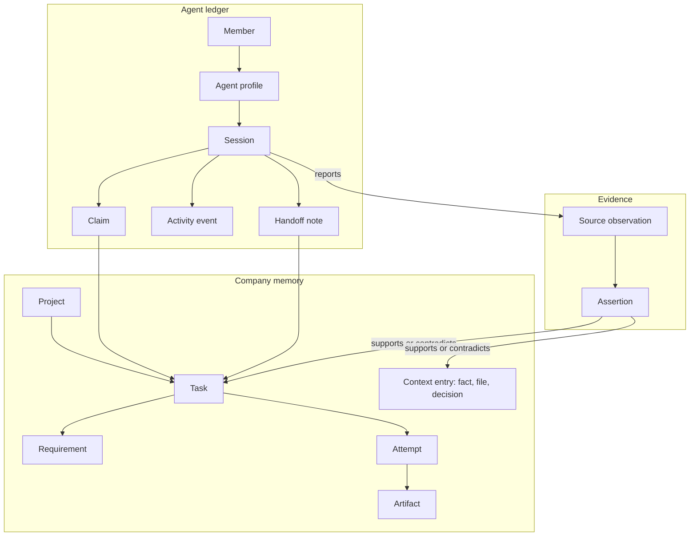
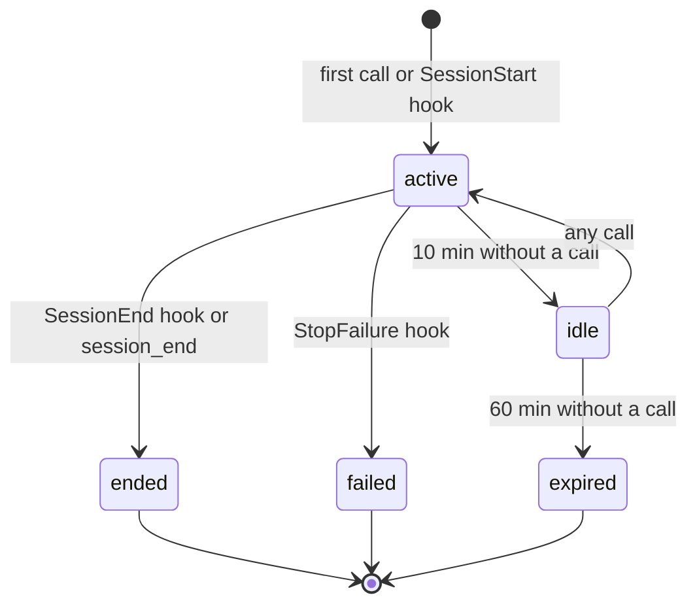
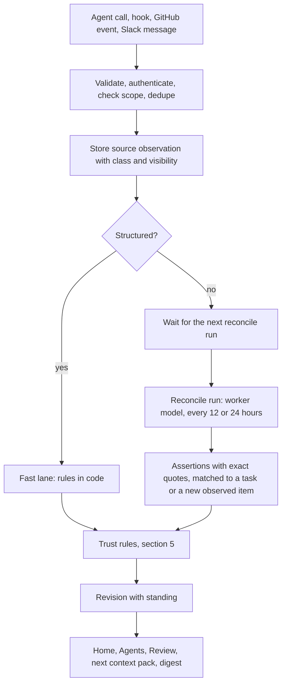

# Panini product spec v2 (proposal)

**Status:** written 2026-11-14; built on branch `spec-v2` the same day (see section 17). `PRODUCT.md` stays the canonical contract until this is approved.

**Tags used below:** `[exists]` is in the code today. `[change]` exists but must change. `[new]` must be built.

## 1. The product in one page

**One line:** the open work ledger for agent teams: what is true, who is doing what, and the proof.

**Who it is for:** a team of 5 to 50 people where most people run a coding agent (Claude Code, Codex, Hermes, Pi), work is spread over Slack and GitHub, and the team wants to host its own memory.

**What it holds:**

| Part           | Question it answers                                                           |
| -------------- | ----------------------------------------------------------------------------- |
| Company memory | What is the company doing, what does it know, what did it decide?             |
| Evidence       | What was actually said or done, where, and when?                              |
| Agent ledger   | Whose agent is working on what, what did it read, what did it report?         |
| Private files  | What does my agent, or what do I, want to remember that is not company truth? |

**Five rules the product never breaks:**

1. A model never writes accepted truth by itself.
2. Every item shows its standing (observed, accepted, and so on) and its proof.
3. Every agent belongs to a person. Its access is never wider than that person's.
4. Every read and write by an agent is logged by id, not by content.
5. Nothing leaves the installation until an owner turns it on.

## 2. The model at a glance



Evidence feeds memory. Agents read memory and add evidence. Nothing skips the evidence step.

## 3. Company memory ontology

### 3.1 Objects

| Object       | Meaning                                                             | Key fields                                                                     | Tag                              |
| ------------ | ------------------------------------------------------------------- | ------------------------------------------------------------------------------ | -------------------------------- |
| Organization | One company, one installation                                       | name, settings                                                                 | `[exists]`                       |
| Member       | A person                                                            | name, role, status                                                             | `[exists]`                       |
| Identity     | A member's account in Slack, GitHub, Notion                         | provider, provider id, member                                                  | `[exists]`                       |
| Project      | A lasting company outcome                                           | name, outcome, owner, status, context folder                                   | `[exists]`                       |
| Task         | One concrete piece of intended work                                 | title, description, project, owner, status, result, priority, due, version     | `[exists]`                       |
| Requirement  | One step the task asked for, with the exact quote that asked for it | id, text, quote, source                                                        | `[exists]` as work scope         |
| Attempt      | One try at the task                                                 | who or which session, environment, result, time                                | `[exists]` as execution evidence |
| Artifact     | Something produced                                                  | kind, reference (PR, commit, file, URL), revision                              | `[exists]`                       |
| Work link    | Task-to-task relation                                               | depends on, blocks, duplicates                                                 | `[exists]`                       |
| Fact         | One standalone claim with a typed value                             | path, value, effective interval                                                | `[exists]`                       |
| File         | A long document at a path                                           | path, body, document state                                                     | `[exists]`                       |
| Decision     | What was decided, by whom, and why                                  | statement, reason, options rejected, decided by, decided at, scope, supersedes | `[new]` as a third context kind  |
| Revision     | One accepted change to any object above                             | before, after, actor, evidence, times                                          | `[exists]`                       |

Drop the Workstream object from the UI and the agent interface. Keep old rows readable. `[change]`

### 3.2 Task status and result

Status and result stay separate. `[exists]`

| Status      | Meaning                                     |
| ----------- | ------------------------------------------- |
| backlog     | Known, not planned                          |
| planned     | Agreed, not started                         |
| in_progress | Someone or some agent is working on it      |
| blocked     | Cannot move; the blocker is named           |
| review      | Someone claims it is done; not yet verified |
| done        | Verified against its requirements           |
| cancelled   | Dropped, with a reason                      |

| Result         | Meaning                       |
| -------------- | ----------------------------- |
| unknown        | No outcome reported           |
| succeeded      | The intended outcome happened |
| failed         | It was tried and did not work |
| mixed          | Part worked                   |
| not_applicable | No outcome to judge           |

A finished experiment can be `done` with result `failed`. A task whose agent says "done" is `review`, not `done`.

### 3.3 Standing: how much to believe an item

Every task, fact, file and decision carries one standing. This is the main change in v2. `[change]`

| Standing   | Meaning                                                        | Shown as          |
| ---------- | -------------------------------------------------------------- | ----------------- |
| observed   | Seen in a source or reported by an agent. Not confirmed.       | Grey outline chip |
| proposed   | A change waiting for a rule or a person                        | Amber chip        |
| accepted   | Confirmed by the rules in section 5                            | Solid chip        |
| superseded | Replaced by a later accepted revision                          | Struck through    |
| rejected   | Looked at and refused                                          | Hidden by default |
| stale      | Accepted, but its source changed or it is past its review date | Clock icon        |
| revoked    | Its source was removed; content hidden                         | Lock icon         |

Observed items are useful. They appear on the board and in agent context, clearly marked. Agents are told to treat them as hints, not instructions.

### 3.4 Time

Keep the five times: occurred, fetched, received, accepted, effective interval. `[exists]` Every screen shows occurred time by default, never model-run time.

## 4. Evidence ontology

### 4.1 Objects

| Object             | Meaning                                                                                                                                                          | Tag        |
| ------------------ | ---------------------------------------------------------------------------------------------------------------------------------------------------------------- | ---------- |
| Source observation | An immutable receipt of one thing seen: a Slack message, a PR event, an agent report. Has provider, kind, source link, content hash, visibility, the five times. | `[exists]` |
| Source content     | The encrypted payload. Can be revoked without deleting the receipt.                                                                                              | `[exists]` |
| Assertion          | One claim taken from one observation, with the exact quote and a pointer to where it sits in the payload.                                                        | `[exists]` |
| Assessment         | A judgement of whether assertions support a change, with a per-requirement verdict.                                                                              | `[exists]` |
| Episode            | Observations that belong together: a thread, a PR and its checks.                                                                                                | `[exists]` |

### 4.2 Assertion kinds

`request`, `progress_report`, `completion_report`, `artifact_observation`, `correction`, `cancellation`. `[exists]` Add `decision` and `handoff`. `[new]`

### 4.3 Source classes

The class decides what a source may confirm. This table is deterministic code, not a prompt. `[new]`

| Class                 | Sources                                              | What it is good for                               | What it can never do alone                            |
| --------------------- | ---------------------------------------------------- | ------------------------------------------------- | ----------------------------------------------------- |
| A: person in the app  | A signed-in member clicking or typing in Panini      | Authority: accept, reject, decide, change scope   | Nothing is barred, within their role                  |
| B: system record      | GitHub PR merged, check passed, deployment succeeded | Facts about artifacts                             | Say a task's intent or scope                          |
| C: enrolled agent     | A session of a known agent profile                   | "I started", "I tried X", "I produced Y", handoff | Mark its own work done; make a decision; change scope |
| D: chat and documents | Slack messages, Notion pages                         | Requests, discussion, hints of state              | Accept anything                                       |

Identity and authority stay separate. A Slack message from the CEO is still class D text until the CEO, or a rule the CEO set, confirms it.

### 4.4 Visibility

Every observation has a visibility string (company, a channel, a repo, a member). `[exists]` A derived item is visible to an agent only if every source behind its current fields is visible to that agent. `[exists]`

Agent reports must inherit the visibility of the task's project, not `company`. `[change]`, fixes a bug.

## 5. Trust rules

### 5.1 Changes apply at once; people undo `[change]`

With thousands of agents, no person can approve each change. So nothing waits for a person:

| Change                                                                 | What happens                                                                     |
| ---------------------------------------------------------------------- | -------------------------------------------------------------------------------- |
| Agent creates or changes a task                                        | Applies at once                                                                  |
| Agent records a decision                                               | Applies at once as a context file under `/decisions`                             |
| Agent or member adds or corrects context                               | Applies at once                                                                  |
| Nightly run reads chat, GitHub, docs                                   | Creates and updates tasks and context directly, including done, cancel and owner |
| A change fails a hard check (stale version, missing source, no access) | Not applied; shown under "Could not apply" with the reason                       |

Every applied change is recorded with who made it, when, why, and its sources. People control it after the fact:

- **Undo one change** from the Changes screen. Undo restores the fields that change touched, unless someone changed them again since. Undoing a new task cancels it; undoing new context marks it superseded.
- **Undo a whole agent session** from Agents. It undoes everything the session applied, dismisses its notes and releases its claims.
- **Revoke an agent** to stop all future writes.

Access rules still apply at read and write time. An agent can only change what its profile may reach.

### 5.2 What the worker model may do `[change]`

The model applies changes directly through the same code paths as agents. Its writes are tagged `observation-agent` and are undoable like any other change.

### 5.3 Defence against bad input

| Risk                                            | Rule                                                                                                                                                |
| ----------------------------------------------- | --------------------------------------------------------------------------------------------------------------------------------------------------- |
| Prompt injection in Slack or a document         | Source text is wrapped and labelled as data in every prompt and agent response. Every write it causes is undoable.                                  |
| Memory poisoning by an agent                    | Agent writes are class C: logged with profile, session and time; one click undoes everything a session wrote.                                       |
| Leak across permissions                         | Access is checked at read time for every item, including search results and summaries.                                                              |
| Stolen agent secret                             | Short-lived tokens, per-device keys, revoke profile also revokes its devices. `[change]`, fixes a bug.                                              |
| Old message overwriting new state               | The agent sees the source time and may decide; any write is undoable.                                                                               |
| Private data plus untrusted text plus a way out | Stated in the docs: Panini supplies the first two; the agent's harness supplies the third. Recommend read-only profiles for agents with web access. |

### 5.4 Human load

No review queue. People spend time only on what they choose to undo. The Changes screen and the daily digest show what changed.

## 6. Agent ledger

### 6.1 Objects

| Object         | Meaning                                                | Key fields                                                                                                         | Tag                     |
| -------------- | ------------------------------------------------------ | ------------------------------------------------------------------------------------------------------------------ | ----------------------- |
| Agent profile  | A member-owned identity for one agent setup            | owner, name, purpose, harness, grants, scope, status, secret hint                                                  | `[exists]`              |
| Device         | One machine enrolled for a profile                     | name, public key, privacy mode, status                                                                             | `[exists]`              |
| Session        | One run of an agent                                    | profile, device, harness, version, repository, branch, objective, state, started, last seen, ended, counters, cost | `[new]`                 |
| Claim          | "This session is working on this task until this time" | session, task, state, expires at                                                                                   | `[new]`                 |
| Activity event | One tool call by a session                             | time, tool, action class, target ids, result count, denied reason, duration                                        | `[new]`                 |
| Work report    | A structured checkpoint from an agent                  | session, task, phase, statement, artifacts                                                                         | `[exists]`, add session |
| Handoff note   | What the next person or agent needs                    | task, done, not done, open questions, next step, artifacts                                                         | `[new]`                 |

### 6.2 Session lifecycle



- A session starts on the first MCP call that carries a new session id, or on the harness SessionStart hook. No agent action is required.
- The objective is one short line. In `metadata` privacy mode it is left empty.
- When a session ends, fails or expires, its claims are released.

### 6.3 Claims

- Advisory, not a lock. A second session asking for the same task gets the holder's name, owner, start time and last handoff note, and may join.
- Default length two hours, renewed by any call from the session about that task.
- States: `active`, `released`, `expired`, `taken_over`.
- A claim moves the task to `in_progress` and accepts an observed task (rule 5.1).
- The owner of a task can clear any claim on it.

### 6.4 Activity log

- One row per tool call, written in one wrapper around tool registration.
- Action classes: `read`, `search`, `write`, `propose`, `report`, `claim`, `denied`.
- Stores ids and counts. Never stores prompt text, returned content or file bodies.
- Kept 180 days by default; the owner can change this.
- A member sees their own agents. An admin sees all agents. Nobody sees private file content through the log.

### 6.5 Handoff notes

- Written by `handoff_write`, or prompted by the SessionEnd hook.
- Fixed shape: done, not done, open questions, next step, artifacts. Max 4,000 characters.
- Stored as class C evidence on the task.
- The next session that claims the task gets the latest handoff note at the top of its context.

### 6.6 Cost

- If the harness sends OpenTelemetry (Claude Code and Codex can), Panini accepts it at `/otlp` and joins it to the session by session id. `[new]`
- If not, cost shows as "not reported". Never guessed.

## 7. How an agent connects

### 7.1 The flow `[new]`

```sh
npx panini connect
```

1. Detects the harness and the git repository.
2. Opens the browser. The member signs in and approves a profile with a suggested name, grants and scope.
3. Stores a device key in the OS keychain.
4. Writes the MCP entry for that harness and installs the hooks.
5. Maps the repository to a project.
6. Runs `identity_get` and prints what the agent can see.

Target: under two minutes, no secret copied by hand. The manual recipe stays for other MCP clients. `[exists]`

### 7.2 Authentication

- **Now:** a per-profile bearer secret, stored hashed. `[exists]`
- **Next:** MCP OAuth 2.1 with resource indicators and audience checks, so tokens are short-lived and bound to this server. `[new]`
- **Later:** company sign-in decides which agents may connect (MCP enterprise-managed authorization). Do not invent an identity scheme.

### 7.3 Grants `[exists]`

`work:read`, `work:propose`, `context:read`, `context:propose`, `source:read`, `evidence:report`, `workspace:read`, `workspace:write`.

Defaults for a new coding agent: all except `source:read`.

Effective access = member's rights ∩ profile grants ∩ profile scope ∩ repository mapping ∩ source visibility. The member intersection is missing today. `[change]`

### 7.4 Tools

| Tool                                                                                    | Purpose                                                                                                                       | Tag        |
| --------------------------------------------------------------------------------------- | ----------------------------------------------------------------------------------------------------------------------------- | ---------- |
| `identity_get`                                                                          | Who am I, what can I do                                                                                                       | `[exists]` |
| `context_get`                                                                           | The pack for this objective: handoff note, claimed task, blockers, decisions, relevant facts and files, observed items marked | `[change]` |
| `context_read`, `source_read`, `history_get`                                            | Open one item, one source section, one history                                                                                | `[exists]` |
| `work_search`                                                                           | Find the exact task. Add a limit and ranking.                                                                                 | `[change]` |
| `task_claim`, `task_release`                                                            | Start and stop working on a task                                                                                              | `[new]`    |
| `work_report`                                                                           | Checkpoint with artifacts                                                                                                     | `[exists]` |
| `handoff_write`                                                                         | Leave a handoff note                                                                                                          | `[new]`    |
| `note_drop`                                                                             | Drop anything worth keeping; Panini sorts it                                                                                  | `[new]`    |
| `decision_propose`                                                                      | Record a decision; applies at once, undoable                                                                                  | `[new]`    |
| `task_create_proposal`, `proposal_create`, `context_proposal_create`, `proposal_status` | Explicit proposals                                                                                                            | `[exists]` |
| `agent_file_*`, `user_file_*`                                                           | Private files                                                                                                                 | `[exists]` |

Merge `memory_read` and `context_search` into the tools above. Keep the surface near 20 tools.

### 7.5 Hooks

| Harness event | Panini action                                         |
| ------------- | ----------------------------------------------------- |
| SessionStart  | Open session; inject a short context pack             |
| TaskCompleted | `work_report` with phase                              |
| SessionEnd    | Ask for a handoff note; close session; release claims |
| StopFailure   | Mark session failed                                   |

Hooks must never block the agent if Panini is down. `[exists]`

## 8. Storage

### 8.1 Engine

- PostgreSQL only. One store. Remove the in-memory store. `[change]`
- Quick start uses an embedded Postgres, so no Docker is needed for a first try. `[new]`
- Search: Postgres full text first; embeddings optional. `[exists]`

### 8.2 Tables

| Group         | Tables                                                                                         | Tag        |
| ------------- | ---------------------------------------------------------------------------------------------- | ---------- |
| Identity      | organizations, members, member_identities, accounts, sessions                                  | `[exists]` |
| Evidence      | source_events, source_event_contents, work_assertions, work_state_assessments                  | `[exists]` |
| Memory        | projects, tasks, work_scopes, work_entities, work_links, context_entries, plus revision tables | `[exists]` |
| Standing      | a `standing` column on tasks and context_entries                                               | `[new]`    |
| Decisions     | `kind = decision` in context_entries, with decided_by and supersedes                           | `[new]`    |
| Agents        | agent_profiles, agent_devices, repository_mappings                                             | `[exists]` |
| Agent ledger  | agent_sessions, task_claims, agent_activity_events, handoff_notes                              | `[new]`    |
| Private files | agent_workspace_file_revisions                                                                 | `[exists]` |
| Operations    | audit_events, outbox_jobs, inference_budgets, model_calls                                      | `[exists]` |
| Retire        | tables used only by the three old pipelines, after an export tool exists                       | `[change]` |

### 8.3 Encryption and keys

- Source payloads and private files are encrypted with AES-256-GCM. `[exists]`
- Add key versions so the key can be rotated. `[new]`
- Task and context bodies are plain text today. Offer encryption for them as an option; it costs search speed. Open question.

### 8.4 Slack terms

Slack's 2025 terms restrict bulk copies by commercial apps. Panini runs as the customer's own internal Slack app, which keeps the higher limits. Whether the "no persistent copies" clause binds an internal app is not verified. To be safe: default to reaction capture, store derived items with links, and let owners set a retention period for raw Slack payloads.

## 9. Private files

| Scope      | Address                            | Who can read                                                    | Purpose                                                  | Tag        |
| ---------- | ---------------------------------- | --------------------------------------------------------------- | -------------------------------------------------------- | ---------- |
| Agent      | `panini://<member>/<agent>/<path>` | That profile, its owner                                         | One agent's working notes                                | `[exists]` |
| User       | `panini://<member>/user/<path>`    | All of that member's profiles with workspace grants, the member | Personal preferences and context shared across my agents | `[exists]` |
| Team notes | `note_drop`, not a file            | Anyone who can see the project                                  | The shared dump space                                    | `[new]`    |

Rules:

- Private files are working memory. They are never company truth and never an instruction that overrides the user or company policy. `[exists]`
- The worker never reads private files. `[new]`, state it and test it.
- Admins see name, size and time. They do not see content in the UI. `[new]`
- Limits: 100 KB per file `[exists]`; add 500 files and 20 MB per scope. `[new]`
- Versioned; a stale write fails rather than overwriting. `[exists]`
- **Promote:** one action turns a private file into a context proposal. The file stays private; the proposal goes through section 5. `[new]`
- When a profile is revoked, its agent files are kept for 30 days for the owner, then deleted. User files stay. `[change]`

Team notes:

- Any agent with `evidence:report` can drop a note: text, optional task, optional links.
- A note is class C evidence with the project's visibility.
- The worker sorts notes into observed facts, observed tasks, or leaves them as notes.
- Notes are searchable and appear in context packs under "unconfirmed notes".

## 10. The web app

### 10.1 Navigation

| View     | Job                                                     | Tag                                    |
| -------- | ------------------------------------------------------- | -------------------------------------- |
| Home     | What changed, what needs me, who is working on what now | `[new]`, replaces the Projects default |
| Work     | Projects and their tasks                                | `[exists]`, merge Projects and Tasks   |
| Agents   | Every agent, live sessions, activity, access            | `[change]`                             |
| Context  | Facts, files, decisions, notes                          | `[exists]`, add decisions and notes    |
| Review   | Proposed and observed items waiting for me              | `[change]`, always visible             |
| History  | Time-ordered changes across everything                  | `[exists]`, merge Timeline and History |
| People   | Members, identities, their work and agents              | `[exists]`                             |
| Settings | Sources, models and budget, access, retention           | `[exists]`, merge Integrations         |

### 10.2 Home

```text
+---------------------------------------------------------------+
| Today                                              [Digest v] |
+----------------------+----------------------------------------+
| Needs you (3)        | Working now                            |
|  o Accept 2 tasks    |  * Asha's Codex   -> Fix login retry   |
|  o Confirm decision  |    12 min, 4 reads, 1 report           |
|  o Verify "done"     |  * Ravi's Claude  -> Billing export    |
|                      |    idle 8 min                          |
+----------------------+----------------------------------------+
| Changed since you last looked                                 |
|  done      Rate limiter shipped        PR #212 merged, checks |
|  review    Onboarding copy             agent says done        |
|  observed  "Move cron to worker"       from #eng, 2h ago      |
|  decision  Use Postgres for search     by Asha, yesterday     |
+---------------------------------------------------------------+
| Sources: Slack ok 2m ago | GitHub ok 1m ago | Budget 41% used |
+---------------------------------------------------------------+
```

### 10.3 Task detail

```text
+---------------------------------------------------------------+
| Fix login retry            [in_progress] [accepted]           |
| Project: Auth   Owner: Asha   Claimed by: Asha's Codex (1h40) |
+---------------------------------------------------------------+
| Requirements                         Evidence                 |
|  [x] Retry 3 times with backoff      PR #218 diff, check pass |
|  [ ] Log each failure                none yet                 |
|  [ ] Add a test                      agent report (claimed)   |
+---------------------------------------------------------------+
| Latest handoff (Ravi's Claude, yesterday)                     |
|  Done: backoff helper. Not done: logging. Next: wire logger.  |
+---------------------------------------------------------------+
| Attempts and artifacts | Sources | History | Sessions         |
+---------------------------------------------------------------+
| [Verify done]  [Clear claim]  [Edit]                          |
+---------------------------------------------------------------+
```

Each requirement shows its own proof and the class of that proof. "Claimed" and "verified" never look the same.

### 10.4 Agents

```text
+---------------------------------------------------------------+
| Agents                       [Live] [All] [By person]  [+ Add]|
+---------------------------------------------------------------+
| Asha's Codex         active   Fix login retry    $0.84 today  |
| Ravi's Claude        idle     Billing export     not reported |
| Mina's Hermes        ended 3h --                 $0.10 today  |
+---------------------------------------------------------------+
| Asha's Codex > session 14:02                                  |
|  14:02  claim    Fix login retry                              |
|  14:02  read     context pack (9 items)                       |
|  14:05  read     decision: retry policy                       |
|  14:09  denied   source: #finance (not in scope)              |
|  14:31  report   progress, PR #218                            |
|  [Access] [Rotate] [Revoke] [Roll back this session's writes] |
+---------------------------------------------------------------+
```

The agent page answers four questions: who owns it, what can it reach, what did it touch, what did it cost.

### 10.5 Changes `[change]`

- **Recent changes**, newest first: what changed, by whom, when, why. One **Undo** button each.
- **Could not apply**: changes that failed a hard check, with the reason.
- No raw JSON, no internal codes.

### 10.6 Context

- Tree by path, as today.
- Add a **Decisions** list: statement, who, when, what it replaced.
- Add **Notes**: the team dump, newest first, with "promote" and "dismiss".
- "This is wrong" on every fact: opens a correction with the fact prefilled. `[new]`

### 10.7 State language in the UI

One chip set everywhere, from section 3.3. Never show a model confidence number as authority. `[exists]`

### 10.8 Notifications `[new]`

- **Daily digest** to each member: what needs you, what your agents did, what changed in your projects. Email, or Slack if the owner grants the bot a write scope. Off by default.
- **In app:** a badge on Review and live updates on Home and Agents.
- **Optional Slack reply:** a small "tracked as task X" reply in thread. Off by default.

### 10.9 Front-end code

The UI is one 2,000-line script string today. Move it to typed components with a build step before adding these views, so outside contributors can work on it. `[change]`

## 11. First-run experience

| Step | What the user sees                                                       | Time  |
| ---- | ------------------------------------------------------------------------ | ----- |
| 1    | `npx panini` starts the app with an embedded database and a demo company | 1 min |
| 2    | Home shows demo tasks, a demo agent session and a review item            | 0     |
| 3    | `npx panini connect` in a repository                                     | 2 min |
| 4    | The agent's first `context_get` appears live on the Agents page          | 0     |
| 5    | Connect GitHub (one OAuth click)                                         | 1 min |
| 6    | Optional: Slack, a model key and a budget, each one screen in Settings   | later |

Value before any API key: steps 1 to 4 need none, because agent reports and GitHub do not need the worker model.

The landing page says what it is in the first screen: "Memory for your agents. Open source." Then a screenshot of Home, the install line, and the sources it reads.

## 12. Not in this product

- An agent, a chat window, or a Slack bot that answers questions.
- Dispatching or running agents.
- A model router or spend limiter for the agents' own model calls.
- A skills marketplace.
- An MCP gateway.
- Ranking people by activity.

## 13. Build order

| Step | Contents                                                                                        | Why first                           |
| ---- | ----------------------------------------------------------------------------------------------- | ----------------------------------- |
| 1    | Fix the three access bugs; standing column; worker may only create observed items; activity log | Makes the trust claim true          |
| 2    | Sessions, claims, handoff notes; Agents and Home views                                          | Delivers the agent overview         |
| 3    | `npx panini`, demo data, `npx panini connect`, new landing page                                 | Makes it adoptable                  |
| 4    | Decisions, team notes, digest, "this is wrong"                                                  | Makes memory correctable and shared |
| 5    | Delete old pipelines and the second store; model provider interface                             | Makes it maintainable               |
| 6    | MCP OAuth, OpenTelemetry in and out, key rotation                                               | Makes it fit company security       |

## 14. How we know it works

| Measure                                             | Target                       |
| --------------------------------------------------- | ---------------------------- |
| Time from install to first agent context pack       | Under 5 minutes              |
| Sessions that claim a task                          | Over 60%                     |
| Done tasks with class B evidence or a human confirm | 100%                         |
| Review items per person per day                     | Under 5                      |
| Messy Benchmark, implied state changes              | Above today's 48             |
| Worker cost per source event                        | Below today's roughly $0.009 |

## 15. Data flow: how data gets in and how it is processed

### 15.1 Four ways an agent adds data

| Way              | What is sent                                                                                 | Agent effort                    | Needs a model? |
| ---------------- | -------------------------------------------------------------------------------------------- | ------------------------------- | -------------- |
| Automatic        | Session start, end and failure (hooks); every tool call (activity log); cost (OpenTelemetry) | None                            | No             |
| Structured calls | `task_claim`, `work_report`, `handoff_write`, `decision_propose`, proposals                  | One tool call with fixed fields | No             |
| Free text        | `note_drop`                                                                                  | One tool call with any text     | Yes            |
| Through its work | Branch, commits, PR, checks in GitHub                                                        | None                            | No             |

How we get agents to do the structured calls:

- The plugin ships a short skill that says when to claim, report and hand off.
- The SessionStart hook injects the context pack and names the likely task.
- The SessionEnd hook asks for a handoff note.
- If the agent never claims, Panini infers a claim from the repository mapping plus the branch or PR that names the task. An inferred claim is marked as inferred.

### 15.2 Two processing lanes



**Fast lane.** Runs inside the request, in milliseconds, with no model call.

1. Validate the fields.
2. Authenticate the profile and check grants and scope.
3. Drop duplicates by the caller's event id.
4. Store a source observation (class C for agents, class B for GitHub).
5. Apply the rule for that call: a claim sets `in_progress`; a report links its artifacts; a session end releases claims; a merged PR with passing checks marks matching requirements as met.
6. Write the revision and the activity row.

**Reconcile run.** The worker model does not run all day. It runs on a schedule: once a night by default, every 12 hours as an option, and on demand from a "Run now" button. `[change]`

Inputs for one run, all from the window since the last run:

- Slack threads and team notes (unprocessed text).
- Agent data already stored by the fast lane: sessions, claims, reports, handoff notes.
- GitHub events already stored by the fast lane.
- The current tasks, decisions and facts.

Steps:

1. Group the window's text into episodes: one per thread, one per note cluster.
2. Skip episodes a cheap filter marks as empty of work content.
3. Extract assertions, each with an exact quote.
4. Match each assertion to an existing task or context entry, or create an observed item.
5. Reconcile across sources: merge duplicate tasks (for example one an agent created and one Slack mentioned), link PRs and reports to the right task, and flag conflicts (an agent reported done, Slack says it is still broken).
6. Judge each requirement: performed, not performed, uncertain, conflicting.
7. Mark accepted items as stale when the window contradicts them.
8. Hand everything to the trust rules. The model stops here.
9. Build the digest from the run's results.

Rules for the run:

- One budget per run, with a hard cap. A run that hits the cap stops cleanly and reports what it skipped.
- A run is keyed by its time window, so a retry does not redo or double-pay finished episodes.
- A failed run leaves the fast lane untouched. The next run covers both windows.
- The run processes episodes in parallel; it is no longer one event at a time.

Why a schedule and not live:

- The model sees a whole thread and the day's agent and GitHub data together, so it guesses less.
- One run per thread costs less than one run per message.
- A provider error delays one run; it does not stop the product.

What it costs, and the answer:

- A task that exists only in Slack shows up at the next run, not at once. An agent that cannot find its task creates one with `task_create_proposal` and claims it; the next run merges it with the Slack thread.
- Anything urgent can use "Run now", or a `:panini:` reaction that queues that thread for an immediate small run.

### 15.3 The join

GitHub events are matched to tasks by, in order: a task id in the PR or branch name, the claiming session's repository and branch, a link in a work report, and last a model match (which only creates an observed link).

### 15.4 One task, end to end

| Step | Input                                                    | Lane                   | Result                                                     |
| ---- | -------------------------------------------------------- | ---------------------- | ---------------------------------------------------------- |
| 1    | Slack: "login retry is broken, needs backoff and a test" | Reconcile (that night) | Observed task with two requirements, each with its quote   |
| 2    | Asha's Codex calls `task_claim`                          | Fast                   | Task accepted, `in_progress`, claim for 2 hours            |
| 3    | Codex calls `work_report` with PR #218                   | Fast                   | Attempt and artifact linked                                |
| 4    | GitHub: PR #218 merged, checks pass                      | Fast                   | Requirement "backoff" met with class B proof               |
| 5    | Session ends; `handoff_write`                            | Fast                   | Handoff note: test not written; claim released             |
| 6    | Slack: "retry is done"                                   | Reconcile (next run)   | Task to `review`, not `done`: one requirement has no proof |
| 7    | Ravi's Claude claims; adds the test; PR #221 merges      | Fast                   | All requirements met; task `done`, result `succeeded`      |

### 15.5 When things fail

- Model or budget down: the fast lane keeps working; the text waits for the next reconcile run. One provider error must not suspend the whole budget. `[change]`
- Panini down: hooks queue reports locally and send them later. `[exists]`
- Same input twice: the event id makes it a no-op. `[exists]`
- Wrong match: one click unlinks it, and the correction is stored as evidence.

## 16. Open questions

1. Should a claim by a member's agent accept an observed task with no human click? This spec says yes.
2. Should admins be able to read private file content in an emergency, with an audit record?
3. Should task and context bodies be encrypted at rest by default?
4. Is Notion in or out for the first release? This spec says out.
5. Who pays later: a hosted version, or a paid audit and single sign-on add-on?

## 17. Implementation status (2026-11-14)

Built on branch `spec-v2`, not committed or released.

| Spec item                                        | State                       | Notes                                                                                                                                                                                                                                                                                                    |
| ------------------------------------------------ | --------------------------- | -------------------------------------------------------------------------------------------------------------------------------------------------------------------------------------------------------------------------------------------------------------------------------------------------------- |
| Access bug fixes                                 | Built, tested               | Reports inherit the task's visibility; revoking a profile revokes its devices; the relay checks the profile and the task.                                                                                                                                                                                |
| Standing (observed/accepted)                     | Built for tasks             | Context uses the existing `needs_review` state. Observed context is not served to agents as accepted context yet.                                                                                                                                                                                        |
| Changes apply at once; Undo                      | Built, tested               | Agent and nightly-run changes apply directly. Undo per change (Changes screen) and per session (Agents). Members may clear an outcome contract through Undo.                                                                                                                                             |
| Activity log, sessions, claims, handoffs, notes  | Built, tested               | One wrapper around tool registration.                                                                                                                                                                                                                                                                    |
| Decisions                                        | Built                       | Context files under `/decisions`, applied at once, undoable.                                                                                                                                                                                                                                             |
| Home and Agents views                            | Built, checked in a browser | Session timeline and rollback on Agents.                                                                                                                                                                                                                                                                 |
| `npx panini-work`, demo data, `connect`, landing | Built, used as a real user  | Checked end to end with the real Claude Code CLI against an empty install. The embedded PostgreSQL start was not verified (pnpm skipped its symlink script here). Not published to npm.                                                                                                                  |
| "This is wrong", digest                          | Built, tested               | Digest is posted to `PANINI_DIGEST_WEBHOOK_URL` after each run; no email.                                                                                                                                                                                                                                |
| Scheduled reconcile                              | Built, tested               | Threads run in parallel (default 3), messages in a thread in message-time order. A `:panini:` reaction runs that message at once. Home says when model processing is off.                                                                                                                                |
| Remove old pipelines and the second store        | Built, tested               | Removed the evidence-v2 shadow/review/apply modes, the legacy interpreter, adjudicator, Jev router, proposal classifier, suggestion engines and the in-memory store (about 31,000 lines with their tests). Tests now run on PostgreSQL. Store methods used only by removed code remain in `postgres.ts`. |
| Model provider                                   | Built                       | Any OpenAI Responses-compatible model with configured prices.                                                                                                                                                                                                                                            |
| MCP OAuth 2.1                                    | Built, tested               | Dynamic client registration only; no client metadata documents; no enterprise-managed authorization.                                                                                                                                                                                                     |
| OpenTelemetry in and out                         | Built, tested               | OTLP over HTTP with JSON only.                                                                                                                                                                                                                                                                           |
| Key rotation                                     | Built, tested               | Key ring; no bulk re-encryption tool.                                                                                                                                                                                                                                                                    |
| UI moved to typed components                     | Built, checked in a browser | The browser code is TypeScript in `src/client/` (seven files by area), checked against DOM types by `tsconfig.client.json` and compiled to `dist/client/app.js`. Checking is relaxed (no strict null checks), and there is no component framework.                                                       |
| Agent token in the OS keychain                   | Built, checked on this Mac  | `panini connect` stores the token in the macOS keychain; Claude Code reads it through a `headersHelper`, so `~/.claude.json` and `~/.panini/agent.json` hold no token. Other systems use a file only the owner can read.                                                                                 |
